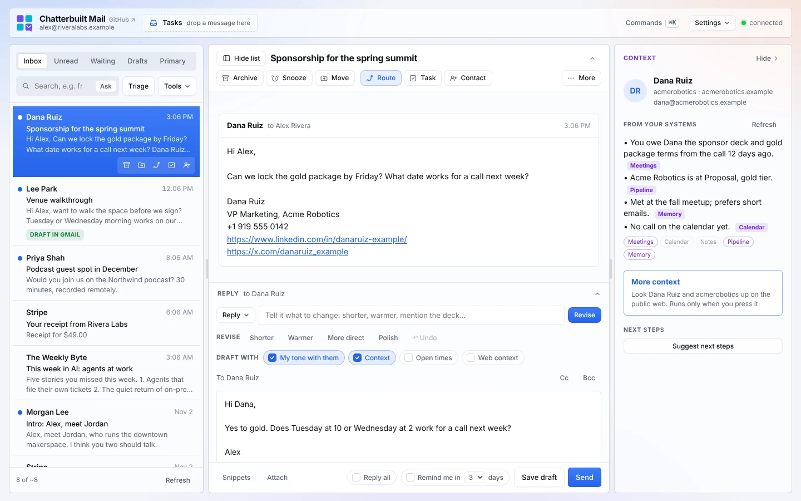

# Chatterbuilt Mail

A triage hub that connects your Gmail to the rest of your systems. It runs as your own private Claude artifact.

Most AI email tools sort and draft inside the inbox. Chatterbuilt Mail also checks each thread against your meeting notes, calendar, tasks, pipeline, contacts and memory before you reply. Then it routes the thread back out to them: a task, a Slack handoff, a contact, a CRM note, a snooze. A morning run checks the same systems while you sleep and leaves reply drafts in Gmail. Why this matters: [docs/why.md](docs/why.md).

**The context panel is the core of it.** Open a thread and you get a short brief from every system you've connected. Each line names its source, chips show which systems came back empty, and it won't merge a lookalike match or guess at what it doesn't know. Your drafts, the pre-send check and Route all use it. See [docs/context-panel.md](docs/context-panel.md).

It also does the email-client work: drafts in your voice, a check on every reply before it goes out, a tracker for who owes you an answer, and rules that learn from what you do.

Nothing is sent, moved or filed without a click from you. Every AI suggestion waits for approval, and a read-only mode blocks changes outright.



*A thread with context from your systems and the web beside it, suggested next steps, and the pre-send check catching a promised deck. Made-up data.* **[Watch the 30-second demo](docs/media/demo.mp4)** · [more screenshots](docs/demo.md)

## What it does

| Area | Features |
|---|---|
| Connect | **Context panel** beside every thread, from any read-only connector (Fireflies, Calendar, Notion, a pipeline, a CRM, Beehiiv, a memory system). **More context** looks the person and company up on the public web, with citations, when you ask. **Route** and **Next steps** suggest where the thread goes across your systems, with the text written, for you to approve. **Today** shows drafts waiting, what needs you and your next meeting. **Morning run** drafts replies into Gmail before you wake up |
| Read | Inbox with previews and unread dots, one-click summaries, triage into reply / read / skip, Ask your inbox (plain-English questions answered with numbered sources), a cleaned formatted view |
| Reply | Drafts in your voice from one-click intents or your own instruction, three options per thread (best fit, shorter, polite no), pre-drafts for everything that needs a reply, per-recipient tone matching, open times from your calendar, snippets, attachments, drafts waiting in Gmail, **pre-send check** that rereads your reply against the thread and your systems before it goes |
| Follow up | Waiting-on-reply tracker with a one-click Nudge, snooze, remind-me-if-no-reply (both plain Gmail labels) |
| Organize | Move to folder, copy to another account, unsubscribe, bulk unsubscribe sweep, plain-English rules, rules suggested from what you do by hand, review queue with undo |
| Capture | Drag a thread to Tasks (Notion, Asana, Basecamp, Linear, Todoist or anything with a connector), add a person to Contacts with their signature details, social handles, Clay enrichment and a note on how you first met |
| Learn | Voice panel (paste a prompt, point to a Notion page, or train from sent mail), lessons learned from your edits and rejections, a skill that makes those lessons permanent in your copy |
| Control | Skills picker to switch features on and off, keyboard shortcuts and a ⌘K command palette, read-only mode, works on phones |

Claude does the drafting by default. Other models (GPT, Gemini, GLM and more) plug in through the OpenRouter connector.

## Get started

**Fastest:** paste the install prompt from [docs/install.md](docs/install.md) into Claude. There's also a ChatGPT version that sets up the same triage approach as a chat workflow. The full app needs Claude; the page explains why.

Or pick the path that fits how you work. The full walkthrough is in [docs/getting-started.md](docs/getting-started.md).

1. **Fork it and back it with memory (recommended).** Fork or privately copy this repo, fill in [`memory/EMAIL-MEMORY.md`](memory/EMAIL-MEMORY.example.md) with how you handle email, then ask Claude to run the `chatterbuilt-mail-setup` skill. Your config, voice, rules and lessons live in your own repo and improve over time.
2. **No GitHub.** Save the template and skills to Google Drive, OneDrive or SharePoint, keep your email memory file next to them, and point Claude at that folder.
3. **Just the plugin.** Install `chatterbuilt-mail.plugin` and say "Set up Chatterbuilt Mail."

You need the Gmail connector in claude.ai (Settings, Connectors). Everything else is optional, and you can connect it two ways:
- **Native connectors**, one per app: Notion or another task app, a contacts app or CRM, Google Calendar, meeting notes, Slack, Clay, OpenRouter, a web search tool.
- **One Composio connector** that reaches all of them. Suggested if you don't want to manage native connectors. See [docs/composio.md](docs/composio.md).

## Documentation

The full index is [docs/README.md](docs/README.md). Every guide has screenshots.

**Set up:** [install with a prompt](docs/install.md) · [getting started](docs/getting-started.md) · [Composio](docs/composio.md) · [connectors](docs/connectors.md) · [configuration](docs/configuration.md) · [morning run](docs/morning-run.md)

**Use it:**
- [Today](docs/today.md): drafts waiting, what needs you, your next meeting
- [Reading and triage](docs/reading-and-triage.md): the list, Triage, Summarize, Ask, Formatted view
- [The context panel](docs/context-panel.md): the brief from your systems on every thread, and why it's the core of the app
- [More context](docs/more-context.md): a cited web lookup, only when you press it
- [Route and next steps](docs/route-and-next-steps.md): send a thread to your task app, Slack, contacts or a reminder
- [Replying](docs/replying.md): drafts, open times, 3 options, Pre-draft, the pre-send check
- [Voice](docs/voice.md): your voice, per-recipient tone, snippets
- [Following up](docs/following-up.md): Waiting, Nudge, Snooze, Remind me
- [Organizing](docs/organizing.md): move, copy, unsubscribe, sweep, rules, Review and Undo
- [Tasks and contacts](docs/tasks-and-contacts.md)
- [Settings and shortcuts](docs/settings-and-shortcuts.md)
- [Phone](docs/phone.md)

**Reference:** [features](docs/features.md) · [self-improving](docs/self-improving.md) · [safety and privacy](docs/safety-and-privacy.md) · [troubleshooting](docs/troubleshooting.md) · [screenshots and video](docs/demo.md) · [why Chatterbuilt Mail](docs/why.md)

## Skills in this plugin

| Skill | What it does |
|---|---|
| `chatterbuilt-mail-setup` | Builds and publishes your copy, or changes it later (new task app, contacts, calendar, models, voice) |
| `chatterbuilt-mail-improve` | Takes the "Copy for Claude" export from the app and folds lessons, voice, rules and snippets into your copy and your memory file |
| `chatterbuilt-mail-morning` | The morning run: wakes snoozes, drafts replies into Gmail with context, lists who owes you, and sends a short summary |
| `email-voice-profile` | Learns how you write from your sent mail |

## Repository layout

```
.claude-plugin/plugin.json         plugin manifest
skills/chatterbuilt-mail-setup/    setup skill + the page template (assets/)
skills/chatterbuilt-mail-improve/  improve skill
skills/chatterbuilt-mail-morning/  morning run skill (for a scheduled task)
skills/email-voice-profile/        voice profile skill
memory/EMAIL-MEMORY.example.md     template for your email memory file
examples/config.example.js         a filled-in CONFIG to copy from
scripts/build.py                   builds your page from the template + your CONFIG
scripts/demo/                      records the screenshots and demo video with made-up data
docs/                              documentation (images/ and media/ hold the screenshots and video)
CLAUDE.md                          tells Claude how to work in your fork
```

## Support

Bugs and requests: [GitHub issues](https://github.com/mrhinkle/chatterbuilt-mail/issues). The app's Skills panel links here too.

## License

Apache License 2.0. See [LICENSE](LICENSE) and [NOTICE](NOTICE).
Copyright 2026 Mark R. Hinkle. "Chatterbuilt" and "Chatterbuilt Mail" are trademarks of Mark R. Hinkle; the license does not grant rights to the names. See [TRADEMARKS.md](TRADEMARKS.md).
