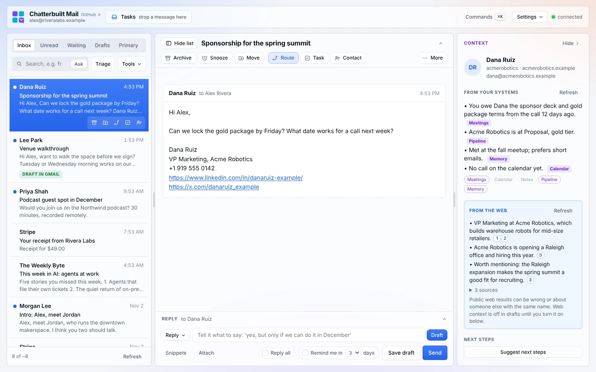
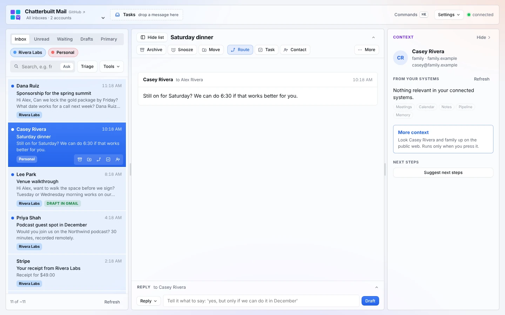

# Connect everything through Composio

Chatterbuilt Mail reaches your apps through claude.ai connectors. You can add a native connector for each app (Notion, Slack, Asana, Fireflies…), or add **one** connector, [Composio](https://composio.dev), and reach hundreds of apps through it.

**Suggested if you don't want to manage a stack of native connectors.** You connect each app once inside Composio, and Chatterbuilt Mail sees all of them through a single claude.ai connector.

Almost every screenshot in these docs comes from a demo copy set up this way: Gmail native, and context, tasks, contacts, Route actions and More context all through Composio. The account-switcher screenshot and the demo video run Gmail through Composio too.



## What goes where

| Part | Connector | Why |
|---|---|---|
| Your mailbox | **Gmail**, the native claude.ai connector, or **Gmail through Composio** | Composio can hold several Gmail accounts. The page shows them in one list (All inboxes) or one at a time. See below. |
| Drafting, triage, checks | **Claude** (built in) | No connector needed. |
| Everything else | **Composio**, or native connectors, or a mix | Context sources, tasks, contacts, Route actions, More context. |

## Gmail through Composio: several accounts in one copy

Connect each Gmail account in Composio (work, a second business, personal), then list them in CONFIG:

```js
gmail: {
  via: "composio",
  accounts: [
    { id: "gmail_xxxx", email: "you@work.example", label: "Work", color: "blue" },
    { id: "gmail_yyyy", email: "you@side.example", label: "Side project", color: "red" },
    { id: "gmail_zzzz", email: "you@personal.example", label: "Personal" }
  ]
}
```



`id` is Composio's connected-account id. The setup skill finds them for you, or look in Composio under Connected accounts.

- **All inboxes.** With two or more accounts, the page opens on one list that merges them, newest first. Each row carries its account's name, and its color if you gave it one (`blue`, `red`, `green`, `amber`, `purple`, `teal`, `pink`, `gray`, or a `#hex`). Chips over the list turn an account off and on, so you can look at two of three. Everything you do on a thread (reply, draft, move, archive, snooze) goes through the account it belongs to, with that account's signature. Folders show by name across accounts; moving a thread into a folder its account doesn't have yet creates it there. A message that landed in two of your mailboxes shows once, under the account it was sent to.
- **One account at a time.** The menu under the app name lists All inboxes and each account. Pick one and the list, labels, drafts and Today reload for it. The command palette has **Show All inboxes** and **Switch to …** too. The app remembers your choice; add `start: "first"` to `gmail` to open on the first account instead of All inboxes.
- **Colors.** **Settings → Accounts** picks a color for each account and which accounts All inboxes shows. That's saved in your browser; **Copy for Claude** (under Settings → Voice) carries it into your copy when you run chatterbuilt-mail-improve.
- **Same features.** Reading, Triage, Ask, replies, drafts, Move, Archive, Snooze, Remind me, unsubscribe, Waiting, Pre-draft, opening attachments and your Gmail signature all work through Composio. Each account uses its own labels, drafts and signature.
- **What's missing.** Attaching files to a reply doesn't go through Composio yet, so **Attach** is hidden. Attach from Gmail for now.
- **Speed.** Each call takes one extra hop through Composio. The list uses one metadata-only search per page per account, 25 messages at a time, so it stays quick; All inboxes asks every account at once. Waiting checks each sent thread in full, so it takes a little longer than with the native connector.
- **Large replies.** Composio sends back only a preview when a reply runs past about 8K tokens, and saves the full reply to a file in its sandbox. Long threads, big drafts and attachments do that. The page then reads the file with `COMPOSIO_REMOTE_BASH_TOOL`: one fixed `jq` command keeps the fields it needs (long bodies trimmed) and writes them next to Composio's file, and it reads that back in 30,000-character pieces. It never runs anything else there.
- **Permissions.** The page holds `COMPOSIO_MULTI_EXECUTE_TOOL`, which can run any action on any app you've connected in Composio, including sending from every Gmail account there, and `COMPOSIO_REMOTE_BASH_TOOL`, which runs commands in your Composio sandbox. The page only calls the Gmail tools listed in [CONTRIBUTING.md](../CONTRIBUTING.md#add-another-email-platform) and the read commands above, read-only mode blocks every change, and writes are never retried.

## Native connectors or Composio?

| | Native connectors | Composio |
|---|---|---|
| Setup | One claude.ai connector per app | One claude.ai connector, then connect apps inside Composio |
| Apps | Those with a claude.ai connector | Hundreds, including web search (Firecrawl, Exa, Tavily, Perplexity) |
| Permissions the page holds | Exactly the tools it uses, app by app | One tool, `COMPOSIO_MULTI_EXECUTE_TOOL`, which can run any action on any app you've connected in Composio |
| Errors | Each connector's own | Composio reports failures inside a successful response; the page unwraps them and shows the real message ("No active connection for toolkit=asana") |
| Cost | Your apps' own plans | Composio's plan, plus any per-call cost of the apps it calls (web search credits, for example) |

The one real tradeoff is the permission. With native connectors, the page can only call the tools you declared. With Composio, the page only *calls* the actions in your CONFIG, but the permission it holds is wider. The artifact is private to you, and read-only mode still blocks every change the page makes, but if that breadth bothers you, use native connectors for anything that writes and Composio for lookups.

## How it looks in CONFIG

Every connector setting in Chatterbuilt Mail is the same shape: `{ server, tool, input }`. Through Composio, `server` is `"Composio"`, `tool` is `"COMPOSIO_MULTI_EXECUTE_TOOL"`, and `input` names the Composio action and its arguments. Placeholders work the same way.

These action names and arguments were read from Composio in November 2026. The setup skill looks them up again for your account, since they change.

**A context source** (read-only):

```js
context: [
  { label: "Notion", server: "Composio", tool: "COMPOSIO_MULTI_EXECUTE_TOOL",
    input: { tools: [{ tool_slug: "NOTION_SEARCH_NOTION_PAGE", arguments: { query: "{{orgOrEmail}}", page_size: 5 } }], sync_response_to_workbench: false } }
]
```

**Tasks in Asana:**

```js
tasks: { label: "Asana", server: "Composio", tool: "COMPOSIO_MULTI_EXECUTE_TOOL",
  input: { tools: [{ tool_slug: "ASANA_CREATE_A_TASK", arguments: { data: { name: "{{title}}", notes: "{{text}}", projects: ["<project id>"] } } }], sync_response_to_workbench: false } }
```

**A Route action** (a Slack handoff):

```js
actions: [
  { key: "handoff", label: "Hand off to Sam in Slack", server: "Composio", tool: "COMPOSIO_MULTI_EXECUTE_TOOL",
    input: { tools: [{ tool_slug: "SLACK_SEND_MESSAGE", arguments: { channel: "<user or channel id>", markdown_text: "{{handoff}}\n\n{{url}}" } }], sync_response_to_workbench: false },
    ai: { handoff: "A short Slack message asking Sam to handle this email" },
    when: "Scheduling, invoices or logistics" }
]
```

Note: Composio's `SLACK_SEND_MESSAGE` **sends** the message; it doesn't leave a draft the way the native Slack connector's draft tool does. You still approve it in Route first.

**More context** (web lookups):

```js
lookup: [
  { label: "Web: person", server: "Composio", tool: "COMPOSIO_MULTI_EXECUTE_TOOL",
    input: { tools: [{ tool_slug: "FIRECRAWL_SEARCH", arguments: { q: "{{personQuery}}", limit: 5 } }], sync_response_to_workbench: false } },
  { label: "Web: company", server: "Composio", tool: "COMPOSIO_MULTI_EXECUTE_TOOL", needs: ["companyQuery"],
    input: { tools: [{ tool_slug: "FIRECRAWL_SEARCH", arguments: { q: "{{companyQuery}}", limit: 5 } }], sync_response_to_workbench: false } }
]
```

A Firecrawl search returning 3 results used 2 Firecrawl credits when tested.

## Set it up

1. In claude.ai, add the **Gmail** connector and the **Composio** connector (Settings, Connectors).
2. In Composio, connect the apps you want: your task app, notes, CRM, Slack, a web search tool.
3. Ask Claude to set up Chatterbuilt Mail and say you'd like to use Composio (the [starter prompt](install.md#claude) has a line for it). The setup skill:
   - finds each action with Composio's tool search and reads its exact arguments;
   - checks that each app has an active connection in Composio, and tells you which to connect if not;
   - writes CONFIG and declares `COMPOSIO_MULTI_EXECUTE_TOOL` in the page's permissions;
   - makes one read-only call per context source to check the results, and never runs a write as a test.

The first time the page calls Composio, claude.ai asks you to allow it.

## What the page does with Composio's replies

Composio wraps each action's result: `{ successful, data: { results: [{ response: { successful, data, error } }] } }`. The page:
- hands the inner `data` to the rest of the app, so an empty search shows as a grey "nothing found" chip and isn't sent to the model;
- for Gmail, reads a reply Composio saved to its sandbox instead of sending back (see Large replies above), so a long thread never looks empty;
- turns a failed inner call into an error you see ("Composio reported an error: No active connection for toolkit=asana"), so a task is never reported as filed when it wasn't.

## Troubleshooting

| What you see | What to do |
|---|---|
| "No active connection for toolkit=…" | Connect that app inside Composio, then try again. |
| "This page isn't allowed to use COMPOSIO_MULTI_EXECUTE_TOOL" | Allow it in the artifact's Permissions menu, or ask Claude to republish with it declared. |
| Gmail through Composio shows an empty inbox, or a thread with no text | Update to 0.6.1 or later. Earlier versions asked for 50 messages a page, which Composio cut to a preview the page read as empty. Then make sure the page declares `COMPOSIO_REMOTE_BASH_TOOL` (ask Claude to republish with chatterbuilt-mail-setup). |
| "couldn't read the large reply Composio saved" | The page couldn't reach Composio's sandbox. Try again; if it keeps happening, open that thread in Gmail. |
| A Composio source is always grey | It's returning nothing. Check the action and its arguments with Claude; Notion search, for example, matches titles, not page text. |
