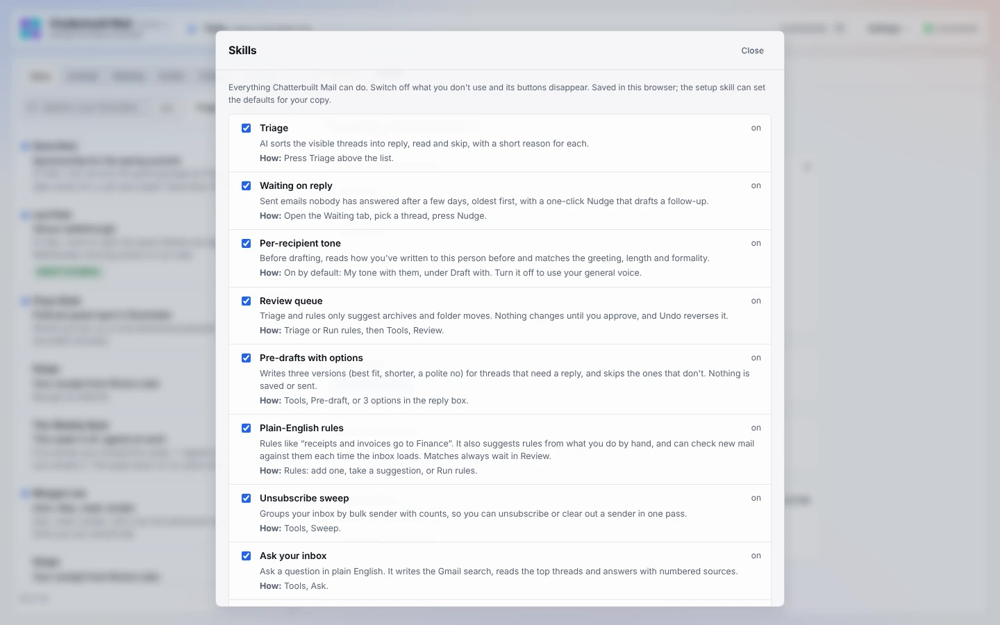

# Configuration

Everything personal lives in one `CONFIG` object at the top of the page script. In a fork it's kept in `my/config.js`. `scripts/build.py` swaps it into the template:

```bash
python3 scripts/build.py skills/chatterbuilt-mail-setup/assets/chatterbuilt-mail.template.html my/config.js my/chatterbuilt-mail.html
```

You don't need to edit this by hand. Ask Claude, and the setup skill does it. This page is the reference. A first install starts from [`examples/config.example.js`](../examples/config.example.js): Gmail and Claude, nothing else. Every option filled in is in [`examples/config.full.example.js`](../examples/config.full.example.js).

## You

| Key | What it is | Example |
|---|---|---|
| `ownerName` | Your name, as drafts should use it | `"Alex"` |
| `ownEmail` | Your Gmail address; used to tell your messages from theirs | `"alex@example.com"` |
| `gmail` | `null` for claude.ai's Gmail connector. Or Gmail through Composio, with one or more accounts and a switcher: `{ via: "composio", accounts: [{ id, email, label, color }] }`. With two or more, the page opens on All inboxes, which merges them; `color` (`blue`, `red`, `green`, `amber`, `purple`, `teal`, `pink`, `gray` or a `#hex`) tints that account's rows there, and `start: "first"` opens on the first account instead. With accounts, each account's `email` replaces `ownEmail`. See [composio.md](composio.md#gmail-through-composio-several-accounts-in-one-copy) | |
| `about` | One or two sentences on who you are; context for every prompt | `"Alex runs partnerships at Example Co."` |
| `voice` | How you write | `"Warm, brief, a little dry."` |
| `rules` | Hard writing rules, checked again before you send | `"Never use 'synergy'. US spelling."` |
| `signoff` | How drafts end | `"Alex"` |
| `voiceSource` | Optional Notion page link holding a voice prompt; drafts follow it | `"https://www.notion.so/..."` |
| `lessons` | Lessons from your corrections, written by the improve skill. Two sections, `DRAFTING:` and `TRIAGE:`, one `- ` line each | |

## Models

The model comes from where the page runs. In Claude, the page asks Claude without naming a model or a tier, and Claude's interface decides, so it never reaches for a bigger model than the task needs. Leave these as they are unless you want another model on purpose.

| Key | What it is |
|---|---|
| `defaultModel` | `"claude"` (built in, no setup), or a value from `models` |
| `models` | Extra models through the OpenRouter connector: `[{ value: "provider/model-slug", label: "Name" }]`. The setup skill looks up real slugs with OpenRouter's `list-models`; don't guess them. The **Model** picker in Settings appears only when this list isn't empty. |

## Tasks and contacts

<a id="contacts-and-enrichment"></a>

| Key | What it is |
|---|---|
| `tasks` | Any task app: `{ label, server, tool, input }`. See [connectors.md](connectors.md). |
| `notion` | Older Notion shortcut for tasks: `{ dataSourceId, titleProp, urlProp, notesProp, emailProp, extra }`. Used only when `tasks` is null. |
| `contacts` | Any contacts app: `{ label, server, tool, input, dupCheck }`. Or the Notion shortcut: `{ dataSourceId, nameProp, emailProp, companyProp, titleProp, phoneProp, linkedinProp, xProp, blueskyProp, githubProp, instagramProp, websiteProp, locationProp, metProp, firstContactProp, notesProp, backgroundProp, extra }`. |
| `contacts` (Google) | `{ book: "google" }` saves to Google Contacts through Composio, with How we met and Background as custom fields and First contact as a dated event. With several Gmail accounts, give each account its own address book: `accounts: [{ id, email, label, contacts: "<Composio googlecontacts connected-account id>" }]`. When Gmail runs through Composio and `contacts` isn't set, this is the default. Composio has no ready-made sign-in for Google Contacts, so it needs your own Google OAuth client in Composio's dashboard first; until then the dialog offers setup and vCard instead of Save. |
| `clay` | `true` shows **Enrich with Clay** on contacts. Needs the Clay connector; uses Clay credits. |
| `enrich` | Another enrichment app: `{ label, server, tool, input }` with `{{email}}`, `{{name}}`, `{{domain}}`, `{{company}}`, `{{linkedin}}`. Shows **Enrich with** *label*. Its answer can be any shape; the AI maps it to contact fields. With neither `clay` nor `enrich`, the button is **Set up enrichment ↗**, which opens a new Claude chat with the setup request. |

## Your other systems

| Key | Default | What it is |
|---|---|---|
| `context` | `[]` | Read-only lookups run when you open a thread: `[{ label, server, tool, input }]`. Feeds the context card, drafts, the pre-send check, Route and the morning run. See [connectors.md](connectors.md#context-sources). |
| `slack` | `false` | `true` adds **Message someone in Slack** to Route: you name a person or `#channel`, and it leaves a draft in Slack for you to send. Needs the Slack connector. |
| `actions` | `[]` | Custom Route actions: `[{ key, label, server, tool, input, ai, when }]`. `ai` names the fields the AI writes; `when` tells it when the action fits. See [connectors.md](connectors.md#route-actions). |
| `lookup` | `[]` | **More context** web lookups: `[{ label, server, tool, input, needs }]`. Placeholders `{{personQuery}}`, `{{companyQuery}}`, `{{name}}`, `{{org}}`, `{{domain}}`, `{{email}}`. `needs: ["companyQuery"]` skips an entry when the person has no company domain. See [connectors.md](connectors.md#more-context-web-lookups). |
| `snippets` | `[]` | Starting snippets: `[{ name, text }]`. `{{firstName}}` and `{{myName}}` are filled in. |
| `labelPrefix` | `"CB"` | Gmail label prefix for snooze (`CB/Snooze/YYYY-MM-DD`), remind-me (`CB/Remind/YYYY-MM-DD`) and morning-run drafts (`CB/Drafted`) |

## Calendar and follow-ups

| Key | Default | What it is |
|---|---|---|
| `calendar` | `false` | `true` turns on open times from Google Calendar |
| `workHours` | `[9, 17]` | Local hours that open times fall inside |
| `waitingDays` | `3` | Days without an answer before a sent email shows under Waiting |

## Rules and features

`features` sets the defaults for the switches in **Settings → Skills**, where each person can still turn features on and off:




| Key | What it is |
|---|---|
| `mailRules` | Rules built into your copy. A plain-English rule: `{ text: "Receipts and invoices", op: "move", labelName: "Finance" }`. A sender rule: `{ text: "Email from Stripe", from: "stripe.com", op: "archive" }`. `op` is `move`, `archive`, `star` or `read`. Rules you add in the app are saved in your browser and override these until the improve skill writes them back here. |
| `features` | Default on/off per feature, for example `{ sweep: false, calendar: true }`. Keys: `triage`, `waiting`, `tone`, `review`, `predraft`, `rules`, `sweep`, `ask`, `calendar`, `contacts`, `voice`, `learn`, `tasks`, `move`, `unsub`, `precheck`, `context`, `more`, `today`, `route`, `snooze`, `drafts`, `snippets`, `attach`, `html`, `keys`. |
| `readOnly` | `true` starts in read-only mode. You can still switch it off in the app. |

## Other

| Key | What it is |
|---|---|
| `copyTargets` | One-click "copy to account" addresses: `[{ label: "work", address: "me@work.example" }]` |
| `searchExample` | Placeholder text in the search box |
| `repoUrl`, `supportUrl` | Where the header logo and Skills help link. Point them at your fork if you like. |

## Kept in your browser, not in CONFIG

The app keeps these in your browser:
- your voice edits;
- the linked voice page text;
- rules you add;
- snippets you add or delete;
- feature switches;
- read-only state;
- what it has learned (edits, rejections, actions, lessons).

That data stays on that browser and device. **Copy for Claude** (Settings → Voice) exports it, and the improve skill writes it into `CONFIG` so it's permanent.
