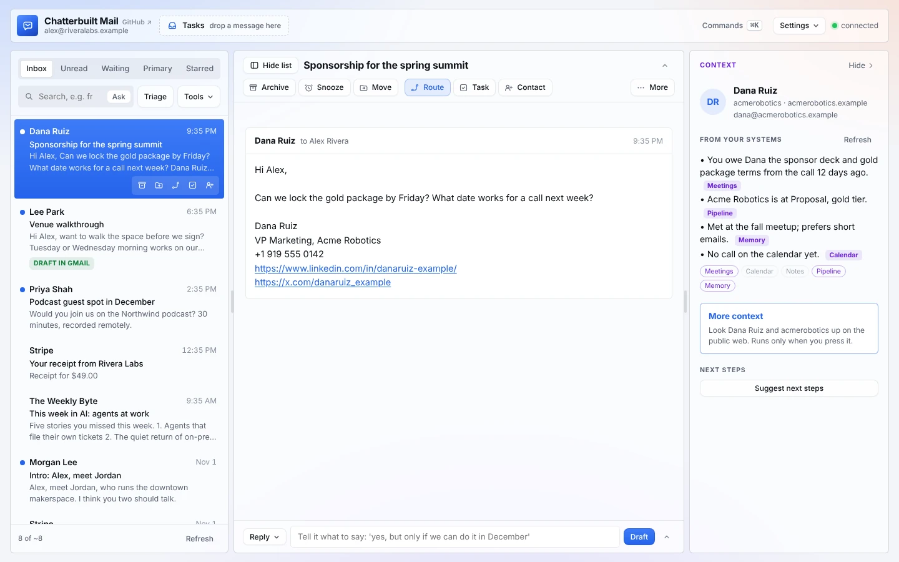
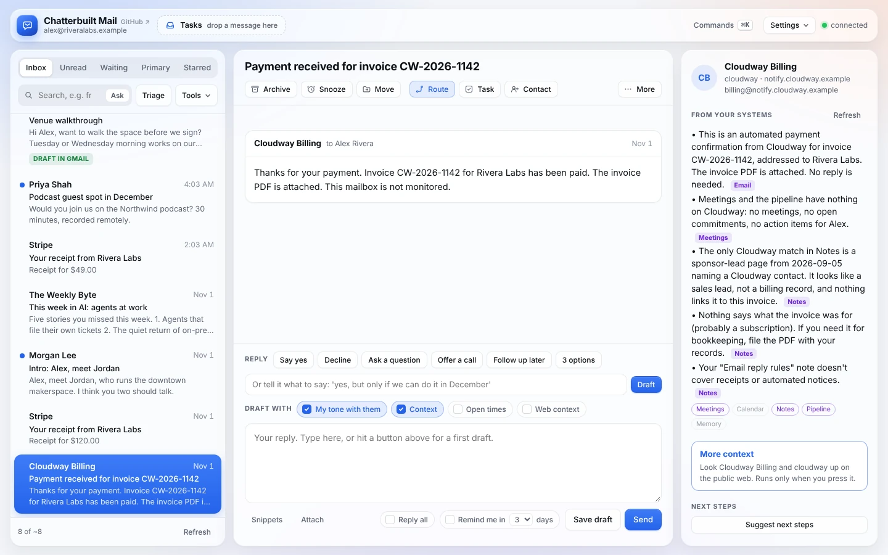
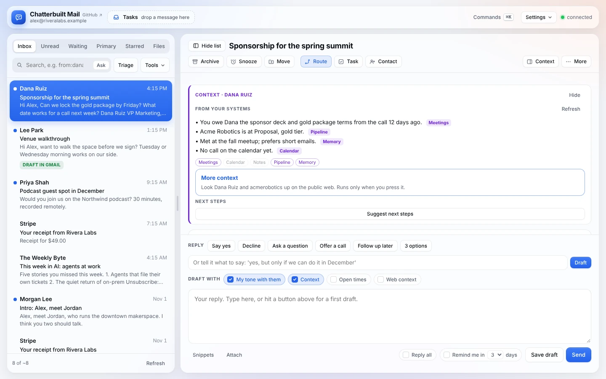

# The context panel

When you open a thread, Chatterbuilt Mail checks every system you've connected for that person and that topic, all at once, and writes a short brief before you reply. Each line names the system it came from. Chips underneath show which systems found something, came back empty, or failed.

This is the feature the rest of the app is built around. The brief also feeds the draft, the pre-send check, Route and the morning run, so the whole app knows what you know.

## Why it matters

Your inbox only knows what's in your inbox. The thing you need before replying is usually somewhere else: the action item from last week's call, the deal stage, whether they're already on your newsletter list, the note you made after you met them. The panel brings that to the thread so you don't go looking.

What makes it worth trusting:

- **It runs on its own.** You don't ask; it's there when the thread opens. Every source runs in parallel, so one slow system doesn't hold up the rest.
- **Every line shows its source.** Each line ends in a tag like `[Meetings]` or `[Pipeline]`. If something looks wrong, you know where to look.
- **It shows what came back empty.** Purple chips are systems that returned something, grey chips found nothing, and red chips failed (hover for the reason). "Not in the pipeline" is useful to know, and you can tell it apart from "the pipeline didn't answer."
- **It doesn't mix people up.** A search for "Acme" can turn up a different Acme, or a different person with the same name. The brief is told never to merge a match like that into this person: it either leaves it out or says plainly that nothing links it to this thread.
- **It says what's missing.** If the reply needs a fact no source has, the brief says so rather than guessing.
- **Your sources, your queries.** Any read-only connector tool can be a source, including your own: a sponsor pipeline in Notion, a newsletter subscriber list, a memory system. For each one you choose what to search with (their email, name or company) and how tightly. See [connectors.md](connectors.md#context-sources).

## Two examples

The names and details below are made up.

### A receipt that needs nothing from you

An automated payment confirmation from a software vendor. Five systems checked:

The chips at the bottom: Meetings, Notes and Pipeline returned something (purple), and Calendar and Memory came back empty (grey). What came back from Meetings and Pipeline wasn't about this vendor, and the brief says so rather than using it.

What to notice:
- The first line answers the real question: does this need a reply? No.
- The empty checks are stated, so you know it looked and found nothing. You don't have to wonder whether it skipped them.
- The vendor's name turned up in a sponsor lead. The brief flags it as a separate thing instead of telling you this vendor is a sponsor.
- It's clear about what it doesn't know (what the invoice was for) and points to the next step (file the PDF).
- The last line notices a gap in your rules. That's a cue to add a rule that archives receipts to a Finance folder.

### A sponsor waiting on you

Dana at Acme Robotics asks to lock the gold package and set up a call. The brief:

> - You owe Dana the sponsor deck and gold package terms from the call 12 days ago. `Meetings`
> - Acme Robotics is at Proposal, gold tier. `Pipeline`
> - Met at the fall meetup; prefers short emails. `Memory`
> - No call on the calendar yet. `Calendar`

Now draft a quick "yes." The **pre-send check** reads the reply against the thread and this brief before it sends. It catches that you promised the deck on the last call and the reply doesn't mention it, then offers a version that does.

That's the loop: your meeting notes caught a promise, the brief put it in front of you, and the check made sure the reply kept it.

## Where the brief goes

| Feature | How it uses the brief |
|---|---|
| **Drafts** | With **Context** ticked under *Draft with* (on by default), drafts are written with the brief in view, so a reply can deal with the open commitment and match where things stand. |
| **Pre-send check** | Flags a reply that contradicts what your systems say or forgets a commitment in the brief, on top of its usual checks (unanswered questions, wrong dates, reply-all risk). |
| **Route and Next steps** | Suggests where the thread goes (a task, a Slack handoff, a CRM note) using what the brief found. |
| **Morning run** | Runs the same lookups before it leaves reply drafts in Gmail. |
| **More context** | Kept separate on purpose. Public web results go in their own **From the web** box, only when you press it, and drafts leave them out unless you tick **Web context**. |

## How it works

1. You open a thread. The page works out who the other person is (the sender, or whoever you wrote to if you had the last word), plus their name, email domain and company.
2. Every source in `CONFIG.context` runs at once with those details filled in. Each one gets 15 seconds. Results are cached for five minutes, and **Refresh** runs them again.
3. Empty results become grey chips and are dropped. Failures become red chips. Anything else is trimmed and sent to Claude, or to the model you picked.
4. The model writes two to seven lines covering:
   - who they are to you;
   - open commitments either way, especially action items assigned to you;
   - recent and upcoming meetings, with dates;
   - status in any pipeline, list or task;
   - anything that should change the reply.

   It never merges a lookalike match, and it says what's missing. If nothing is relevant, it says exactly that.
5. On screens 1180 px and wider, the brief sits in a panel beside the thread. On narrower screens and phones, it sits at the top of the thread.
   - The button in the panel's top corner hides it, and the brief moves to the top of the thread. **Panel** in the thread toolbar brings it back. The page remembers your choice.

     

   - Where the brief sits at the top of the thread, **Hide** folds it to one line and **Show** opens it again. `]` does the same, or shows and hides the side panel on wide screens. Both choices are remembered.
   - While a thread loads, the panel says so. If there's no one on the thread but you, it says that instead of staying blank.

Every source is a read-only lookup. Nothing is written anywhere when you open a thread.

## Getting good briefs

- **Use exact filters.** A meeting-notes search by participant email is better than a free-text search for their name. A pipeline search inside one database is better than a search of your whole workspace.
- **Six to eight sources is plenty.** Each one is a call every time you open a thread.
- **Put a memory system in.** One that answers "who is this person to me" (Cortex, a Notion people database, your CRM) gives the brief its first line.
- **Add your lists.** A newsletter subscriber lookup tells you whether someone already reads your work before you pitch them.
- **If a source keeps returning the wrong person,** tighten its query. [Troubleshooting](troubleshooting.md) has the common fixes.
- **Through Composio,** every source can run through one connector. See [composio.md](composio.md).

## How this compares

Other AI email tools now connect to apps outside the inbox:
- **Superhuman Go** connects through pre-built or custom MCP connectors, names Salesforce, Jira and Asana, and offers a context-aware side chat in the browser [1].
- **Shortwave's assistant** can use HubSpot, Notion, Slack, Asana, Linear and custom MCP servers [2].
- **Fyxer** connects to Slack, Microsoft Teams, HubSpot and more, and learns your tone from sent mail [3].

What their public pages don't describe, as of November 2026:
- **A brief that appears on its own for every thread you open.** Shortwave's guide describes its assistant answering what you ask. The automatic "CRM data on incoming threads" it mentions belongs to Tasklet, a separate product [2].
- **A source on every line, and chips for which systems found nothing or failed.** Superhuman says Go is "grounded in your knowledge" but doesn't say it labels where each fact came from [1].
- **You pick each source and the exact query,** including sources no vendor integrates with, running on your own Claude plan, open source.

Product pages change often, so check them before repeating this comparison.

## Sources

1. [Superhuman Go](https://superhuman.com/go), product page
2. [Shortwave: The AI Assistant](https://shortwave.com/docs/guides/ai-assistant), product guide
3. [Fyxer: Meet Fyxer, your AI email and meeting assistant](https://support.fyxer.com/article/meet-fyxer-your-ai-email-and-meeting-assistant), support article
