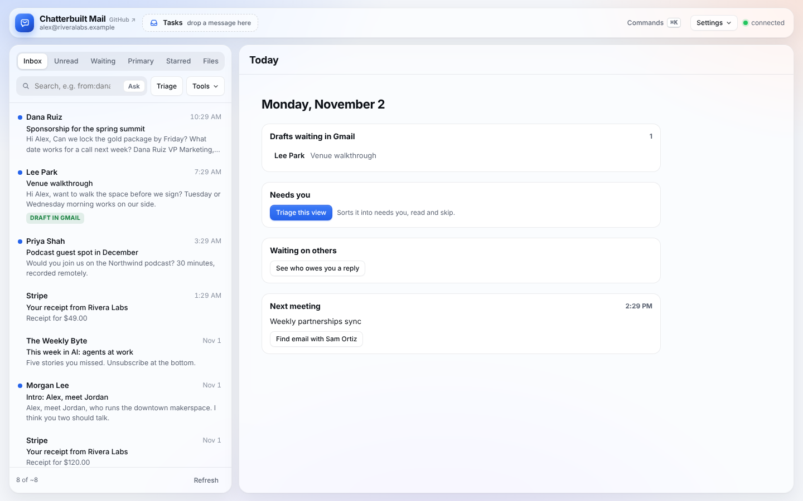
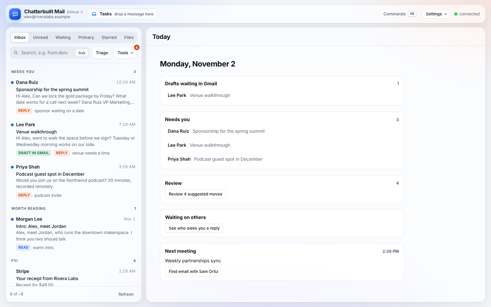
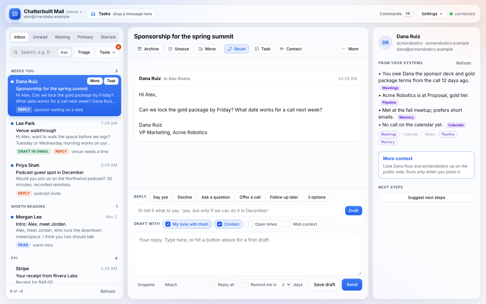
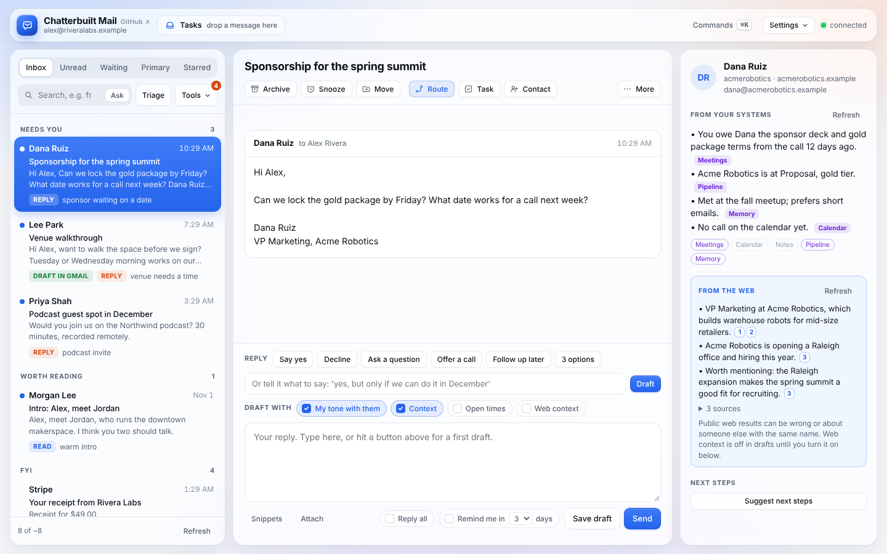
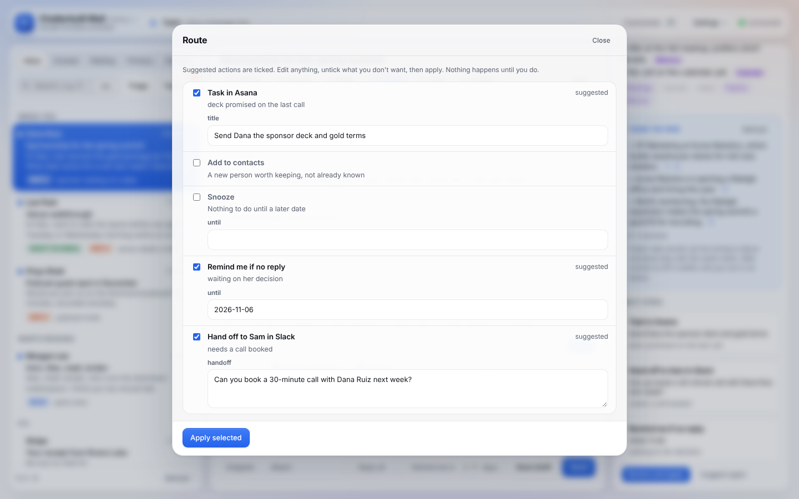
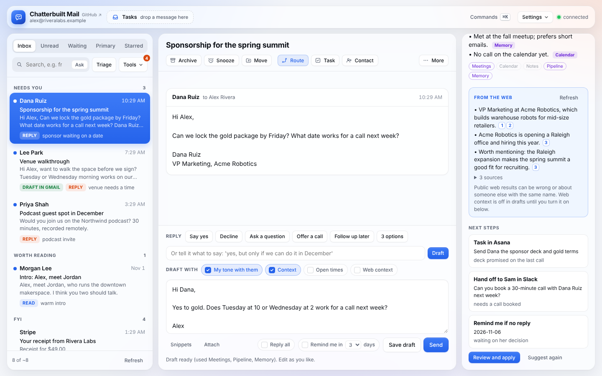
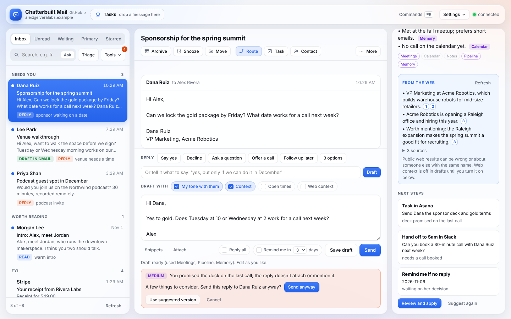
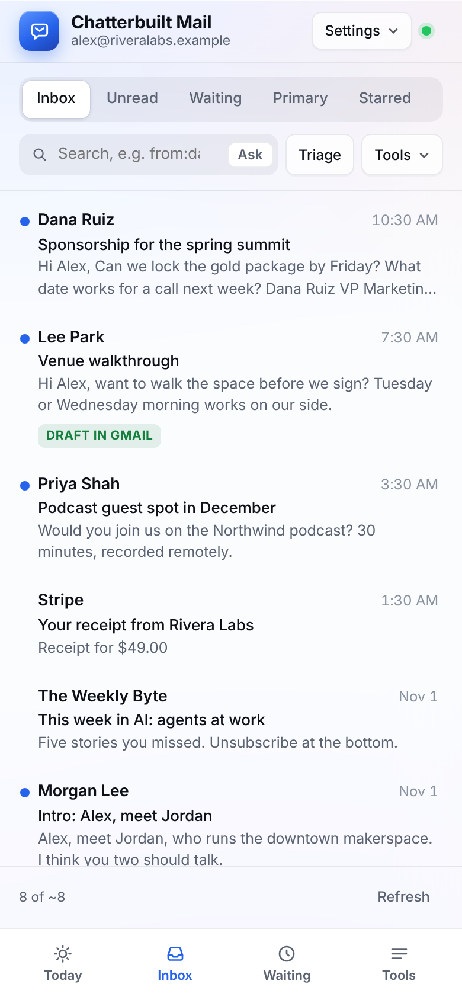
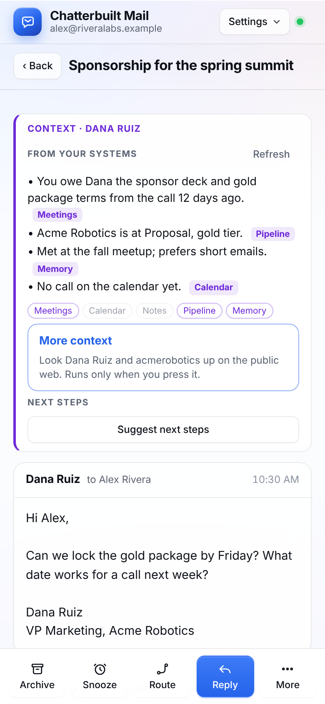
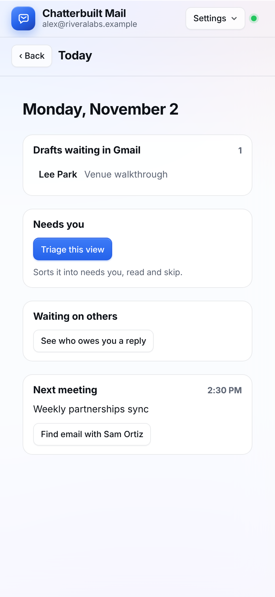

# Screenshots and demo video

Every image and the video on this page use made-up people and companies (Alex Rivera at Rivera Labs, Dana Ruiz at Acme Robotics). No real inbox, connector or account was touched to make them.

**Video:** [demo.mp4](media/demo.mp4), about 30 seconds: Today, Triage, the context panel, More context, Next steps and Route, a draft, and the pre-send check catching a forgotten promise.

## Desktop

**Today.** What you see before you open a thread: drafts waiting in Gmail, what needs you, who owes you a reply, and your next meeting.



**Triage.** The list grouped into Needs you, Worth reading and FYI, with a reason on each thread. Archive and move suggestions wait in Review (the badge on Tools).



**Context panel.** Open a thread and the panel beside it shows what your systems know about the person, each line tagged with its source. Chips show which systems found something.



**More context.** A cited public-web lookup, run only when you press it, kept in its own box.



**Route.** Next steps opens Route with the suggestions filled in: a task, a Slack handoff, a remind-me. Nothing runs until you apply.



**Draft.** A reply in your voice that uses what the panel found.



**Pre-send check.** Rereads the reply against the thread and your systems before it goes. Here it catches the deck promised on the last call.



## Phone

<p>



</p>

Inbox with the tab bar, a thread with context at the top and the thumb-zone action bar, and Today.

## Make your own

The recorder builds the page from the template with a fictional config, fakes every connector inside the browser, and clicks through the app.

```bash
node scripts/demo/record.js demo-out
```

It needs Node with Playwright and Chromium, Python 3, and ffmpeg for the video. It writes the screenshots, the frames and `demo.mp4` to `demo-out/` (ignored by git). Edit `scripts/demo/demo.config.js` to change the made-up owner and connectors, or the fake data at the top of `record.js` to change the threads.

To record your real inbox for a talk or a private walkthrough, use a screen recorder on your own computer with the artifact open in claude.ai. Don't commit those: they show real mail.
