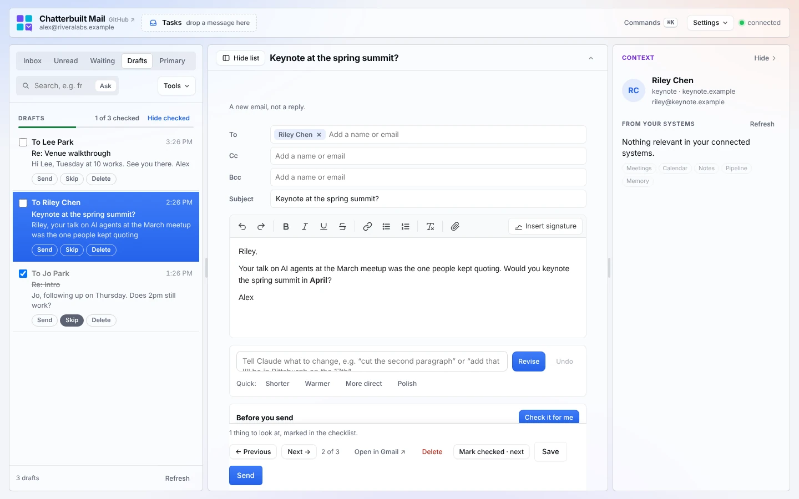
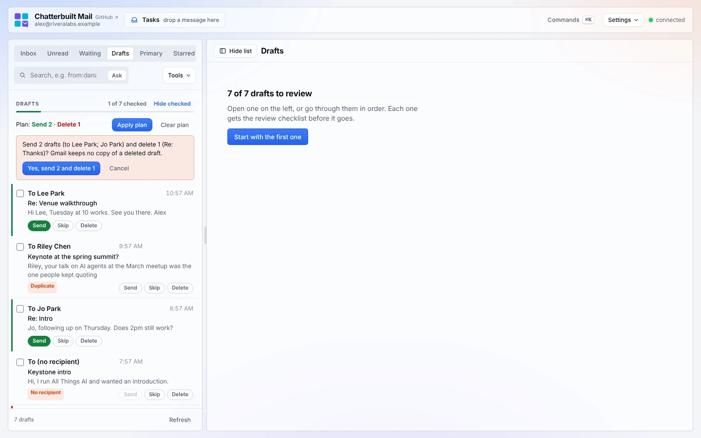
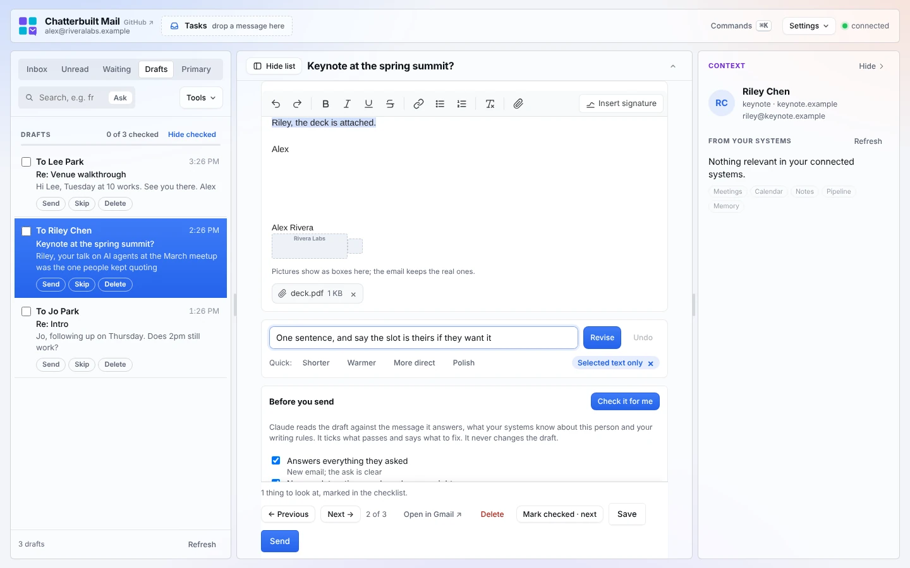
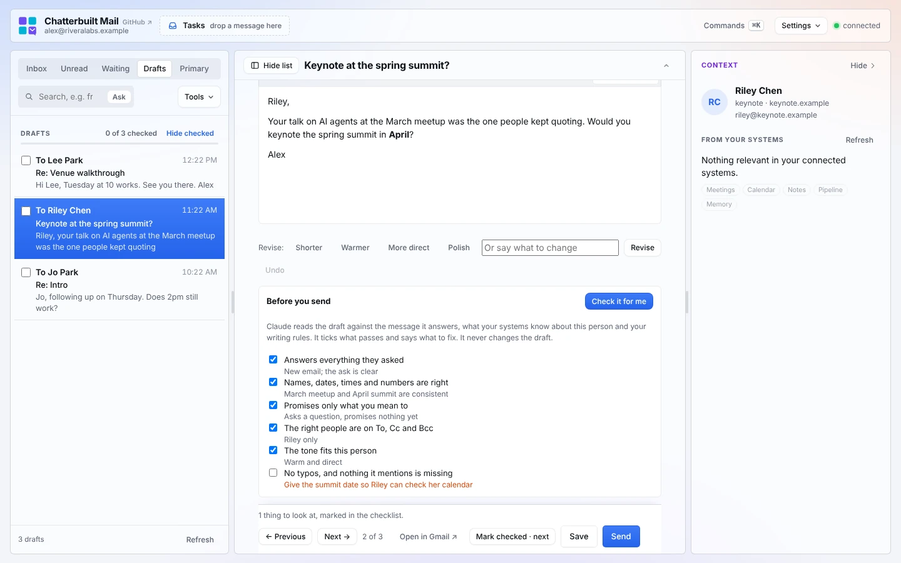
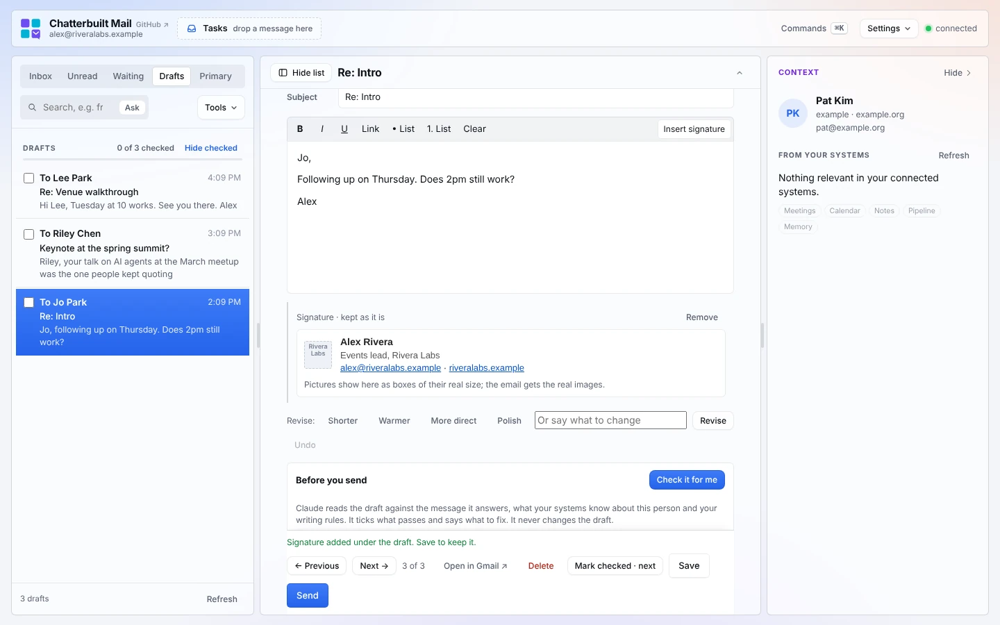

# Drafts

The **Drafts** tab is for going through your Gmail drafts one at a time: the ones the morning run left, the ones you worked out in chat, the ones you started and forgot. The list is a checklist, the editor is rich text, and every draft gets the same short review before it goes.

*Made-up data.*

## How to use it

1. Press **Drafts** in the tabs over the list. Every Gmail draft shows with who it's to, the subject and its first line, newest first. In All inboxes, each row carries its account. With none open, the desk says how many are left to review, and **Start with the first one** opens it.
2. Open one. The message it answers sits on top (fold it away if you don't need it), then To, Cc, Bcc and Subject, then the draft in a what-you-see-is-what-you-get editor: one white sheet laid out like the email, with your text (in its own fonts and colors), your signature under it and the earlier messages folded at the bottom. The toolbar has undo and redo, bold, italic, underline, strikethrough, link, bulleted and numbered lists, and clear formatting; the buttons light up for what's on where the cursor is. An empty draft says *Write your message…* where you type. The **context panel** on the right shows what your systems know about the person it's to, the same brief you get beside a thread.
   - **To, Cc and Bcc** are address fields: start typing a name and pick from the people in your threads and, once one is connected, your address book (Google Contacts, for example). Enter, Tab or a comma adds someone; × removes them.
3. Edit it. The toolbar has **bold**, *italic*, underline, links and bulleted or numbered lists; Ctrl or ⌘ B, I and U work too. Pasted text comes in plain, so you don't drag in someone else's fonts. The **paperclip** attaches files; the draft's files sit under the sheet, each with an × (see [Attachments](#attachments)).
4. **Tell Claude what to change.** The prompt box under the editor takes your instruction in your own words: *cut the second paragraph*, *add that I'll be in Pittsburgh on the 17th*, *less formal*. Enter sends it (Shift+Enter for a new line); the **Quick** chips (Shorter, Warmer, More direct, Polish) are one-word versions. The draft is rewritten in place and keeps its links, bold and lists; every fact, name, date and commitment stays. Select a passage first and only that passage is rewritten (a **Selected text only** chip says so; × goes back to the whole draft). **Undo** steps back one revision at a time. Nothing is saved until you press Save.
5. Look at **Before you send**. **Check it for me** has usually already run (see below): what passes is ticked, and anything that doesn't has a short note saying what to fix.
6. **Save** writes your changes to the Gmail draft. **Send** asks once, naming everyone on it and how many checklist items aren't ticked, then sends the draft and opens the next one.
7. **Delete** removes the draft from Gmail. It asks first, naming the draft, because Gmail doesn't keep deleted drafts: there's no Undo. The keyboard starts on Cancel. Then the next draft opens. While a draft is sending or deleting, the other buttons wait for Gmail's answer.
8. **Mark checked · next** moves on without sending. **← Previous** and **Next →** (or `j` and `k`) step through the list. While you're on one draft, the next one loads in the background, so Next opens at once.

## Batch review

For a pile of drafts, decide from the list and let the page do the sending. Every row has **Send**, **Skip** and **Delete**, and the list says what's wrong with a draft before you open it.

- **Flags on the rows.** *No recipient*, *Empty* (nothing written, or only a signature), *[TK] to fill in* (placeholder text left in the draft) and *Duplicate* (another draft to the same people with the same subject). A draft with no recipient or nothing written can't be sent as it is, so its Send is off and says why; Delete still works, and so does opening it to fix it.
- **The plan.** Press **Send** or **Delete** on a row to mark it; press again to unmark. **Skip** is the checkbox: you looked at it and it stays in Gmail. The bar above the list counts the plan (*Send 3 · Delete 2*), and the plan is kept in this browser, so you can close the tab and come back to it. Opening a draft and sending or deleting it from the editor still works as before.
- **Apply plan** asks once, naming who the sends go to and which drafts are deleted, and reminds you that Gmail keeps no copy of a deleted draft. Then it sends the marked drafts one at a time, in list order, and deletes after the sends, so a failure never costs a draft you meant to send. Each one leaves the list as it goes; a draft open in the editor closes if the batch sends or deletes it.
- **If one fails, the run stops there.** A write is never retried: the message says which draft it stopped at, what went through before it, and, when Gmail didn't answer, to check Sent (or Gmail Drafts) before trying that one again. The failed draft and the rest of the plan stay marked for the next Apply.
- **Clear plan** unmarks everything. Read-only mode blocks Apply plan.

## Check it for me

This is the part worth slowing down for. Every draft gets a second read before it goes, and you don't have to remember to ask for it.

- **When it runs:** on its own the first time you open a draft, right after the context panel loads. Press **Check it for me** again after you edit, or any time you like.
- **What it reads:** the draft, who it's going to (To, Cc and Bcc) and the subject; the message it answers; what your systems know about this person (the context brief: meetings, open commitments, the pipeline); and your writing rules.
- **What it checks:** the six items below. Each one comes back ticked, or unticked with a note of at most 15 words saying what's wrong: "Doesn't answer her question about the fee", "Says Tuesday; she offered Wednesday", "You promised the deck on the last call; it isn't mentioned".
- **What it flags:** only problems you'd want to fix before sending. Something it can't confirm from what it has (whether a slot is free, say) stays ticked, with a note if it matters. Wording you plainly chose isn't marked down, and your signature isn't judged. A check that flags everything gets ignored, so it doesn't.
- **What it does with the result:** ticks and notes, nothing else. It never rewrites the draft, never sends, never saves. The count of things to look at shows in the bar beside Save and Send. If everything passes, the draft is marked checked in the list. If you've already ticked an item yourself, the automatic run leaves your tick alone.
- **What it sends to the AI:** the draft and its recipients, the message it answers, the context brief and your rules. Nothing else from your mailbox.

It's the same idea as the [pre-send check](replying.md#the-pre-send-check) on a reply, laid out as a checklist so you can see exactly what was checked.

## The checklist

Two kinds of checking, both kept in this browser:

- **The list.** Tick a draft's box when you're happy with it. The header counts how many of your drafts are checked, with a progress bar, and **Hide checked** leaves only the ones still to do. A draft is checked automatically when every item on its review list is ticked, or when **Check it for me** finds nothing wrong.
- **Before you send**, for the open draft:
  - Answers everything they asked
  - Names, dates, times and numbers are right
  - Promises only what you mean to
  - The right people are on To, Cc and Bcc
  - The tone fits this person
  - No typos, and nothing it mentions is missing

Sending doesn't need every box ticked. The confirmation just tells you how many aren't.

## Good to know

- **Unsaved edits** are saved to the draft when you open another one or leave the tab. With read-only on, nothing is saved or sent.
- **Attachments:** see below.
- **Emptying Cc or Bcc:** Gmail keeps a field's old value when it's saved empty, so to take everyone off Cc, do it in Gmail.
- **The quoted earlier messages** in a reply draft stay attached. They fold under **Earlier messages** at the bottom of the sheet; open it to read them.
- **Signature:** the signature in the draft stays exactly as it is, tables, images and links included. It shows in the sheet right under your text, as it will in the email, and stays out of edits, revisions and the check; **Remove signature** (top right of it) takes it off. It goes back on when you save, and saving from here doesn't add a second one.
- **Any mail app.** Signatures and quoted history are found the way Gmail, Outlook (desktop and phone), Apple Mail, Thunderbird and Yahoo write them, so a reply you started in Outlook on your phone opens with its signature and earlier messages in place, and saving keeps them.
- **Insert signature** (in the editor's toolbar) adds the signature you set in Gmail to a draft that has none, such as one written by the morning run or in chat, or swaps an old signature for your current one. It uses the draft's account, and the From address's own signature when it has one. **Remove** takes it off. Nothing changes in Gmail until you **Save**. If no signature is set in Gmail, it says where to add one.

  

- **Replies saved through Composio lose their threading headers.** Composio's draft update rewrites the message without `In-Reply-To` and `References`. Gmail still keeps the draft in your thread, but the other person's mail app may show it as a new conversation. On a reply draft the editor says so before you save. If threading matters, make your edits in Gmail; sending an unsaved draft from here is fine. The Gmail connector doesn't have this problem.

## Attachments

A draft's files show under the sheet when it opens, each with an ×, and the **paperclip** in the toolbar adds more (up to 18 MB in all per save). Pictures inside the email, such as the logo in a signature, stay where they are and aren't listed. **Save** keeps the files you left and adds the ones you attached; **Send** sends the draft as saved.

How it works, since Gmail makes this harder than it sounds: Gmail drops a draft's attachments unless every save sends them all again. So when a draft with files opens, the page reads them, and Save sends them back along with anything new. If the files can't be read, the sheet says so and Save stays off rather than save a draft without them; Send and Open in Gmail still work.

Through Composio, the page doesn't download the files: on Save it copies each one straight from the draft into Composio's store and attaches it from there, and a new file is uploaded through Composio's workbench. One limit: Composio can't carry a picture that sits inside the email's text (a signature's logo, say). If the draft has one, Save first says so, and **Save without them** goes ahead with the picture taken out; the files at the bottom are kept either way.

The reply box on an open thread attaches files the same way through the Gmail connector. Through Composio that isn't available yet.

## What it touches

| Step | Reads | Writes | Sent to the AI |
|---|---|---|---|
| The list | Gmail drafts (`list_drafts`, then `get_draft` for each subject) | nothing | nothing |
| Opening a draft | the draft (`get_draft`) and the thread it answers (`get_thread`) | nothing | nothing |
| Tell Claude what to change / Quick | | nothing until you Save | the draft as HTML (or the selected passage, with the rest for context), your instruction and the message it answers |
| Check it for me | | nothing | the draft, its recipients and subject, the message it answers, the context brief, your writing rules |
| Context panel | your context sources, for the person the draft is to | nothing | what those sources return, to write the brief |
| To, Cc and Bcc suggestions | the threads you've loaded; your address book's search, when one is connected | nothing | nothing |
| Insert signature | your signature from Gmail (`GMAIL_LIST_SEND_AS` through Composio; your newest signed sent message with the Gmail connector) | nothing until you Save | nothing |
| Opening a draft with attachments | the draft's raw message (`get_draft` as RAW), for the files it holds; through Composio, only their list | nothing | nothing |
| Save | | the Gmail draft (`update_draft`), with its files; through Composio, `GMAIL_GET_ATTACHMENT` copies each file the draft had and a new file goes up through `COMPOSIO_REMOTE_WORKBENCH` | |
| Send | | sends the draft (`send_message` with the draft) | |
| Delete | | deletes the draft, after you confirm (`delete_draft`); never retried | |
| Apply plan | | sends each marked draft (`send_message` with the draft), then deletes each marked draft (`delete_draft`), one at a time after one confirmation; never retried | |

Through Composio, the same steps use `GMAIL_LIST_DRAFTS`, `GMAIL_GET_DRAFT`, `GMAIL_LIST_SEND_AS`, `GMAIL_UPDATE_DRAFT`, `GMAIL_SEND_DRAFT` and `GMAIL_DELETE_DRAFT`. Turn the tab off in **Settings → Skills → Drafts**.

## Related

- [Replying](replying.md): drafting in the reply box, and **Load it** for a draft on an open thread
- [Morning run](morning-run.md): drafts waiting before you're up
- [Today](today.md): **Review drafts one at a time**
- [Settings and shortcuts](settings-and-shortcuts.md)
