# Features

Every feature can be switched off in **Settings → Skills**, and its buttons disappear. The table at the end lists what each feature touches. To see it first, look at the [screenshots and demo video](demo.md).

This page is the reference. Each area also has a guide with screenshots:

| Guide | Covers |
|---|---|
| [Today](today.md) | The start-of-day view: drafts waiting, what needs you, the next meeting |
| [Reading and triage](reading-and-triage.md) | The list, Triage, Summarize, Ask, Formatted view |
| [The context panel](context-panel.md) | The brief from your systems on every thread |
| [More context](more-context.md) | The cited web lookup |
| [Route and next steps](route-and-next-steps.md) | Sending a thread to your other systems |
| [Replying](replying.md) | Drafts, 3 options, Pre-draft, open times, the pre-send check |
| [Voice](voice.md) | Your voice prompt, per-recipient tone, snippets |
| [Following up](following-up.md) | Waiting, Nudge, Snooze, Remind me |
| [Organizing](organizing.md) | Move, copy, unsubscribe, sweep, rules, Review and Undo |
| [Tasks and contacts](tasks-and-contacts.md) | Filing tasks, adding contacts |
| [Settings and shortcuts](settings-and-shortcuts.md) | Skills, read-only, models, keyboard, the command palette |
| [Phone](phone.md) | The tab bar, the thumb-reach action bar, bottom sheets |

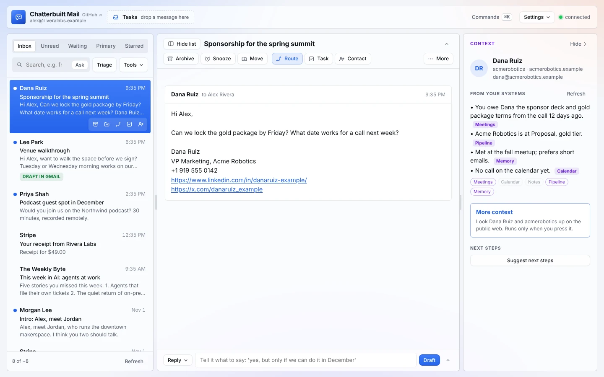

## Where things are

The layout follows a few common rules: keep the actions you use most visible, with labels; put occasional ones one click away in a labeled menu; and never go deeper than that. See [Layout](#layout) for the reasoning.

| Place | What's there |
|---|---|
| Top bar | **Tasks** drop zone, **Commands** (⌘K), **Settings** (Voice, Skills, Speed, Read-only, Model, shortcuts, docs), connection status. A dark **Read-only on** button appears while read-only is on. |
| Thread list | Tabs (Inbox, Unread, Waiting, Primary, Starred, Files), the search box (press Enter; switch on **Ask** inside it to ask a question instead), **Triage**, and **Tools** (Review, Pre-draft, Rules, Sweep, Ask). A badge on Tools counts what's waiting in Review. After Triage, the list is grouped into **Needs you**, **Worth reading** and **FYI**. **Hide list** at the left of the thread title (or `[`) gives the thread the full width; **Show list** brings it back. |
| No thread open | **Today**: drafts waiting in Gmail, what needs you, suggestions in Review, who owes you a reply, and your next meeting. |
| Above a thread | **Archive, Snooze, Move**, then **Route, Task, Contact**, then **More** (Summarize, Star, Mark read, Unsubscribe, Formatted view, Open in Gmail). |
| Beside a thread (wide screens) | The **context panel**: who it is, what your systems know, **More context** from the web, and **Next steps**. **Hide** at the top of the panel closes it; **Context** in the thread toolbar opens it again. On narrower screens the same panel sits at the top of the thread. Drag the grip between any two panes to resize them; double-click to reset. |
| Reply box | Reply buttons, your own instruction, **Draft with** switches (My tone with them, Context, Open times), who it goes to with **Cc** and **Bcc**, the reply, then Snippets, Attach, Reply all, Remind me, **Save draft** and **Send**. |

## Reading

Guide: [reading-and-triage.md](reading-and-triage.md).

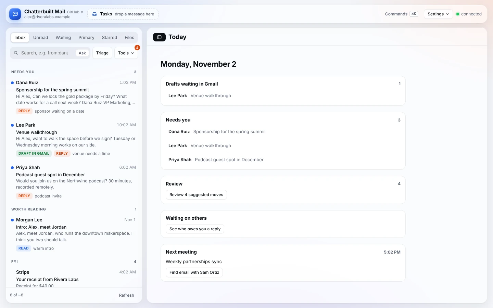

**Inbox, Unread, Primary, Starred, Files.** These are Gmail searches. Type any Gmail query in the search box and press Enter (`from:alex newer_than:7d`, `subject:invoice has:attachment`). Rows fill in their preview, date and unread dot as each thread loads. The list shows 25 at a time; scroll to the end, or press **Load older mail**, for the next batch.

**Links and attachments.** Links in a message open in a new browser tab. Click an attachment to open it in the page: PDFs page by page, images, and text files. Anything else gets **Save** (it asks first) and **Open in Gmail**.

**All your inboxes in one list.** With Gmail through Composio and two or more accounts, the page opens on **All inboxes**: every account merged, newest first, each row tinted with its account's color (pick them in **Settings → Accounts**). Chips over the list turn an account off and on, and the menu under the app name switches to one account at a time. Replies, moves and drafts go through the account the thread belongs to. See [composio.md](composio.md#gmail-through-composio-several-accounts-in-one-copy).

**Summarize.** Two or three sentences on where the thread stands, then any asks of you as a list.

**Triage.** Sorts the visible threads into *reply* (a person is waiting on you), *read* and *skip*, with a short reason each, and groups the list under **Needs you**, **Worth reading** and **FYI**. Each row then gets a **next step** button: a reply type (Say yes, Decline, Ask a question, Offer a call), Create task, a Route action, Snooze to a date, Unsubscribe, Add contact, Star, Archive or Move to a folder. Press it and it happens; **×** dismisses it and teaches Triage. Section headers add **Pre-draft**, **Mark N read** and **Clear N** (archive or file the whole FYI section, with one Undo). Archive and move suggestions also wait in the review queue. Nothing moves until you press something.

**Ask your inbox.** Switch on **Ask** inside the search box and type a question, or **Tools → Ask**. Ask a question in plain English ("When is the venue walkthrough?").
- It writes the Gmail search and shows it to you, so you can edit and re-run.
- It reads the top five threads and answers with numbered sources.
- Click a source to open the thread.

**Open mail at once.** A copy of each thread you open, and of the next few in the list, is kept in this browser, so opening it again or moving on with `j` doesn't wait on Gmail. A copy is only used while it has the newest message your list shows for that thread; otherwise the thread is fetched as before. A copy more than a minute old opens at once and is then checked quietly: a message that came in since appears (or, if you've started a reply, a note says so). Anything you change on a thread (send, archive, star, label) drops its copy. The next thread's [context brief](context-panel.md) is built before you get there, and the list opens where you left it, even after you close the page. Every few minutes the list checks Gmail in the background; new and changed threads load then, so **Update** opens them at once. **Settings → Speed** sets how far ahead to load (off, 3, 5 or 10 threads), shows what's kept, and **Clear kept mail** removes it. Switch it off in **Settings → Skills**.

**Formatted view.** Messages open formatted, with their own layout, colors, links, lists and tables, each in a sealed-off box. Scripts, style sheets, forms and `javascript:` links are stripped first, pictures show as boxes of their size, links open in a new tab, and quoted history folds away. **More → Formatted view** above the thread switches to plain text and back, and the choice is remembered.

## Connecting your systems

Guides: [context-panel.md](context-panel.md), [more-context.md](more-context.md), [route-and-next-steps.md](route-and-next-steps.md).

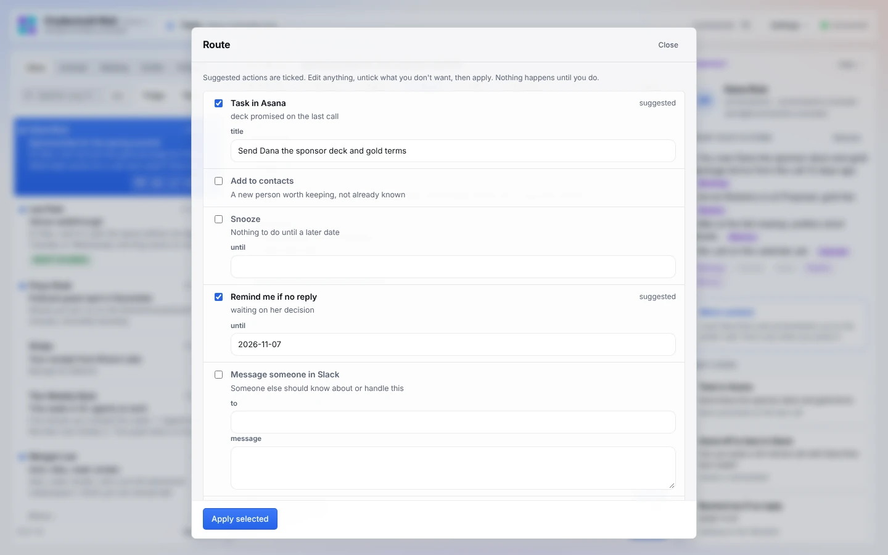

This is what sets Chatterbuilt Mail apart from email clients with AI added: each thread is checked against the rest of your systems, and routed back out to them. Why it matters: [why.md](why.md).

**Context.** When you open a thread, a card above the messages checks every system in `CONFIG.context` for that person and topic, all at once:
- meeting notes (Fireflies, Zoom, Notion meeting notes);
- calendar (past and upcoming meetings);
- tasks and notes;
- a sales or sponsor pipeline;
- contacts or CRM;
- newsletter subscriber lists;
- your memory system.

The AI keeps only what matters for the reply, two to seven lines, each tagged with its source: who they are to you, open commitments either way (especially action items assigned to you), the last and next meeting, pipeline status. Chips under the card show which systems found something, came back empty, or failed. Lookups are read-only, cached for five minutes, and time out after 15 seconds each so one slow system never holds up the rest.

Drafts and the pre-send check use the card. Turn off **Context** under *Draft with* in the reply box to leave it out of a draft. The full story, with examples: [context-panel.md](context-panel.md).

**More context.** The context panel's **More context** button looks the person and their company up on the public web, through a search connector you choose (`CONFIG.lookup`; see [connectors.md](connectors.md#more-context-web-lookups)). It searches the person by name and company, and the company by its domain, then writes two to six cited lines: who they are, what the company does, recent news, and what's worth mentioning. Each line links to its sources.
- It runs only when you press it, and results are cached for an hour.
- It stays in its own **From the web** box, apart from what your systems say.
- It flags results that might be about someone else with the same name (common with Gmail or Outlook addresses, which have no company domain).
- Drafts leave it out until you switch on **Web context** under *Draft with*.

**Next steps.** **Suggest next steps** in the panel asks Route's question in place: where should this thread go? Suggestions show with their text; **Review and apply** opens Route with them already filled in, so nothing is asked twice.

**Route.** Press **Route** above the thread (or `o`). The AI reads the thread and the context card and suggests where the thread should go, with the text already written:
- a task in your task app, with a title starting with a verb;
- a contact, which opens Add to contacts;
- snooze until a date, or remind me if nobody replies;
- **Message someone in Slack** (with `slack: true`): it finds the person or `#channel` by name and leaves a draft in Slack;
- custom actions you describe in plain words, such as a handoff to your assistant, a CRM note, a pipeline update or a ticket. **Add a custom action…** at the bottom of Route copies your description for Claude to set up. See [connectors.md](connectors.md#route-actions).

Suggested actions are ticked. Edit any field, untick what you don't want, then **Apply selected**. Each action shows *done* or the reason it failed. Nothing runs until you apply, and read-only mode blocks it.

## Replying

Guides: [replying.md](replying.md), [voice.md](voice.md).

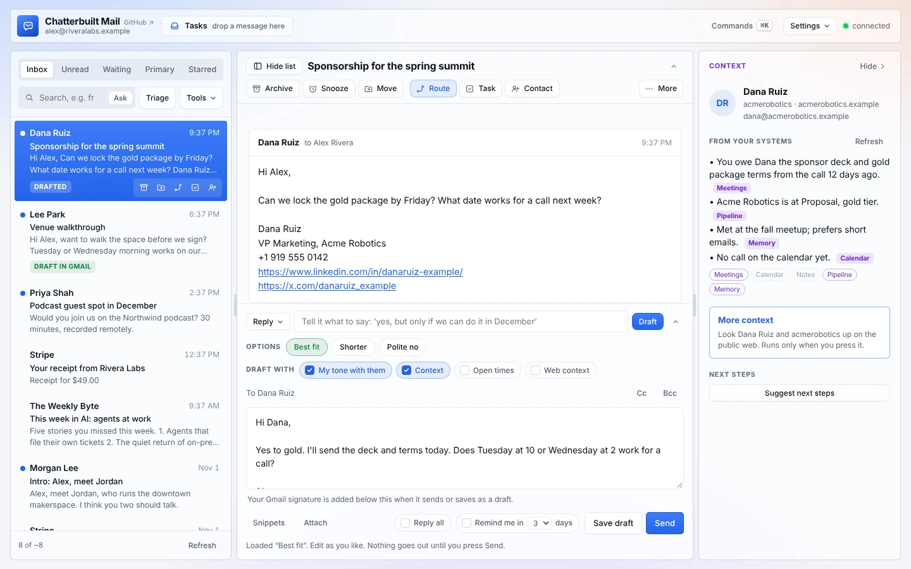

**Reply menu.** Say yes, Decline, Ask a question, Offer a call, Follow up later. With a draft in the box, type what to change and press **Revise**, or use **Shorter**, **Warmer**, **More direct** and **Polish**; **Undo** steps back a version. Or type an instruction ("yes, but only if we can do it in December") and press Draft.

**Three options.** Three versions: best fit, shorter, and a polite no. If the thread doesn't need a reply (a newsletter, a receipt, an FYI), it says so instead of inventing one.

**Pre-draft.** **Tools → Pre-draft**. Runs triage if needed, then writes the three options for up to eight threads marked *reply*, two at a time. Threads get a *drafted* tag. Nothing is saved to Gmail or sent.

**Per-recipient tone.** Before drafting, it reads up to three of your earlier sent emails to the same person and matches their register: greeting, length, formality, sign-off. Turn off *My tone with them* under *Draft with* to skip it.

**Calendar times.** Turn on *Open times* under *Draft with*, or press Offer a call.
- It reads the next seven days from Google Calendar and finds three open 30-minute slots inside your working hours, preferring around 10:00 and 2:00 on different days.
- It skips declined, cancelled and all-day events.
- Only the free times go to the model, never event names, people or locations.

**Pre-send check.** When you press Send, the AI rereads your reply against the thread and flags:
- questions or requests you didn't answer;
- names, dates, times, numbers or prices that don't match the thread;
- commitments you might not mean;
- an attachment you mention but haven't attached;
- reply-all or wrong-recipient risk;
- tone that could land badly;
- typos.

With the context card on, it also flags a reply that contradicts what your systems say: a meeting date that doesn't match your calendar, or a promise from the last call that the reply forgets.

It offers a corrected version you can take, or you can send anyway. If the check fails to run, you can still send. Turn it off in Skills if you prefer.

**Snippets.** Reusable text you insert at the cursor. `{{firstName}}` becomes the other person's first name and `{{myName}}` your sign-off. Start with the ones in `CONFIG.snippets`; add or delete them in the Snippets panel. Changes are saved in your browser until the improve skill writes them into your copy.

**Attachments.** **Attach** adds files to a reply, a follow-up or a Gmail draft, up to 18 MB in total. For bigger files, share a Drive link.

**Drafts waiting in Gmail.** Threads that already have a Gmail draft (written by the [morning run](morning-run.md), or by you in Gmail) show a *draft in Gmail* tag. Open one and press **Load it** to put it in the reply box. When you send, the old Gmail draft is removed so you don't end up with a stray copy.

**Save draft** puts the reply in Gmail Drafts. **Send** always asks you to confirm.

## Following up

Guide: [following-up.md](following-up.md).

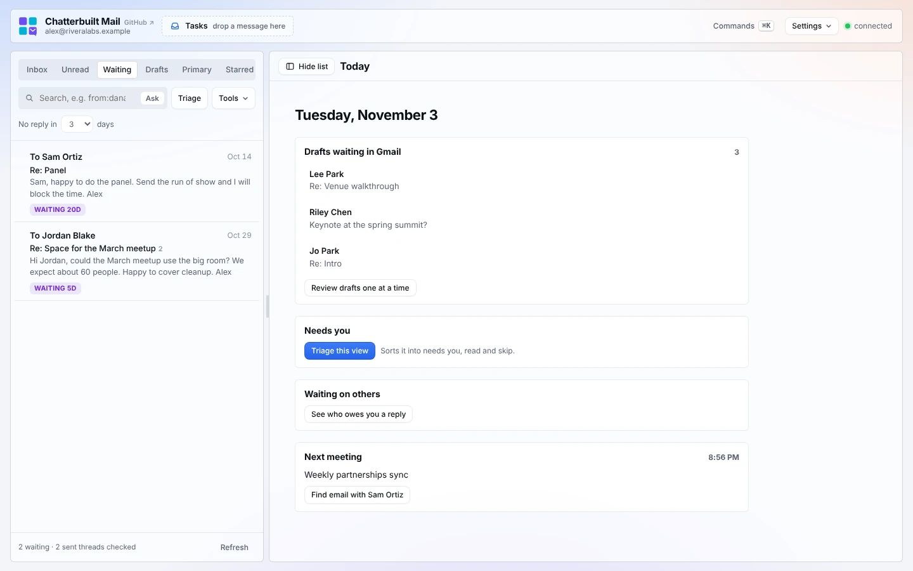

**Waiting.** A tab listing sent emails where you had the last word and nobody has answered after N days (3 by default; change it above the list while the Waiting tab is open). Oldest is listed first, with a *waiting 6d* tag. It checks your 50 most recent sent threads from the last 30 days, or four times the day setting if that's longer.
- Open one and press **Nudge** for a short, friendly follow-up.
- Sending goes to the people you wrote to, threaded under your last message.
- **3 options** gives a nudge, a shorter nudge, and a graceful "happy to drop this."

**Snooze.** Press **Snooze** above the thread (or `b`) and pick tomorrow, in two days, next Monday, in a week, in two weeks, or a date. The thread leaves the inbox and comes back, unread, that morning. Undo works.

**Remind me if no reply.** Tick *Remind me in N days if no reply* under the reply box before you send, or pick it in the Snooze panel. If nobody has answered by that morning, the thread comes back to your inbox. If they have, the reminder quietly clears.

Both are plain Gmail labels (`CB/Snooze/2026-11-05`, `CB/Remind/2026-11-05`), so you can see them in Gmail and nothing is stored anywhere else. The app checks for due ones each time it opens, and so does the morning run. The `CB/` labels are hidden from the Move folder list.

**Morning run.** A Claude scheduled task that triages each weekday morning, writes reply drafts into Gmail with context from your systems, and pushes a summary to your phone. See [morning-run.md](morning-run.md).

## Organizing

Guide: [organizing.md](organizing.md).

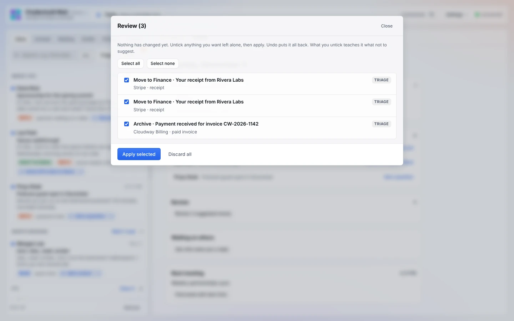

**Move and copy.** **Move** above the thread (or `m`). Move a thread into a folder (or create one), or forward a copy to another account you own. Moves can be undone.

**Unsubscribe.** **More → Unsubscribe** above the thread. It reads the sender's List-Unsubscribe header, then looks for an unsubscribe link in the text and in the formatted message. The panel leads with one button that does the job: **Unsubscribe** (opens their page), **Unsubscribe by email** (you confirm first), or, when there's nothing to unsubscribe from, **Archive** and **Archive and add a rule for this sender**. It can archive the thread afterward.

**Unsubscribe sweep.** **Tools → Sweep**. Scans your inbox for bulk mail and groups it by sender with counts. Per sender you can:
- unsubscribe;
- **Archive all**, which takes up to 100 threads out of the inbox after a confirm click and can be undone.

The sweep's Unsubscribe looks in the same places as **More → Unsubscribe**: the List-Unsubscribe header, the text, then the formatted message.

**Review queue.** **Tools → Review**. Every archive or move suggested by triage or rules waits here.
- Untick what you want left alone, then press **Apply selected**.
- Undo puts it all back.
- Whatever you untick teaches the app what not to suggest.

**Rules.** Rules come in two kinds:
- **Plain-English rules** ("receipts, invoices and payment confirmations", then move to Finance). AI matches them.
- **Sender rules**, which match an address or company domain exactly, with no AI involved.

A rule can move to a folder, archive, star or mark read.

Rules never act on their own. *Run rules* sends matches to Review. With *Check the inbox against my rules each time it loads* on (the default), they run quietly whenever the inbox loads, and matches show up as a badge on Tools and Review.

**Suggested rules.** The app watches what you do by hand. Move or archive three emails from the same sender (or four from the same company) the same way, and it offers to make it a rule: *Add rule* or *Not now*. **Suggest rules from my history** asks the AI for broader patterns across your recent actions. It needs at least five actions on file first.

**Undo.** `z` or the Undo button on a toast reverses the last archive, move, star, mark read, snooze, review batch or sweep Archive all. Sent mail can't be unsent.

## Capturing

Guide: [tasks-and-contacts.md](tasks-and-contacts.md).

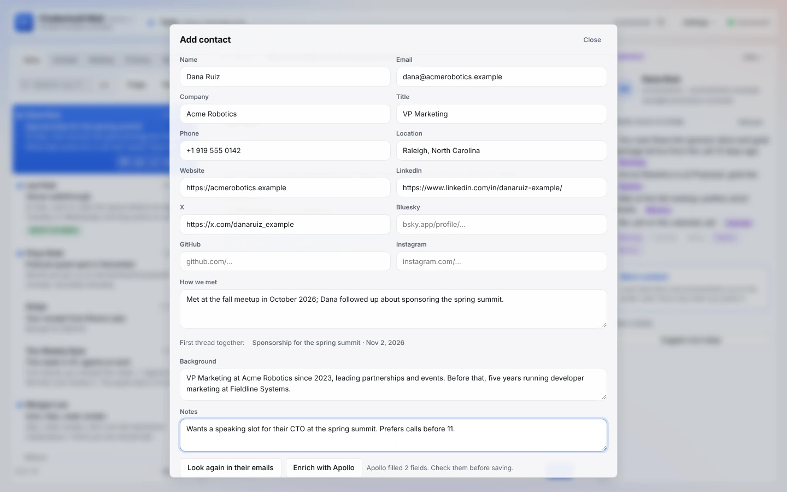

**Tasks.** Drag a thread or a single message onto **Tasks** in the top bar, press **Task** above the thread, or press `t`.
- The task gets the subject, sender, a link back to Gmail, and the message quoted.
- It works with any task app that has a claude.ai connector. See [connectors.md](connectors.md).

**Drafts.** The **Drafts** tab lists every Gmail draft as a checklist (tick each as you review it; **Hide checked**). From the list, mark each draft **Send**, **Skip** or **Delete** (rows flag *No recipient*, *Empty*, *[TK] to fill in* and *Duplicate*) and **Apply plan** sends and deletes them one at a time after one confirmation. Open one to edit it in a rich-text editor under the message it answers, attach files, tell Claude what to change (in your words, or Shorter, Warmer, More direct, Polish; a selected passage on its own), run the **Before you send** checklist yourself or with **Check it for me**, then **Save**, **Send** (it asks once), **Delete** (it asks too; Gmail keeps no copy) or **Mark checked · next**. Guide: [drafts.md](drafts.md).

**Select several.** Tick a row's box (on hover), Cmd/Ctrl-click, press `x`, or Shift-click a range; the bar over the list archives, moves, marks read or stars them all, with one Undo.

**Add to contacts.** Press **Contact** above the thread, or `c`. Pick the person if the thread has several. Then:
- **Details from their emails.** It reads every email they've sent you (the current thread plus up to four more) for their signature: title, company, phone, website, location. It also picks up social profiles: LinkedIn, X, Bluesky, GitHub, Instagram.
- **How we met.** It finds your earliest thread with them and writes a one- or two-sentence note: month and year, who reached out, what it was about, who introduced you. It links that first thread.
- **Background and Notes.** Background is a work-history summary from your enrichment app; Notes are yours.
- **Enrich** (optional). **Enrich with Clay**, or with Apollo, People Data Labs, ZoomInfo, Lusha or any app with a person lookup, adds title, LinkedIn, profiles, location and Background. It uses credits in that app and only runs when you press it. With none set up, **Set up enrichment ↗** opens a new Claude chat that sets it up.
- **Edit and save.** Every field is editable. If the person is already in your address book, it warns you before you save a second entry. **Save** writes to the address book that comes with your mail account (or, if none is connected, the dialog asks where you keep contacts and **Set it up in Claude ↗** starts the setup) (Google Contacts for Gmail, with How we met and Background as custom fields), or to any contacts app or CRM you pick.
- **Copy as vCard** works with no address book at all.
- **In bulk:** the `contact-cleanup` skill completes the address book you already have the same way, after you approve the changes.

## Learning and voice

Guides: [voice.md](voice.md), [self-improving.md](self-improving.md).

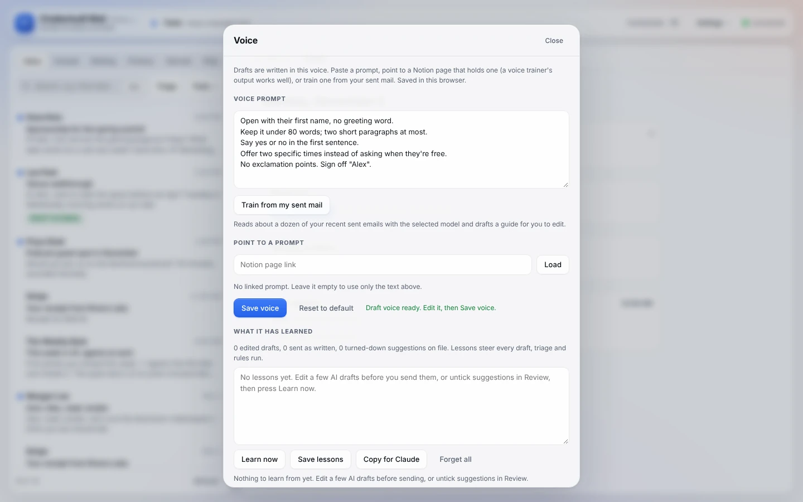

**Voice.** Three ways to set how drafts sound:
- type or paste a voice prompt;
- **point to a prompt**: paste a Notion page link (the output of a voice trainer, a style guide, your brand voice page) and drafts follow it;
- **Train from my sent mail**: reads about a dozen of your recent sent emails and writes a voice guide for you to edit.

**Self-improving.** See [self-improving.md](self-improving.md).

## Control

Guide: [settings-and-shortcuts.md](settings-and-shortcuts.md).

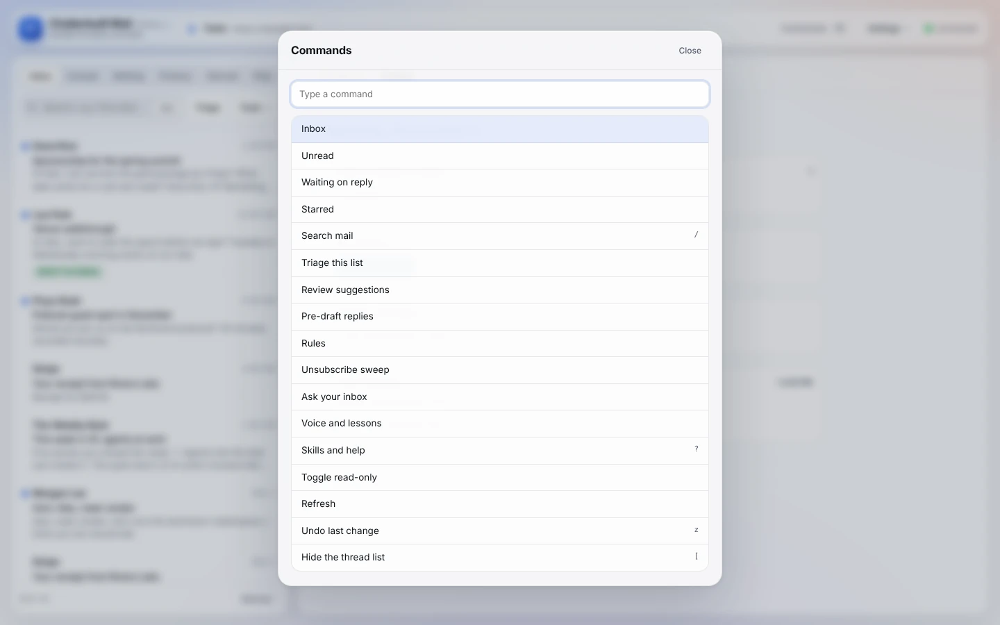

**Skills.** Every feature with a description and how to use it, an on/off switch for each, keyboard shortcuts, safety notes, and links to these docs.

**Keyboard.**

| Key | Action |
|---|---|
| `j` / `k` | Next / previous thread |
| `Enter` | Open the selected thread |
| `e` | Archive |
| `s` | Star or unstar |
| `m` | Move |
| `t` | Task |
| `c` | Contact |
| `o` | Route |
| `b` | Snooze or remind |
| `r` | Reply box |
| `/` | Search |
| `z` | Undo |
| `[` | Show or hide the thread list |
| `]` | Show or hide context (the side panel on wide screens, the card at the top of the thread otherwise) |
| Arrow keys on a pane grip | Make that pane wider or narrower (Shift for bigger steps, Home and End for the limits) |
| `⌘K` / `Ctrl K` | Command palette (every action, searchable) |
| `?` | This list (opens Skills at Keyboard) |
| `Esc` | Close a menu or dialog |

**Model.** The model comes from where the page runs. In Claude, the page never names a model or tier, so Claude's interface picks, and it won't reach for a bigger model than the job needs. If `CONFIG.models` lists other models (through OpenRouter), a **Model** picker appears in Settings; with none listed, it stays hidden.

**Look.** A square grid: flat panes on hairline borders, small corners and no drop shadows, so the panes read as one sheet. Only floating menus and dialogs keep a light shadow.

**Read-only.** A switch in **Settings**. While it's on, a dark **Read-only on** button shows in the top bar; click it to turn read-only off. While it's on, buttons that change something are greyed out, and nothing can be sent, moved, labeled, drafted, filed or saved. Route and Contact still open, so you can see suggestions or copy a vCard, and they say saving is off. Reading, summaries, triage, Ask and drafting on the page still work.

**Phones.** One pane at a time, with a tab bar at the bottom of the list: **Today, Inbox, Waiting, Tools**. In a thread, the actions sit in a bar at the bottom, in thumb reach: **Archive, Snooze, Route, Reply, More**. Reply jumps to the reply box, and while it's open the bar with Send sits just above the action bar. On a touch screen the action bar steps aside while the keyboard is up. Menus and dialogs open as bottom sheets with a Close button, and notices show at the top so they never cover Send.

## Layout

Phone guide: [phone.md](phone.md).

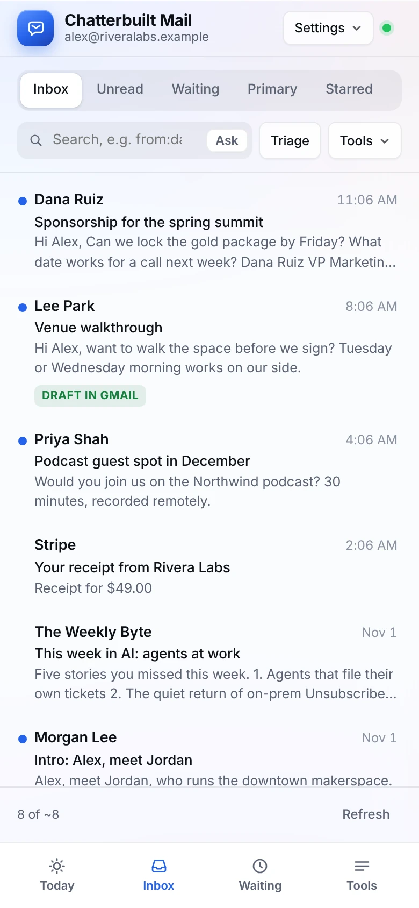
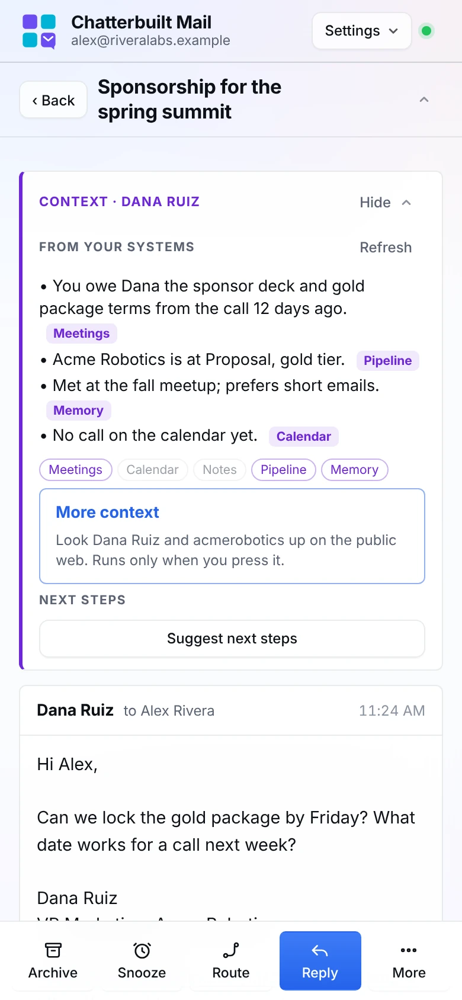
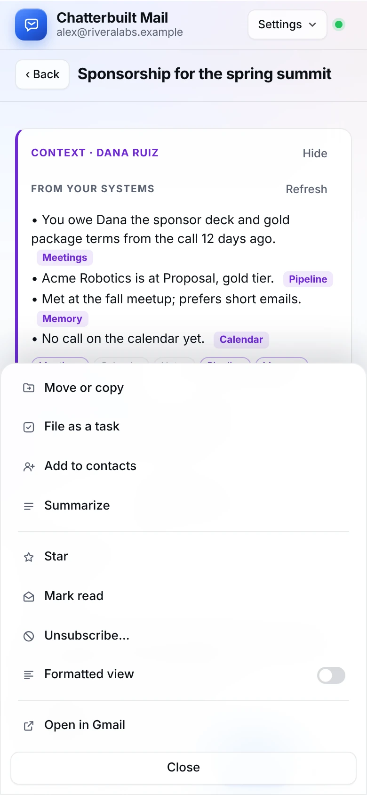

Why it's arranged this way, and the guidance behind it:

- **Fewer, grouped actions.** Apple's toolbar guidance: don't overcrowd, group by function and frequency, aim for no more than three groups, and put less important actions in a More menu [1]. The thread toolbar went from twelve equal buttons in two rows to three groups: organize, connect, More.
- **One click deep, no deeper.** Progressive disclosure works when the first screen has what people use most and the rest sits one clearly labeled step away; more than two levels gets people lost [2]. Tools, More and Settings are each one menu, with no submenus.
- **Labels on everything.** Icons alone are ambiguous, and hover-only labels don't work on touch screens, so every toolbar icon has a visible text label [3].
- **Menus say what they hold.** Hidden navigation is found less often, so each menu button has a specific name and a down arrow ("Tools", "Settings", "More") [4]. A split button would have been wrong here: its menu should hold variations of the button's own action, and the Tools items aren't variations of Search [5].
- **One primary action.** Send is the only filled button in the reply box, on the trailing edge [1]. Route gets a light accent because it's what makes this a hub.
- **Thumb reach on phones.** About half of phone use is one-handed [6], so phone menus open as bottom sheets and every item is at least 44 px tall. Bottom sheets get a visible Close button because people miss drag handles [7].
- **Keyboard and ⌘K for speed.** Every action keeps its shortcut, and the command palette lists them, the way Superhuman teaches shortcuts [8].

Sources:
1. [Apple Human Interface Guidelines: Toolbars](https://developer.apple.com/design/human-interface-guidelines/toolbars)
2. [Nielsen Norman Group: Progressive Disclosure](https://www.nngroup.com/articles/progressive-disclosure/)
3. [Nielsen Norman Group: Icon Usability](https://www.nngroup.com/articles/icon-usability/)
4. [Nielsen Norman Group: Beyond the Hamburger, desktop navigation](https://www.nngroup.com/articles/find-navigation-desktop-not-hamburger/)
5. [Nielsen Norman Group: Split Buttons](https://www.nngroup.com/articles/split-buttons/)
6. [Smashing Magazine: The Thumb Zone](https://smashingmagazine.com/2016/09/the-thumb-zone-designing-for-mobile-users)
7. [Nielsen Norman Group: Bottom Sheets](https://www.nngroup.com/articles/bottom-sheet/)
8. [Superhuman design guide (Blake Crosley)](https://blakecrosley.com/guides/design/superhuman)

## What each feature touches

| Feature | Reads | Writes (only after your click) |
|---|---|---|
| Inbox, summaries, triage, Ask, formatted view | Gmail | nothing |
| Context | every system in `CONFIG.context`, read-only | nothing |
| More context | your web search connector (`CONFIG.lookup`), only when pressed | nothing |
| Today | Gmail; Google Calendar (next meeting, shown on the page only) | nothing |
| Drafting, 3 options, Pre-draft, pre-send check | Gmail; your sent mail to that person (tone); Calendar free/busy (times); the context card | nothing until Save or Send |
| Send / Save draft / Nudge / attachments | | Gmail send or draft; removes a loaded Gmail draft after sending |
| Opening an attachment | the message source from Gmail | nothing; Save asks before it downloads |
| Switching accounts, or All inboxes (Gmail through Composio) | each account's Gmail | nothing |
| Route | Gmail; the context card | whatever you tick: your task app, contacts, Gmail labels, or a `CONFIG.actions` tool |
| Snooze, remind-me | Gmail labels | Gmail labels under `CB/` (undoable) |
| Morning run | Gmail; every system in `CONFIG.context`, read-only | Gmail drafts and `CB/` labels only |
| Snippets | | your browser only |
| Move, archive, star, review, sweep archive | Gmail labels | Gmail labels (undoable) |
| Unsubscribe | Gmail message headers | an email to the sender's unsubscribe address, if you choose that |
| Tasks | Gmail | your task app |
| Contacts | Gmail; your address book (duplicate check); your enrichment app if you press Enrich | your address book |
| Cc and Bcc | the threads you've loaded; your address book's search | nothing until you send |
| Voice | Gmail sent mail (train); Notion page (pointer) | your browser only |
| Rules, lessons, feature switches | | your browser only, until you run the improve skill |
