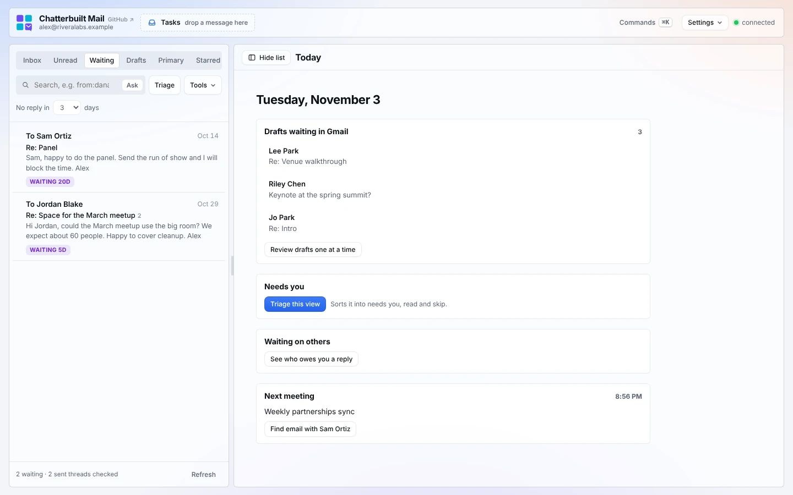
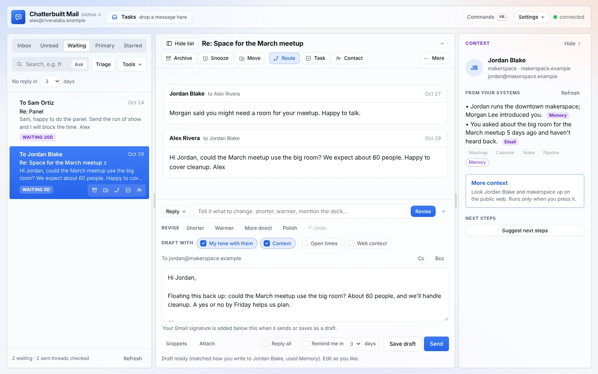
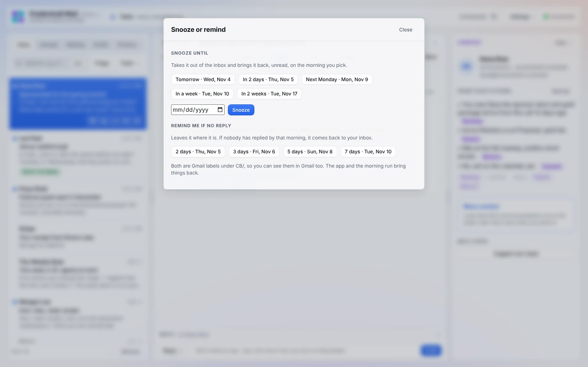

# Following up

Chatterbuilt Mail keeps track of who owes you a reply and brings threads back when you need them. Waiting shows the emails nobody has answered, Nudge drafts the follow-up, and Snooze and Remind me use plain Gmail labels, so nothing is stored anywhere else.

*The Waiting tab with "No reply in 3 days" set. Made-up data.*

## Waiting

**How to use it.** Open the **Waiting** tab above the thread list. Change **No reply in N days** above the list to widen or narrow it (1, 2, 3, 5, 7 or 14 days). Your choice is remembered in this browser.

**What counts as waiting.** A sent thread shows up when:
- the newest message in it is yours;
- it went to at least one other person;
- it's at least N days old.

The tab checks your 50 most recent sent threads from the last 30 days (longer if you set more than 7 days). The oldest wait is at the top, and each row has a pill like **WAITING 5D**. The footer says how many are waiting and how many sent threads it checked.

The default number of days is `waitingDays` in your config (3 if you don't set it). See [configuration.md](configuration.md).

## Nudge

**How to use it.** Open a thread from Waiting and pick **Nudge** from the **Reply** menu. It only appears when you had the last word. You get a short, friendly follow-up that restates the one thing you need and makes it easy to answer. It won't open with "just circling back."

Like any draft, it uses your voice, your tone with that person, and the context panel. Edit it, then **Send**. It goes to the people you wrote to, threaded under your last message.

**Three options** on a thread where you had the last word gives you three follow-ups instead of three replies:
- **Friendly nudge**;
- **Shorter**;
- **Close the loop**, which offers to drop it gracefully if it's no longer a priority for them.

## Snooze

**How to use it.** Press **Snooze** above the thread (or `b`). Under **Snooze until**, pick one:
- Tomorrow;
- In 2 days;
- Next Monday;
- In a week;
- In 2 weeks;
- a date of your own, then **Snooze**.

The thread leaves the inbox and comes back, unread, on the morning you picked. The toast has an **Undo** button, and `z` works too.

## Remind me if no reply

A reminder leaves the thread where it is. If nobody has replied by that morning, the thread comes back to your inbox, unread. If someone has replied, the reminder quietly clears.

There are two ways to set one:
- **In the Snooze panel**, under **Remind me if no reply**: 2, 3, 5 or 7 days.
- **In the reply box**: tick **Remind me in N days** (2, 3, 5 or 7) before you press **Send**. The reminder is set once the reply goes out, and the box unticks itself.

## How things come back

Snoozes and reminders are Gmail labels: `CB/Snooze/2026-11-05` and `CB/Remind/2026-11-05`. The prefix is `labelPrefix` in your config. You can see them in Gmail, and the `CB/` labels are hidden from the Move folder list.

Two things bring threads back on their date:
- **The app**, each time it opens. Snoozed threads go back to the inbox, unread. For a reminder, it checks whether the newest message is still yours. If it is, the thread comes back. If not, only the label comes off.
- **The [morning run](morning-run.md)**, each weekday, even if you never open the app.

While read-only mode is on, the app leaves due threads alone. The morning run is a separate scheduled task and keeps working.

## What it touches

| Feature | Connector tools | What it changes |
|---|---|---|
| Waiting | Gmail `search_threads`, `get_thread` | Nothing. Read-only. |
| Nudge | Your model; Gmail `search_threads` and `get_thread` for your tone | Nothing until you press **Send**. Sending uses Gmail `send_message`, threaded under your last message. |
| Snooze | Gmail `create_label` (first time for a date), `label_thread`, `unlabel_thread` | Adds a `CB/Snooze/<date>` label and takes the thread out of the inbox. |
| Remind me | Gmail `create_label`, `label_thread` | Adds a `CB/Remind/<date>` label. The thread stays put. |
| Bringing them back | Gmail `list_labels`, `search_threads`, `get_thread`, `label_thread`, `unlabel_thread` | Puts due threads back in the inbox, marked unread, and removes the label. |

In the app, read-only mode blocks snoozing, reminders, bringing things back and sending. See [safety-and-privacy.md](safety-and-privacy.md).

## Related

- [Features](features.md#following-up)
- [Morning run](morning-run.md)
- [Replying](replying.md): drafts, 3 options and the pre-send check
- [Organizing](organizing.md): move, unsubscribe, rules and Review
- [Today](today.md): who owes you a reply, at a glance
- [Phone](phone.md): Snooze is in the bottom bar
- [Configuration](configuration.md): `waitingDays`, `labelPrefix`
- [Troubleshooting](troubleshooting.md): "Waiting is empty", "A snoozed thread didn't come back"
