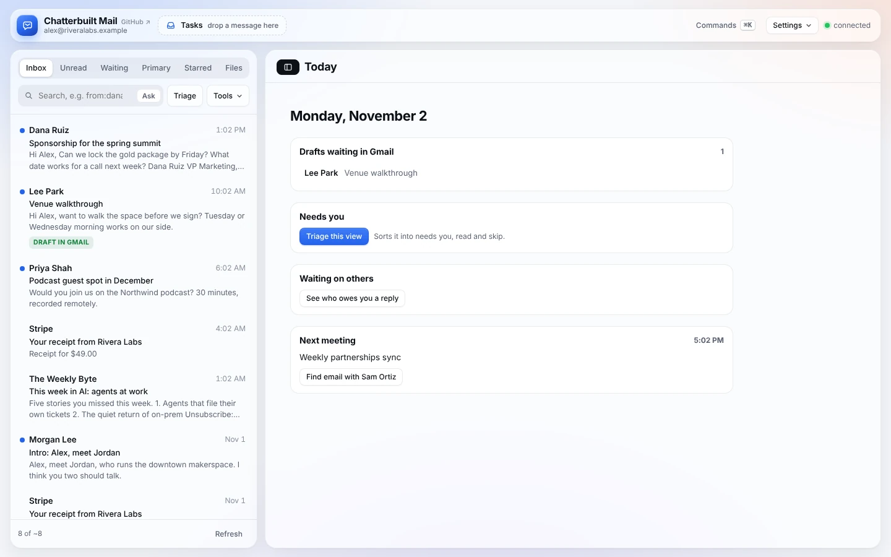

# Getting started

Chatterbuilt Mail is one HTML page that Claude publishes as a private artifact on your claude.ai account. The page reaches your mail and apps through your own claude.ai connectors, so it never holds a password or token. Setup means filling in one `CONFIG` block and publishing the page.

There are three ways to set it up. They all end the same way: a private Chatterbuilt Mail page in your claude.ai artifacts.

The quickest start is a single prompt: see [install.md](install.md). That page also has a ChatGPT version, which sets up the same triage approach as a chat workflow rather than the app.

## Before you start

- A claude.ai account with the **Gmail** connector added (Settings, Connectors).
- For everything else, either native connectors per app or one **Composio** connector that reaches them all ([composio.md](composio.md)). Composio is the easier path if you don't want to manage many connectors.
- Optional apps, depending on what you want:
  - **Notion**, or another task app (Asana, Basecamp, Linear, Todoist...), for Tasks.
  - **Notion** or a CRM for Contacts, plus **Clay** if you want enrichment.
  - **Google Calendar** for open times in replies.
  - **OpenRouter** for models other than Claude.
  - A **web search** tool (Firecrawl, Exa, Tavily, Perplexity) for More context.
  - Meeting notes, a pipeline or CRM, newsletter lists and a memory system for the context panel.

## Path 1: fork the repo and back it with memory (recommended)

This keeps your settings, voice, rules and what the app learns in a repo you own, so every improvement is saved and versioned.

1. **Make your own copy.**
   - Fork [mrhinkle/chatterbuilt-mail](https://github.com/mrhinkle/chatterbuilt-mail) on GitHub.
   - Forks of a public repo are public. Your memory file will describe how you handle email, so if that's personal, make a **private** copy instead: create an empty private repo, then use GitHub's "Import repository" with this repo's URL.
2. **Write your email memory.** Copy `memory/EMAIL-MEMORY.example.md` to `memory/EMAIL-MEMORY.md` and fill it in. It covers:
   - who you are and the people who matter most;
   - how you write;
   - which folders things go in;
   - where tasks and contacts live;
   - your rules ("receipts go to Finance");
   - what never to do.

   Plain sentences are fine. This is the memory Claude uses whenever it sets up or improves your copy.
3. **Run setup.** Open your repo in Claude Code, or in a claude.ai chat with the GitHub connector, and say: *"Run chatterbuilt-mail-setup using my memory file."*
   - `CLAUDE.md` tells Claude to read `memory/EMAIL-MEMORY.md` first.
   - The skill asks only about gaps, writes `my/config.js`, builds `my/chatterbuilt-mail.html` with `scripts/build.py`, and publishes it.
4. **Use it, then teach it.** Over time:
   - The app records how you edit its drafts and which suggestions you turn down.
   - When it has enough, open **Voice → What it has learned → Copy for Claude**.
   - Paste that into Claude and say *"run chatterbuilt-mail-improve."*
   - The skill updates `my/config.js` and `memory/EMAIL-MEMORY.md`, republishes the page, and commits the change. Your lessons now follow you to every browser and device.
5. **Get updates.** When this repo improves, pull from upstream (GitHub's "Sync fork", or `git pull upstream main`), then ask Claude to rebuild: *"rebuild my Chatterbuilt Mail from the template and republish."* Your `my/` folder and memory file are untouched by upstream changes.

## Path 2: no GitHub (Google Drive, OneDrive or SharePoint)

You can keep everything in a cloud folder instead of a repo.

1. **Make a folder**, for example `Chatterbuilt Mail`, in Google Drive, OneDrive or SharePoint.
2. **Put these files in it:**
   - `chatterbuilt-mail.template.html` (from `skills/chatterbuilt-mail-setup/assets/`);
   - the `skills/` folder, or just the `SKILL.md` files;
   - your `EMAIL-MEMORY.md`, filled in as in Path 1, step 2.

   Download them from GitHub's "Code → Download ZIP" if you don't use git.
3. **Connect the folder to Claude.**
   - Google Drive: add the Google Drive connector in claude.ai.
   - OneDrive or SharePoint: add the Microsoft 365 connector, where your organization offers it.
   - Or simply attach the files to a chat.
4. **Run setup.** Say: *"Set up Chatterbuilt Mail from the template and memory file in my Chatterbuilt Mail folder."*
   - Claude follows the setup skill and publishes your page.
   - Ask it to save the finished `config.js` and `chatterbuilt-mail.html` back to the folder, if your connector can write files. If it can't, download them from the chat and drop them in yourself.
5. **Improve it the same way:** Copy for Claude, then *"run chatterbuilt-mail-improve and update the files in my folder."*

What you give up without a repo: version history and an easy way to pull upstream updates. Drive and OneDrive keep file versions, which covers most of that.

## Path 3: install the plugin

1. Install `chatterbuilt-mail.plugin` in Claude.
2. Say *"Set up Chatterbuilt Mail."* The setup skill asks a few questions and publishes your page.
3. Claude's own memory, if you have it turned on, carries your preferences between chats. For a durable, editable record, Paths 1 and 2 are better.

## After setup

*Made-up data.*

- Open the artifact from your claude.ai artifacts list. The first time each connector is used, claude.ai asks for your OK.
- Open **Settings → Skills** at the top to see every feature and turn off what you don't need.
- Turn on **Read-only** for a careful first look; nothing can change in Gmail while it's on.
- Open a thread from someone you know well. The [context panel](context-panel.md) shows what your other systems know about them. Press **Route** to see where it would send the thread.
- Press a reply button to see a draft in your voice.
- When you trust the drafts, set up the [morning run](morning-run.md) so they're waiting in Gmail each morning.

## Changing things later

Ask Claude in plain words. For example:
- "Switch my tasks to Asana."
- "Add GPT as a model."
- "Turn on calendar times."
- "My working hours are 8 to 4."
- "Save contacts to HubSpot."
- "Check Fireflies and my CRM when I open an email."
- "Add a Route action that hands threads to my assistant in Slack."
- "Set up the morning run, weekdays at 6:45."

The setup skill edits your `CONFIG` and republishes to the same link.
