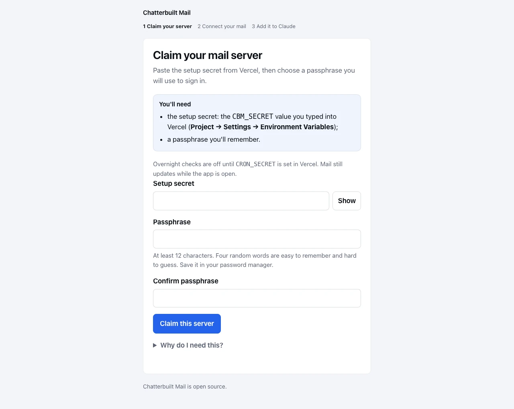
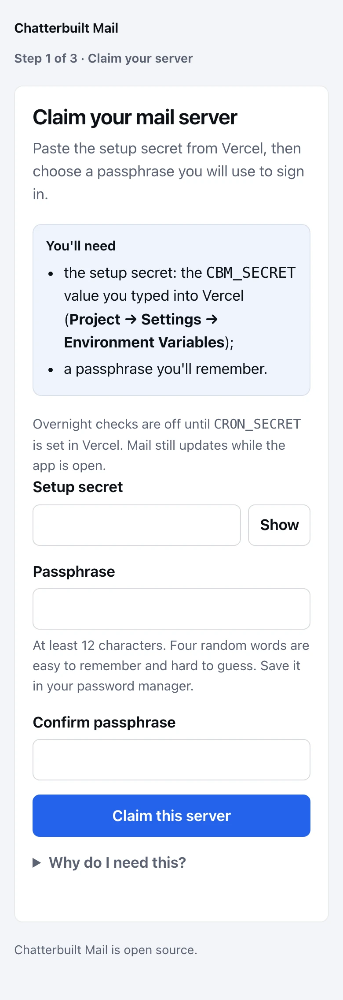
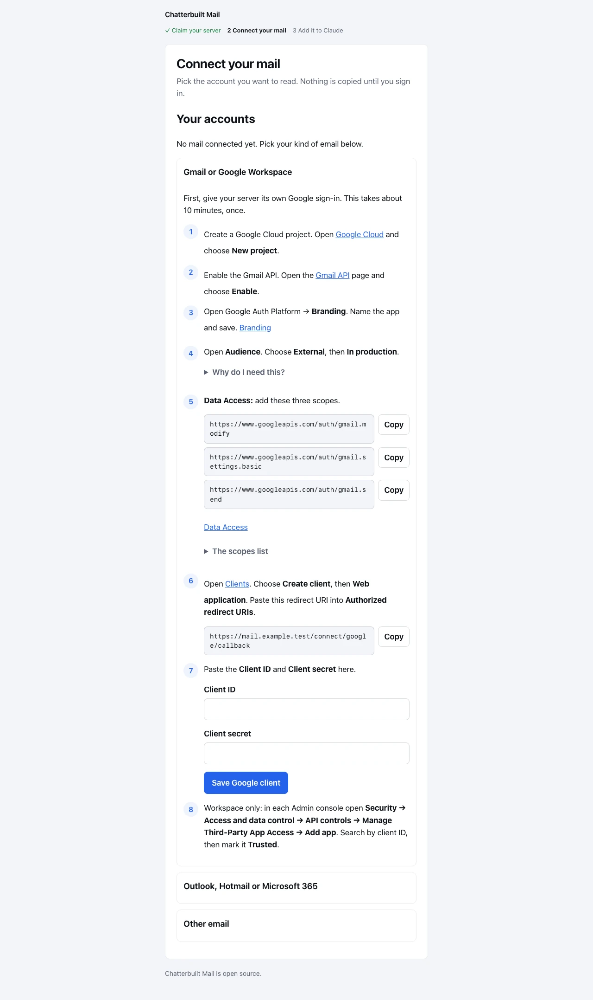
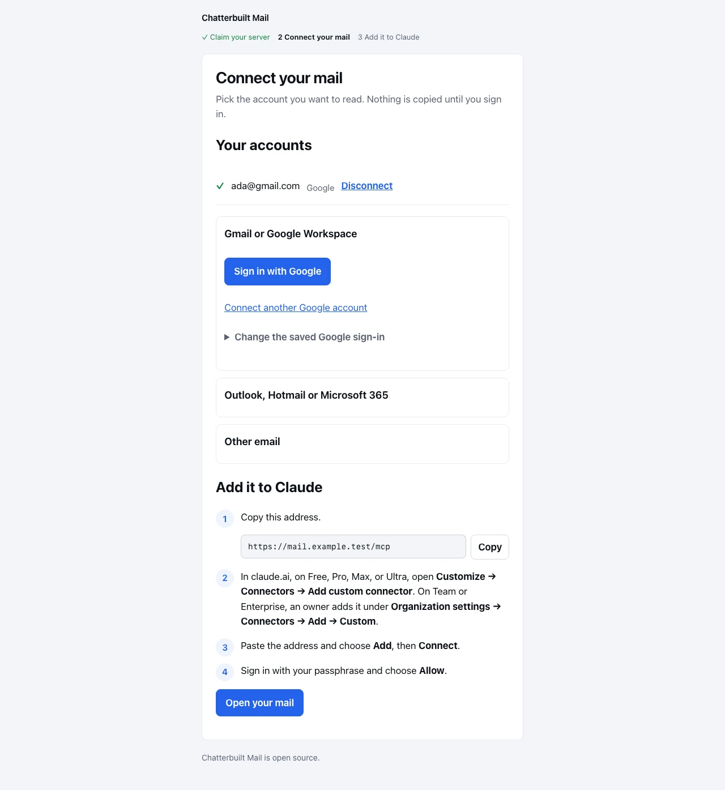
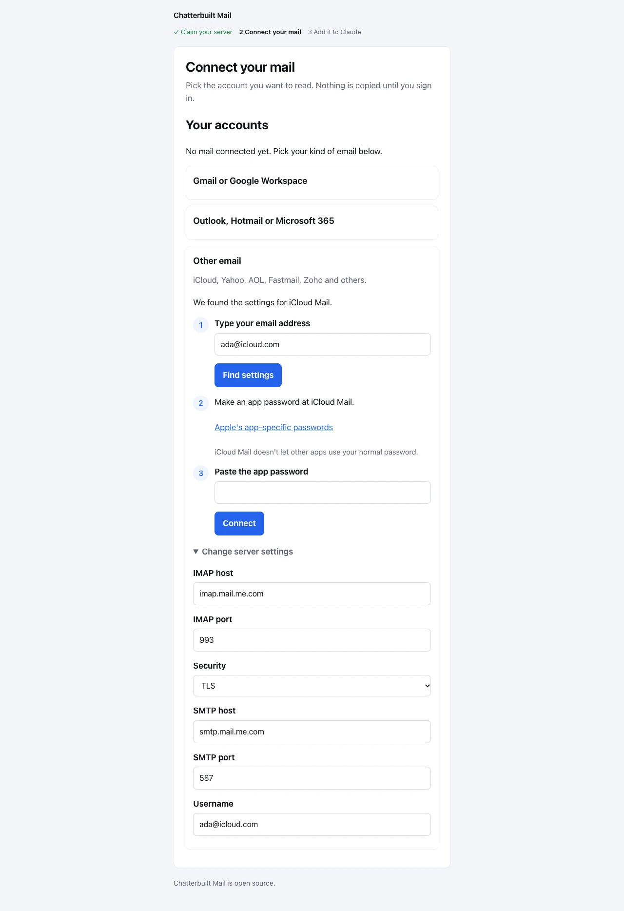
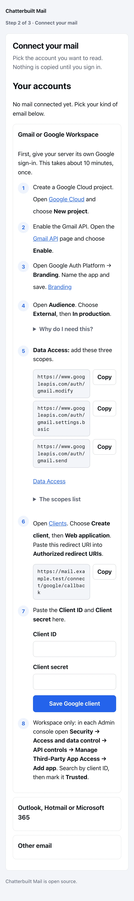
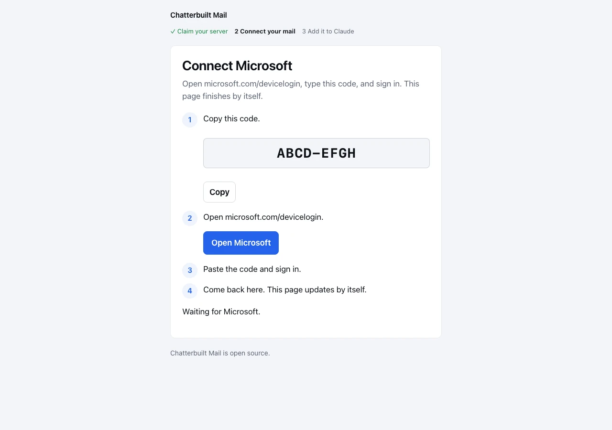
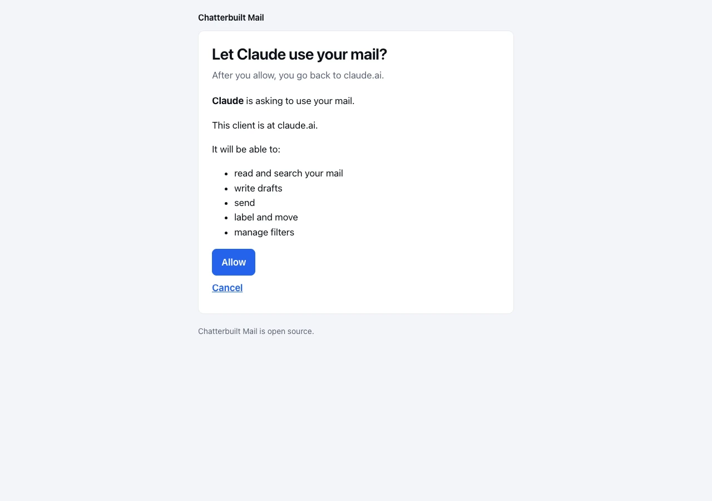

# Hosted mail

The mail server in `server/` exposes the page's Gmail tools over MCP. The page can talk to Gmail through claude.ai's connector, through Composio, or through this server. Claude.ai adds it as a custom connector; the owner signs in with a passphrase and connects their own Gmail. One deployment can hold Gmail, IMAP, and Microsoft accounts. An IMAP account is usable once it is connected. Microsoft mail works when a client is saved on the server or `MICROSOFT_CLIENT_ID` is set. Until then, a Microsoft tool call says Microsoft sign-in is not set up.

The tool names and shapes are in `server/CONTRACT.md`. `/mcp` is Streamable HTTP. A call needs the owner's OAuth access token, or `OWNER_TOKEN` for local dev and the CLI. A missing or bad token is 401, with `WWW-Authenticate` pointing at `/.well-known/oauth-protected-resource`. Access tokens last one hour, are bound to this server's `/mcp` URL, and are stored only as hashes.

`MAIL_MODE=mirror` reads from Postgres and fetches a thread body once when it is missing. `MAIL_MODE=direct` reads the provider and stores accounts, tokens, the audit log, and the jobs-table claim that makes a snooze run once. That claim row holds a thread id, a label id, and a kind. It does not hold mail. A write in `mirror` updates the store after the provider accepts it. A write in `direct` appends an audit row and does not store mail. If that store update or the audit row fails after the provider has accepted the write, the tool still returns success. Tests and local dev use an in-process Postgres (PGlite) and the demo mailbox. Neither is allowed when `NODE_ENV=production`. Boot does not backfill a Gmail mailbox. `sync_now` and the daily cron do.

## Deploy

[](https://vercel.com/new/clone?repository-url=https%3A%2F%2Fgithub.com%2Fmrhinkle%2Fchatterbuilt-mail&env=CBM_SECRET&root-directory=server&integration-ids=oac_3sK3gnG06emjIEVL09jjntDD)

Deploy the `server/` directory from `main`.

The button asks for `CBM_SECRET` and adds Neon's Postgres integration. It does not put a secret value in the URL. The link clones `mrhinkle/chatterbuilt-mail`. In a fork, change the repository URL to yours.

This repository is private. Vercel's deploy button clones a public Git repository, so the button does nothing until this repo is public (https://vercel.com/docs/deploy-button, read 2026-11-06). The query parameters, checked the same day:

- `env` is a comma-separated list of required names, with no values (https://vercel.com/docs/deploy-button/environment-variables).
- `root-directory=server` (https://vercel.com/docs/deploy-button/build-settings).
- `integration-ids` is a comma-separated list of up to three integrations (https://vercel.com/docs/deploy-button/integrations). `oac_3sK3gnG06emjIEVL09jjntDD` is the Neon id on the marketplace listing https://vercel.com/marketplace/neon. The same id is in a Vercel staff answer's example button (https://community.vercel.com/t/how-to-find-integration-ids-to-add-to-deploy-button/3130, read 2026-11-06).

`CBM_SECRET` is one random string of at least 32 characters. The server derives the encryption key and the CLI bearer from it. The Neon integration sets `DATABASE_URL`. A Vercel-managed Neon database also sets the older `POSTGRES_URL` name, and `DATABASE_URL` wins (https://neon.com/docs/guides/vercel-managed-integration, read 2026-11-06). On Vercel, an unset `PUBLIC_URL` uses `VERCEL_PROJECT_PRODUCTION_URL` (https://vercel.com/docs/environment-variables/system-environment-variables).

## Open /setup

The setup pages share one layout with the mail page. They walk through three steps: claim the server, connect mail, add the connector to Claude.







Open `https://<your host>/setup` while the server has no passphrase yet. The page is **Claim your mail server** (step 1 of 3). You'll need the `CBM_SECRET` value from Vercel (**Project → Settings → Environment Variables**) and a passphrase you'll remember. Paste the setup secret, choose a passphrase of at least 12 characters and at most 512, and type it again in **Confirm passphrase**. If the two fields differ, the server answers 400 with "The two passphrases don't match. Type them again." That mismatch does not count against the rate limit. The passphrase is stored as scrypt with N = 2^17, r = 8, p = 1, and a random 16-byte salt. A stored value that is not a scrypt row is refused, including an old unsalted SHA-256 hash. Sign in later with that passphrase. `/setup` answers 404 after the one claim.

A wrong setup secret uses the same limit as a wrong sign-in passphrase: 5 tries from one address, and 10 from anywhere, in 15 minutes. The secret and the passphrase are not written to the log.

If the browser sends an IANA time zone and `OWNER_TIMEZONE` was not set, that zone is stored. Snooze and remind-me labels dated today wake at 06:00 in that zone.

## Connect

After the claim, the browser opens `/connect` (**Connect your mail**, step 2 of 3). Connected accounts are listed at the top. Pick Gmail or Google Workspace, Outlook/Hotmail/Microsoft 365, or Other email. Each option opens in place. Nothing is copied until that provider accepts the sign-in.

- **Google.** If no client is saved, the card walks through a Google Cloud project, enabling the Gmail API, **Branding**, **Audience** (External, then In production), **Data Access** scopes, and **Clients → Create client → Web application**. It saves the client id and secret on this server. The secret is sealed and is not shown again. Then use **Sign in with Google**. The redirect URI is `https://<your host>/connect/google/callback`. The console steps are below.
- **Microsoft.** Default path: **Sign in with Microsoft** (the device code). Save a client id. Add a secret only for your own app, under **Use my own Microsoft app**. A client id with no secret uses the device-code page. The portal steps are below.
- **Other email.** Type the address and choose **Find settings**. When the lookup works, the page says which provider it found. Hosts, ports and security sit under **Change server settings**. Make an app password at that provider, paste it, and choose **Connect**. iCloud, Yahoo, AOL, Fastmail, and Zoho need an app password, not the normal one.







After at least one account is connected, the page shows **Add it to Claude** (step 3): copy `https://<your host>/mcp`. In claude.ai, on Free, Pro, Max, or Ultra, open **Customize → Connectors → Add custom connector**. On Team or Enterprise, an owner adds it under **Organization settings → Connectors → Add → Custom**. Paste the address, choose **Add**, then **Connect**, sign in with your passphrase, and choose **Allow** (https://claude.com/docs/connectors/custom/remote-mcp, read 2026-11-06).

`server_info` reports a provider as set up when its client is saved here or named in the environment. It does not return the secret.

## Advanced

The names below still work. A deployment that already sets `ENCRYPTION_KEY`, `OWNER_TOKEN`, `OWNER_PASSPHRASE`, and a Google client in the environment behaves as before, and tokens sealed with that key still open. Do not put the values in the repo.

- `OWNER_TOKEN` — at least 32 characters. Dev and CLI bearer. When it is unset, the server derives it from `CBM_SECRET`.
- `OWNER_PASSPHRASE` — the sign-in passphrase, compared in constant time and not stored. When it is set, it wins over the stored scrypt hash and `/setup` stays closed.
- `ENCRYPTION_KEY` — seals a Gmail refresh token, a Microsoft refresh token, a Microsoft device code while sign-in is in progress, an IMAP app password, and a saved Google or Microsoft client secret. When it is unset, the server derives it from `CBM_SECRET`.
- `DATABASE_URL` — Postgres. `MAIL_STORE=pg`. `POSTGRES_URL` is accepted when `DATABASE_URL` is unset.
- `MAIL_MODE` — `mirror` or `direct`.
- `MAIL_PROVIDER` — `gmail` or `live`. `gmail` is the dogfood setting: a Google client is required, and the same deployment can also hold IMAP and Microsoft accounts. `live` turns every real provider on, and each one is usable only when its own config is present. Without a Google client, `/connect/google` says Google sign-in is not set up. An IMAP account is usable once it is connected. A Microsoft tool call says Microsoft sign-in is not set up until a client is saved or `MICROSOFT_CLIENT_ID` is set. `fake` is for dev and tests and is refused in production. Production defaults to `live`.
- `GOOGLE_CLIENT_ID` and `GOOGLE_CLIENT_SECRET` — the owner's Google OAuth client. A client saved on `/connect` is used when these are unset.
- `OWNER_TIMEZONE` — an IANA name, such as `America/New_York`. When it is set, the zone from `/setup` is ignored.
- `CRON_SECRET` — bearer for `/api/cron/sync` and `/api/cron/jobs`. Without it, nothing runs on its own overnight. Mail still refreshes while `/app` is open, and when Gmail sends a push.
- `PUBLIC_URL` — an `https` origin with no path. It is the issuer, the token audience, and the host Google and Microsoft redirect back to. Required in production outside Vercel. On Vercel it can stay unset.
- `OAUTH_REDIRECT_HOSTS` — comma-separated host names that may receive an authorization code. The default is `claude.ai`. Anthropic's connector authentication page names the hosted-app callback as exactly `https://claude.ai/api/mcp/auth_callback` (https://claude.com/docs/connectors/building/authentication, Callback URLs, read 2026-11-05). The published client metadata at `https://claude.ai/oauth/mcp-oauth-client-metadata` lists that same redirect. `claude.com` is not a callback host. Loopback (`localhost`, `127.0.0.1`, `::1`) is allowed only when `NODE_ENV` is not production. Add a host here before another client may register or receive a code.
- `GMAIL_PUBSUB_TOPIC`, `GMAIL_PUSH_AUDIENCE`, and `GMAIL_PUSH_SERVICE_ACCOUNT` — only if you turn on push. Leave `GMAIL_PUSH_JWKS`, `GMAIL_API_BASE`, and `GOOGLE_TOKEN_URL` unset in production.

`VERCEL=1` is set by the platform. It tells the server to trust `x-forwarded-proto` and `x-forwarded-host`. Outside Vercel, set `TRUST_PROXY=1` for the same thing. Leave `GOOGLE_AUTH_URL` unset. Production accepts only `https://accounts.google.com`.

## Google OAuth client

In Google Cloud, create an OAuth client of type Web application. Add this authorized redirect URI:

`https://<your host>/connect/google/callback`

Add these scopes: `https://www.googleapis.com/auth/gmail.modify`, `https://www.googleapis.com/auth/gmail.settings.basic`, and `https://www.googleapis.com/auth/gmail.send`. The connect flow asks for all three, with offline access and a consent prompt, so Google returns a refresh token.

Pick the consent screen by whose mail it is:

- **All your accounts are in one Google Workspace.** Make the Cloud project belong to that Workspace and set the consent screen to Internal. Internal apps keep refresh tokens and need no verification.
- **Your accounts span more than one Workspace, or include a personal Gmail.** An Internal app only covers its own Workspace, so make it External and set the publishing status to In production, not Testing. Google lets an unverified app run for personal use (you, or a few people you know): you click past an "unverified app" screen, and refresh tokens don't expire. In each Workspace's Admin console, mark the app as trusted by its client ID so the Workspace doesn't block it.

An External app left in Testing expires refresh tokens after 7 days. The mailbox then stops until the owner connects again. A public app with many users needs Google's verification for these restricted scopes, including a yearly security assessment.

## Connect Gmail

Open `/signin`. The page asks for the passphrase from `/setup`, or for `OWNER_PASSPHRASE` when that name is set. There is no account creation and no second user. A wrong passphrase counts against that address (5 tries) and against one global bucket (10 tries) in 15 minutes. Either limit locks the sign-in page for the rest of the window. Repeated wrong tries can lock the owner out. `OWNER_TOKEN` still authorizes `/mcp` from the command line while the page is locked. Then open `/connect` and use Sign in with Google, or open `/connect/google`. That sends the owner to Google. The callback stores the refresh token sealed and creates the account from the Gmail profile address. It does not start a backfill. The first backfill runs from `sync_now` or cron. Disconnect removes the token and that account's mail rows.

A wrong return `state`, a reused Google code, or a Google reply with no refresh token is refused. Nothing is stored.

## Connect an IMAP account

On `/connect`, Other email takes the address and an app password, looks up the hosts, and runs the same check as `POST /connect/imap`. Sign in at `/signin` first. That POST needs the session cookie and the `x-cbm-csrf` header from that session. The route allows 10 tries an hour.

The body is JSON:

| Field | What to send |
|---|---|
| `email` | The mailbox address. |
| `host` | The IMAP host name. |
| `port` | The IMAP port. `993` is the usual port when security is `tls`. |
| `security` | `tls` or `starttls`. |
| `user` | The login name. Often the same as `email`. |
| `password` | The app password. `appPassword` is the same field. |
| `smtpHost` | The SMTP host name. |
| `smtpPort` | The SMTP port. |
| `aliases` | Optional. Up to 20 extra From addresses. |

The server logs in over IMAP and lists folders, then checks SMTP with EHLO, AUTH, and QUIT. It does not send a message during that check. Nothing is saved unless both checks pass. A wrong password comes back as: "The server said that password is wrong. iCloud, Yahoo and Fastmail need an app password, not your normal one."

`ENCRYPTION_KEY` seals that password the same way it seals a Gmail refresh token.

iCloud, Yahoo, and Fastmail want an app password from their own page:

- **iCloud.** Apple Support, [Sign in to apps with your Apple Account using app-specific passwords](https://support.apple.com/en-us/102654). On account.apple.com, open Sign-In and Security, then App-Specific Passwords.
- **Yahoo.** Yahoo Help, [Generate and manage 3rd-party app passwords](https://help.yahoo.com/kb/generate-password-sln15241.html).
- **Fastmail.** [App passwords](https://www.fastmail.help/hc/en-us/articles/360058752854-App-passwords). In Settings, open Privacy & Security, then Connected apps & API tokens. The Basic plan has no IMAP.
- **Gmail** in this product is `/connect/google`. Google's [app passwords](https://support.google.com/accounts/answer/185833) page says an app password is not the way they recommend, and Sign in with Google is.

`IMAP_ALLOW_PRIVATE_HOSTS=1` lets a dev server or a test connect to a private or loopback host, such as Dovecot on this machine. Production refuses to start if that name is set. Certificate checks stay on.

## Connect Microsoft

Microsoft has two setups. The server picks from the client saved on `/connect`, or from the names you set. A secret present means your own app. A client id and no secret means the shared device-code app. Neither means `/connect/microsoft` says Microsoft sign-in is not set up.

Leave `MICROSOFT_GRAPH_BASE`, `MICROSOFT_TOKEN_URL`, `MICROSOFT_AUTH_URL`, and `MICROSOFT_DEVICE_URL` unset in production. Production accepts only `https://graph.microsoft.com` and `https://login.microsoftonline.com`.

Both setups ask Microsoft for these delegated permissions: `offline_access`, `openid`, `email`, `User.Read`, `Mail.ReadWrite`, `Mail.Send`, and `MailboxSettings.ReadWrite`. Open `/signin`, then `/connect/microsoft`. Disconnect is the button on the connected page. It removes that Microsoft account and does not touch Gmail.

### Your own Microsoft app

Use this when the mailbox's organization can register an app, or when device-code sign-in is turned off.

1. In the Microsoft Entra admin center, register an application.
2. Supported account types: Accounts in any organizational directory and personal Microsoft accounts, if you want work mail and Outlook.com. Pick "this organization only" when every mailbox is in your own tenant.
3. Add a platform of type Web. Set the redirect URI to `https://<your host>/connect/microsoft/callback`.
4. Create a client secret. Put the value in `MICROSOFT_CLIENT_SECRET`. Put the secret's expiry date on a calendar. When it expires, sign-in stops until you create a new one and set the name again.
5. Put the application (client) ID in `MICROSOFT_CLIENT_ID`.
6. Add the delegated permissions listed above. Grant admin consent if your tenant requires it.

`/connect/microsoft` then sends you to Microsoft and comes back to the callback. A return link from another sign-in, an old link, or a link already used is refused. Nothing is stored.

### The shared app, device code

Use this when Chatterbuilt publishes one public client and you do not want a secret on the server.

1. Register an application.
2. Supported account types: Accounts in any organizational directory and personal Microsoft accounts.
3. Under Authentication, set Allow public client flows to Yes.
4. Add the same delegated permissions. Do not create a client secret.
5. Complete publisher verification. A work tenant that blocks unverified apps will refuse this sign-in until the publisher is verified. Personal Outlook.com does not require that step. See Microsoft's publisher verification overview.
6. Put the application (client) ID in `MICROSOFT_CLIENT_ID`. Leave `MICROSOFT_CLIENT_SECRET` unset.

Open `/connect/microsoft` and click Start. The page shows a code and a link that opens in a new tab. Open microsoft.com/devicelogin, type the code, and sign in. The page finishes by itself. If the organization has turned this kind of sign-in off, the page says so and points you at your own app above.



## Use it outside Claude

Open `/app` in a browser. With no session, that page sends you to `/signin` and, after the passphrase, back to `/app`. The session cookie is `cbm_owner`. Connect Gmail at `/connect/google` first if the inbox is empty. The demo mailbox used in tests is already connected.

On a phone, use the browser's Add to Home Screen (or Install app). `/app` has a web app manifest, the Chatterbuilt mark, and a theme color. There is no service worker in this lane, so the icon installs and the page still needs a network.

Summaries, triage, Ask, and pre-drafts use a model key you set on the server: `ANTHROPIC_API_KEY` (Anthropic Messages) or `OPENROUTER_API_KEY`. If both are set, Anthropic is the one that runs. `SAMPLE_MODEL` is the one model id sent to whichever provider is configured. When it is unset, Anthropic uses `claude-haiku-5-5` and OpenRouter uses `anthropic/claude-haiku-5.5`. The key never goes to the browser. Leave both keys unset and those controls stay hidden, the same as when Claude has not granted sampling. A model call is limited to 30 per session every 10 minutes. The count is in the store, so it holds across instances. A prompt over 24,000 characters is refused before the model is called.

Outside Claude, only this mailbox is connected. Notion, Google Calendar, Fireflies, and any other context source in the page say they are not available here. The panel says so. Mail, drafts, filters, and the same-account alias reply still work, because they use this server.

`/app/api/call` and `/app/api/sample` need the session cookie and the `x-cbm-csrf` header from the page. They do not send `Access-Control-Allow-Origin`. A write is not retried.

## Add it to claude.ai

In claude.ai, add a custom connector. The server URL is `https://<your host>/mcp`.



Claude reads `/.well-known/oauth-protected-resource` and `/.well-known/oauth-authorization-server`. It can register with a Client ID Metadata Document (the client id is an https URL of the client's metadata) or with dynamic client registration. Every flow requires PKCE S256. Claude Code's loopback redirect is refused in production; use `OWNER_TOKEN` as a bearer on `/mcp` for that client. The consent page names the client and says where the code goes, for example "After you allow, you go back to claude.ai." A metadata client also names the host of the client id URL. A redirect host that is not on `OAUTH_REDIRECT_HOSTS` never reaches Allow. `/register` allows 20 new clients an hour and 100 stored clients.

## Point the page at the server

Set `CONFIG.gmail` to the accounts `list_accounts` returns:

```js
gmail: {
  via: "chatterbuilt",
  server: "Chatterbuilt Mail",
  accounts: [
    { id: "gmail_work", email: "you@work.example", label: "Work", color: "blue" },
    { id: "gmail_personal", email: "you@personal.example", label: "Personal", color: "red" }
  ]
}
```

`server` is the connector's display name in claude.ai. It defaults to `"Chatterbuilt Mail"`. The setup skill asks whether you have this server, calls `list_accounts`, and writes `via`, `server` and `accounts`. It declares the connector's tools on the artifact. It does not declare `sync_now`.

Calls use the page's own tool names plus `account`. There is no translation layer. All inboxes, the account picker, per-thread ownership and From on drafts work the same way as the Composio path. Reads retry once when the unwrapped error is `upstream_error` or `rate_limited`. Writes are never retried. Kept copies stay on.

Where the server can do what Composio cannot, the page says so:

- **Settings → Filters**, and a rule's **Skip the inbox** action, call `create_filter`. The note says this applies to future mail only.
- A reply from an alias on the same account stays in the thread (`send_message` with `fromEmail` and `replyToMessageId`). The From note says "still inside this thread." A different account is still a new email.
- **Attach** is available on the reply box.
- A draft keeps its threading headers. Saving through Composio still clears them, and the editor still says so on that path.

## Cron

`vercel.json` runs `/api/cron/sync` and `/api/cron/jobs` once a day (`0 13 * * *`). That is the Vercel Hobby limit. On Pro, use `*/5 * * * *` for sync and `*/15 * * * *` for jobs.

The morning run in `docs/morning-run.md` is weekdays at 6:45. Weekend snooze wake-ups lean on the daily cron. On Hobby, a snooze can wake up to a day late when nothing else calls the server. A read still runs a short incremental sync when the last one is over a minute old.

## Optional Pub/Sub push

Create a Pub/Sub topic and put its name in `GMAIL_PUBSUB_TOPIC`. Add a push subscription to `https://<your host>/api/gmail/push`. Turn on OIDC authentication. Set the audience to `GMAIL_PUSH_AUDIENCE` and the service account to `GMAIL_PUSH_SERVICE_ACCOUNT`. The server checks that token, then syncs. A sync failure still answers 204. Cron and the next push catch up.

## What stays local

How to run the dev server and the gate is in `server/README.md`. Environment names, with no values, are in `server/.env.example`.

Do not put a real token, key, passphrase, or mailbox in the repo.
