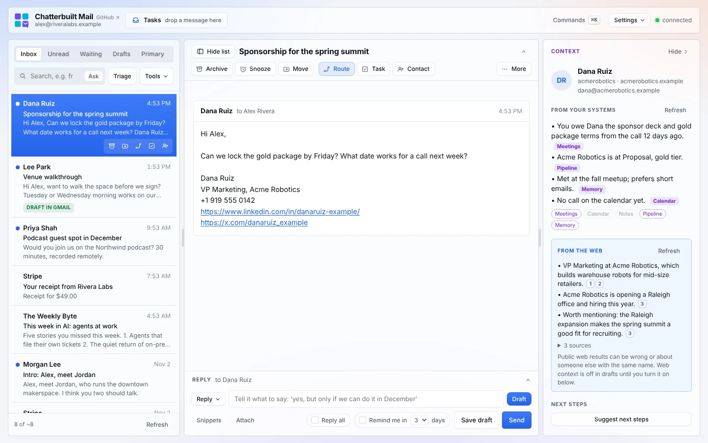

# More context

**More context** looks the person and their company up on the public web and writes a short briefing where every line links to its sources. It runs only when you press it, and what it finds stays in its own box, apart from what your own systems say.

*Made-up data: Alex Rivera at Rivera Labs, replying to Dana Ruiz at Acme Robotics.*

## How to use it

1. Open a thread. The context panel shows a **More context** button under *From your systems*. It names who it will look up ("Look Dana Ruiz and acmerobotics up on the public web").
2. Press it. The box changes to *Looking on the web…*, then fills in **From the web**.
3. Read the lines. Each ends with numbered links like `1` `2`. Hover a number for the page title, or click it to open the page.
4. Open **N sources** under the lines to see the full numbered list.
5. To use it in a reply, tick **Web context** under *Draft with* in the reply box. It's off by default, and greyed out until there's something to use.

**Refresh** in the box runs the lookup again.

## What it searches

It builds two queries from the email address and name:

| Query | What it is | Example |
|---|---|---|
| `{{personQuery}}` | The name in quotes plus the company, or the email address when there's no name | `"Dana Ruiz" acmerobotics` |
| `{{companyQuery}}` | Company and domain plus "company news" | `acmerobotics acmerobotics.example company news` |

`{{companyQuery}}` is empty for Gmail, Outlook, iCloud and other personal addresses, since the domain says nothing about where they work.

Each entry in `CONFIG.lookup` is one search call. An entry with `needs: ["companyQuery"]` is skipped when that query is empty, so a personal address runs only the person search. The usual setup is two entries, person and company. See [connectors.md](connectors.md#more-context-web-lookups) for the format and the placeholders.

Every lookup runs at the same time and gets 45 seconds. The page pulls every result that has a link and a title or snippet out of whatever shape the search returns, drops repeats, and keeps up to ten. The model then writes two to six lines covering:
- who they are (role, company);
- what the company does;
- recent news worth knowing;
- one or two things worth mentioning in a reply.

## The briefing

- **Every line is cited.** The numbers point to the results it came from.
- **It only uses what the results say.** It skips anything that might be about a different person.
- **It warns you when it isn't sure.** If the results might be about someone else with the same name, the first line starts with **Caution:**. Personal addresses make this more likely, because there's no company to narrow the search.
- **It says so when there's nothing.** "Nothing relevant on the web." means the search found nothing worth keeping. A failed search shows its error under the lines; the others still count.
- **It keeps its distance.** The box always ends with a reminder that public results can be wrong or about someone else, and that Web context is off in drafts until you turn it on.

Results are cached for an hour, so opening the same thread again doesn't search again unless you press Refresh.

## Web results are untrusted

Web pages can contain anything, including text written to steer an AI. The model is told the results are untrusted data and never to follow instructions inside them. They reach a draft only when you tick **Web context**, and even then the draft is told to use them lightly. The pre-send check and Route use what your own systems say, not the web box.

## Cost

Each press runs each `CONFIG.lookup` entry once: two searches with the usual setup, one for a personal address. Search providers charge per search or per result. Through Composio, a Firecrawl search returning three results used 2 Firecrawl credits when tested, so a press with both searches costs about 4. The one-hour cache means a second look at the same thread is free.

## What it touches

- **Calls:** the search tools in `CONFIG.lookup` (a web search connector, or Composio's `COMPOSIO_MULTI_EXECUTE_TOOL` running a search such as `FIRECRAWL_SEARCH`), then Claude or your chosen model.
- **Sends out:** the person's name, company and email domain go to the search provider. Nothing from the email itself does.
- **Writes:** nothing. More context only reads, so read-only mode doesn't block it.
- **Turn it off:** Settings → Skills → **More context**.

## Related

- [The context panel](context-panel.md): what your own systems say, in the box above
- [Route and next steps](route-and-next-steps.md): the box below it
- [Replying](replying.md): the *Draft with* switches, including Web context
- [Connectors](connectors.md#more-context-web-lookups): `CONFIG.lookup` format and providers
- [Composio](composio.md): running the search through one connector
- [Safety and privacy](safety-and-privacy.md)
- [Troubleshooting](troubleshooting.md)
- [Features](features.md) · [Configuration](configuration.md)
