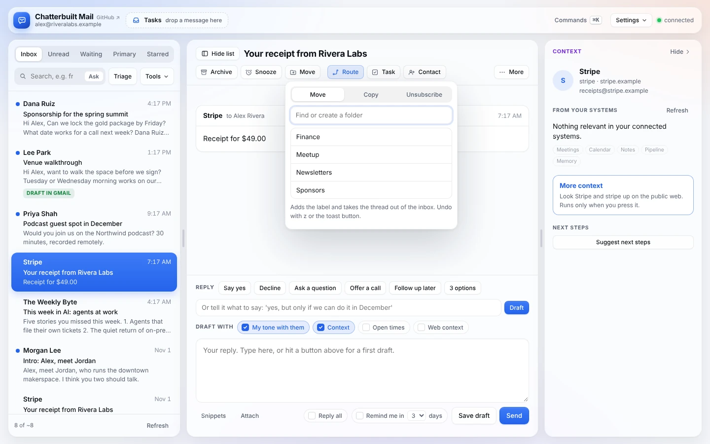
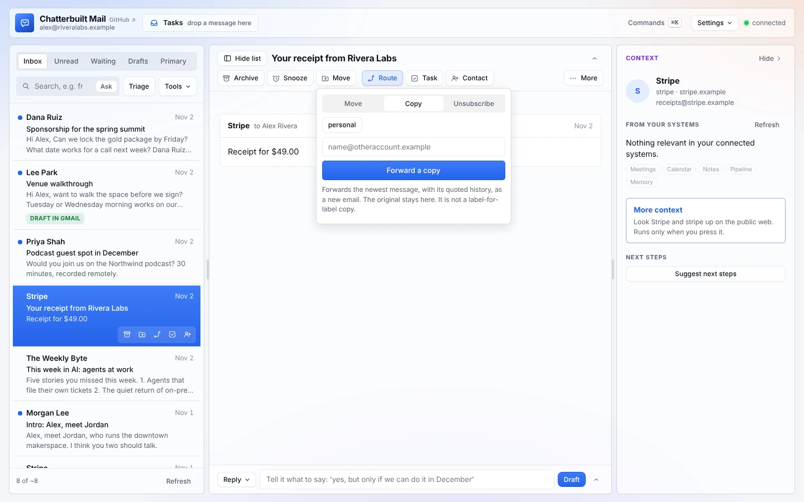
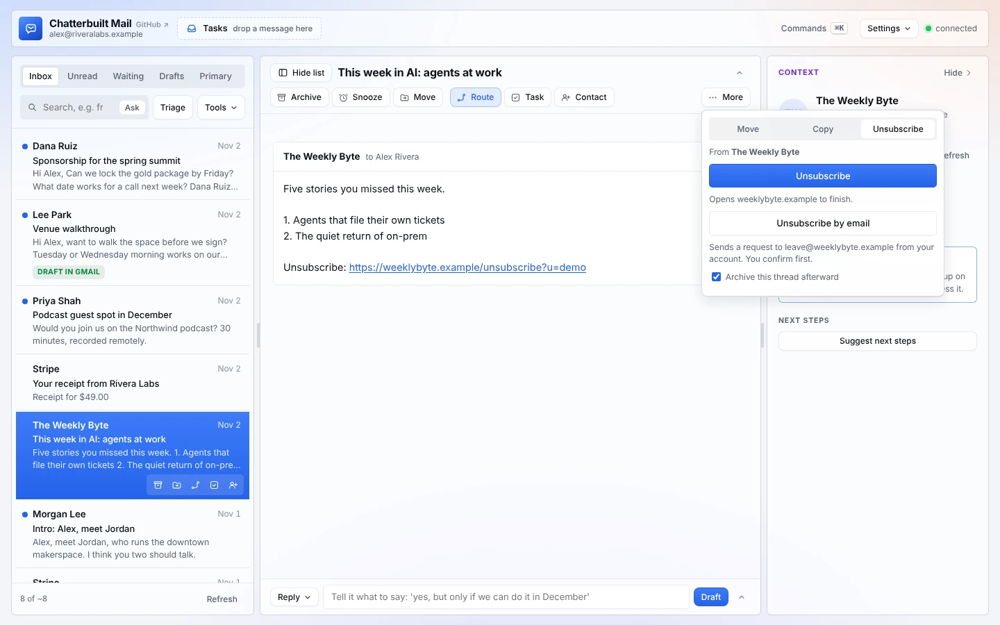
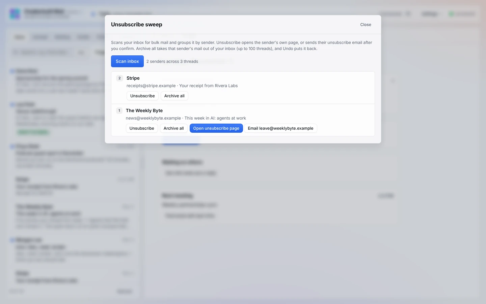
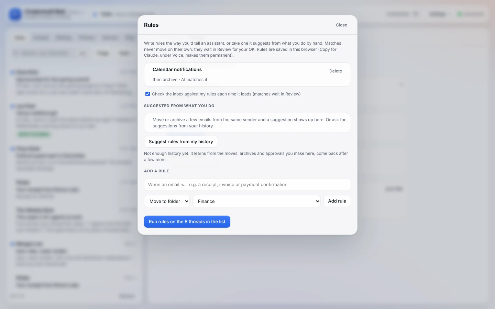
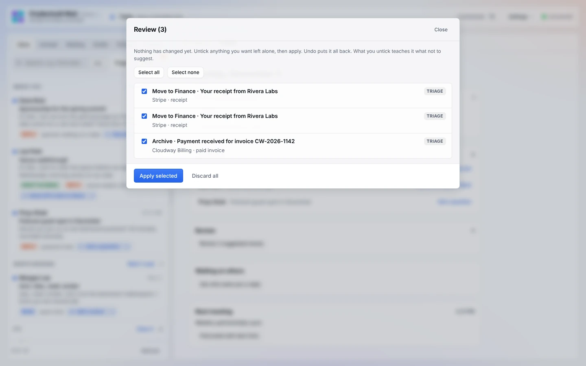

# Organizing

Chatterbuilt Mail files, clears out and unsubscribes with you in charge. Every bulk change waits in Review for your OK, and Undo puts things back.

*Move, Copy and Unsubscribe share one panel above the thread. Made-up data.*

## Move to a folder

**How to use it.** Press **Move** above the thread (or `m`). Type in **Find or create a folder** to filter your Gmail labels, then pick one. If nothing matches, the last option is **+ Create folder "…"**, which makes the label and moves the thread into it. Enter picks the first match.

Moving adds the label and takes the thread out of the inbox. Undo with `z` or the toast's **Undo** button. The `CB/` labels used by snooze and reminders don't show in the list.

Each move by hand is remembered, so the app can suggest a rule later (see [Suggested rules](#suggested-rules)).

## Copy to another account

**How to use it.** In the same panel, open **Copy**. Type an address, or tap a saved one, then press **Forward a copy**. It asks you to confirm before anything is sent.

It forwards the newest message, with its quoted history, as a new email. The original stays where it is. It isn't a label-for-label copy.

The saved addresses are `copyTargets` in your config, for example `[{ label: "personal", address: "me@example.com" }]`. See [configuration.md](configuration.md).

## Unsubscribe

**How to use it.** **More → Unsubscribe…** above the thread opens the **Unsubscribe** tab. It looks for a way out in this order:
1. the sender's `List-Unsubscribe` header;
2. an unsubscribe link in the plain text, judged by the link itself and the words just before it;
3. an "Unsubscribe" or "manage preferences" link in the formatted message.

The panel leads with one button that does the job:
- **Unsubscribe** opens the sender's page in a new tab, where you finish.
- **Unsubscribe by email** sends their unsubscribe request from your account, after you confirm.
- **Archive this thread afterward** is ticked by default and applies to either one.

If there's nothing to unsubscribe from, it says the message may be from a real person and offers:
- **Archive**;
- **Archive and add a rule for this sender**, which archives the thread and saves a sender rule. Future mail from that address then waits in Review.

## Unsubscribe sweep

**How to use it.** **Tools → Sweep**, then **Scan inbox**. It searches your inbox for bulk mail ("unsubscribe", "view in browser", "manage preferences", "email preferences"), up to 100 threads. It groups the results by sender, most threads first.

For each sender:
- **Unsubscribe** checks the sender's header, then the email's text, then the formatted email, the same places **More → Unsubscribe** looks. It then offers **Open unsubscribe page**, **Email** their unsubscribe address (click twice to confirm), or a link from the email. If it finds none, it says so.
- **Archive all** takes up to 100 of that sender's threads out of your inbox. The first click arms it and the second confirms. Undo puts them back.

The last scan stays in the panel until you scan again.

## Rules

**How to use it.** **Tools → Rules**. Under **Add a rule**, describe the email the way you'd tell an assistant ("a receipt, invoice or payment confirmation"). Pick what happens: **Move to folder**, **Archive**, **Star** or **Mark read**. Then press **Add rule**.

There are two kinds:
- **Plain-English rules.** The AI matches them, and it's told to match only when a rule plainly applies.
- **Sender rules.** These match an address or a company domain exactly, with no AI. You get them from suggestions or from Unsubscribe's **Archive and add a rule for this sender**.

**Rules never act on their own.**
- **Run rules on the N threads in the list** checks up to 50 threads and sends matches to Review.
- **Check the inbox against my rules each time it loads** is on by default. It runs the same check quietly, at most every five minutes per view. Matches show as a badge on **Tools** and **Review**.

Rules are saved in this browser. **Copy for Claude**, under Voice, makes them permanent in your copy. See [self-improving.md](self-improving.md).

### Suggested rules

The app watches what you do by hand: moves, archives, and the suggestions you approve in Review. Move or archive three emails from the same sender the same way, or four from the same company domain. A toast then asks, for example, *You've moved 3 emails from Stripe to Finance. Make it a rule?* Choose **Add rule** or **Not now**. Turned-down suggestions aren't offered again.

**Suggest rules from my history**, in the Rules panel, asks the AI for broader patterns across your recent actions. It needs at least five actions on file first. Until then it tells you to come back after a few more.

## Review and Undo

**How to use it.** Every archive and move suggested by Triage or your rules waits here, with its source (**TRIAGE** or the rule) and a short reason. Nothing has changed in Gmail yet. Open it with **Tools → Review**.
1. Untick anything you want left alone. **Select all** and **Select none** help with long lists.
2. Press **Apply selected**.
3. If you change your mind, **Undo** on the toast (or `z`) puts it all back.

**Discard all** clears the queue without changing anything.

**What unticking teaches.** Each suggestion you untick or discard is saved as a turned-down suggestion. **Learn now**, under Voice, turns those into lessons that steer future triage and rules. Each one you approve counts toward a suggested rule. See [self-improving.md](self-improving.md).

`z` or a toast's **Undo** reverses the last archive, move, star, snooze, sweep or Review batch. Sent mail can't be unsent.

## What it touches

| Feature | Connector tools | What it changes |
|---|---|---|
| Move | Gmail `list_labels`, `create_label` (new folders), `label_thread`, `unlabel_thread` | Adds the label and removes the thread from the inbox. |
| Copy | Gmail `forward` | Sends a new email to the address you confirm. |
| Unsubscribe | Gmail `get_message` (raw headers), `get_thread`; `send_message` for email unsubscribes; `unlabel_thread` to archive | Opens the sender's page in your browser, or sends their unsubscribe email after you confirm. |
| Sweep | Gmail `search_threads`, `get_thread`, `get_message`; `send_message`; `unlabel_thread` | Archives a sender's threads, or sends an unsubscribe email, only after a second click. |
| Rules | Your model (plain-English rules only), plus the thread list already loaded | Nothing. Matches go to Review. |
| Review | Gmail `label_thread`, `unlabel_thread` | Applies only the changes you tick. |

Read-only mode blocks every change on this page: moving, forwarding, unsubscribe emails, archiving and applying Review. Scans, rules and suggestions still work. See [safety-and-privacy.md](safety-and-privacy.md).

## Related

- [Features](features.md#organizing)
- [Reading and triage](reading-and-triage.md): where Review suggestions come from
- [Following up](following-up.md): Waiting, Nudge, snooze and reminders
- [Self-improving](self-improving.md): lessons, Learn now, Copy for Claude
- [Voice](voice.md)
- [Settings and shortcuts](settings-and-shortcuts.md): turn Rules, Sweep or Review off in Skills
- [Phone](phone.md): Move and Unsubscribe are under More
- [Configuration](configuration.md): `copyTargets`, `mailRules`, `labelPrefix`
- [Troubleshooting](troubleshooting.md)
