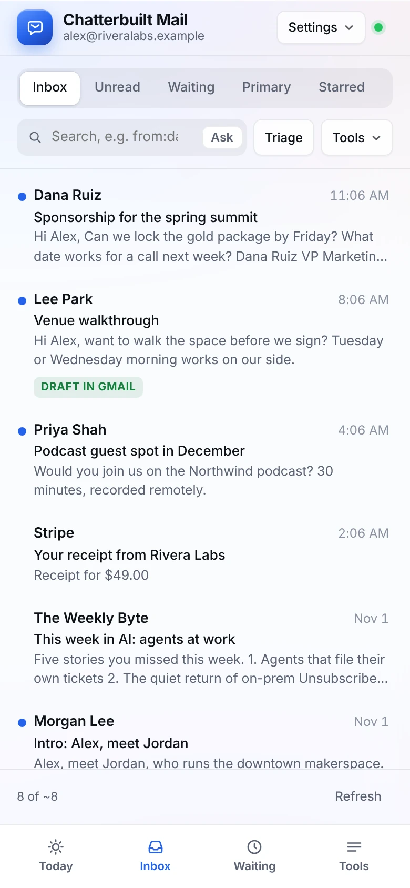
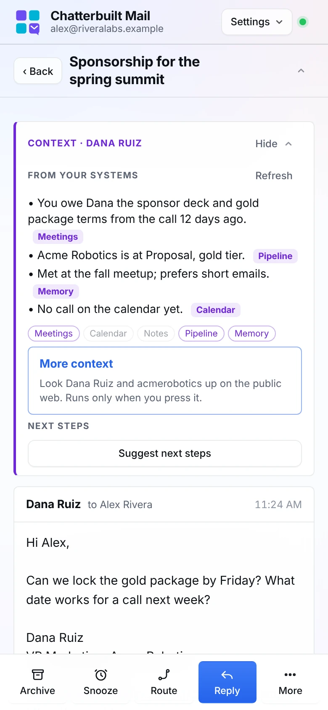
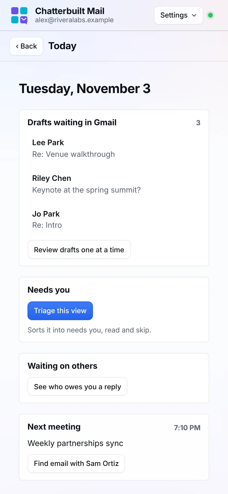
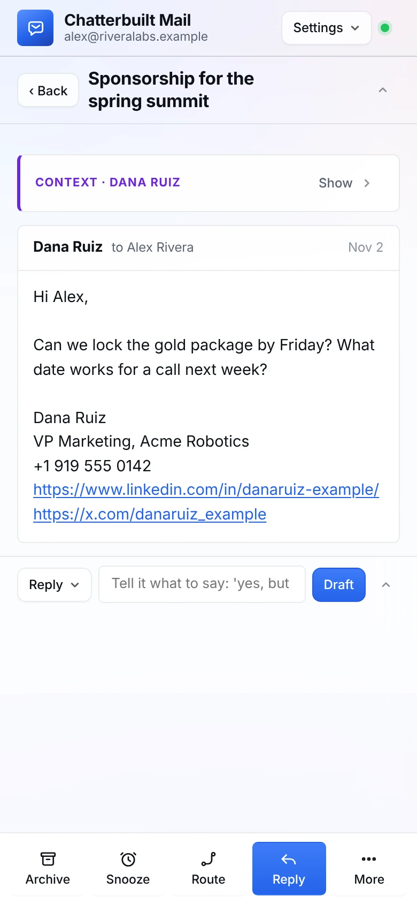
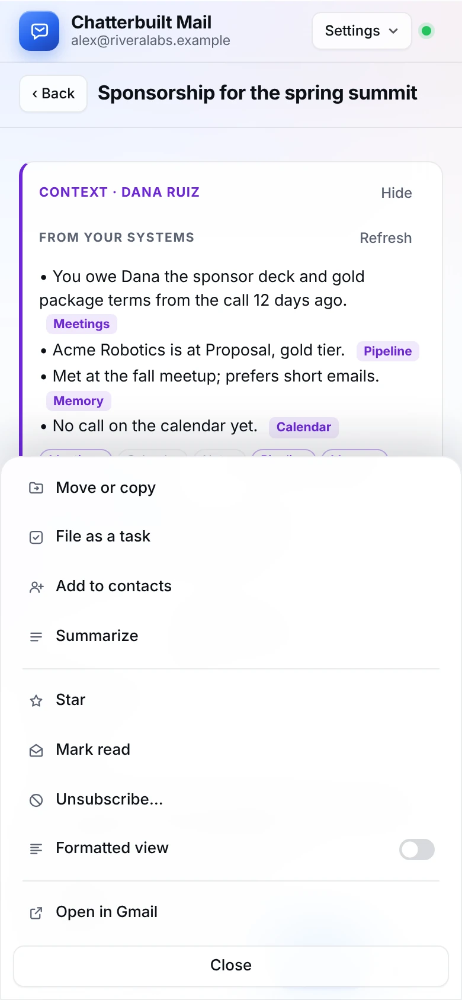
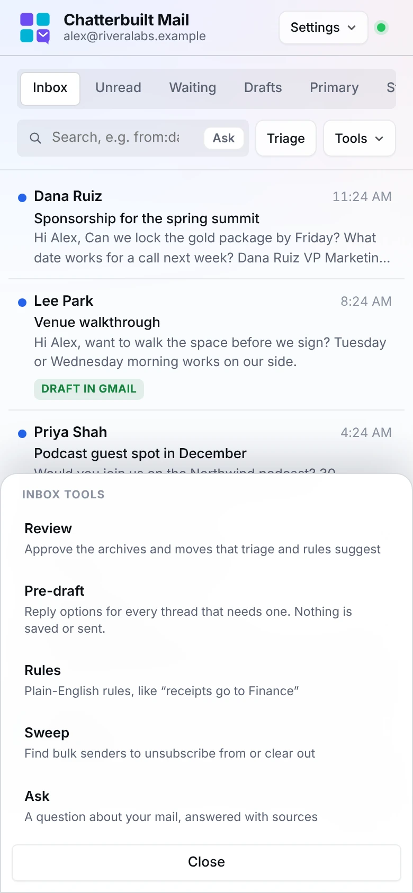
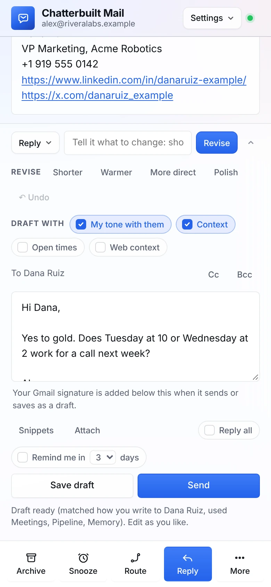
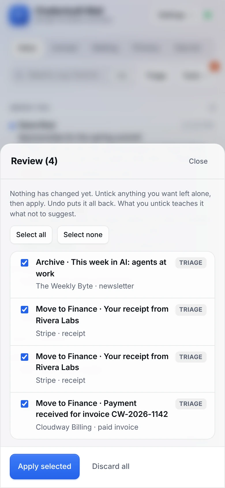

# On a phone

Chatterbuilt Mail works in the Claude app on your phone, and in a phone browser at claude.ai. On a narrow screen it shows one pane at a time and moves the actions to the bottom, where your thumb is.

*Made-up data: Alex Rivera's inbox at Rivera Labs. Inbox, a thread, and Today.*

The phone layout applies at 860 px wide and below, so it also shows on a narrow browser window or a small tablet in portrait.

## How to use it

**The list.** The tab bar at the bottom has four tabs:

| Tab | What it shows |
|---|---|
| **Today** | Drafts waiting in Gmail, what needs you, Review, who owes you a reply, and your next meeting. **Back** returns to the list. |
| **Inbox** | Your inbox, with the same tabs, search, Ask, Triage and Tools as on a computer. |
| **Waiting** | Threads where you sent the last message and nobody has answered. |
| **Tools** | Review, Pre-draft, Rules, Sweep and Ask. A badge counts what's waiting in Review. |

**A thread.** Tap a thread to open it. The list gives way to the thread, with **‹ Back** at the top. The [context brief](context-panel.md) sits at the top of the thread, above the messages, with **More context** and **Next steps** inside it. Tap **Hide** to fold it to one line so the message is right there; tap **Show** to open it again. It stays the way you left it.

 The action bar at the bottom holds what you use most:

| Button | What it does |
|---|---|
| **Archive** | Archive the thread (Undo in the notice) |
| **Snooze** | Snooze, or remind me if no reply |
| **Route** | Suggest where the thread goes, then apply |
| **Reply** | Jump to the reply box and start typing |
| **More** | Everything else, in a sheet |

**More** holds Move or copy, File as a task, Add to contacts, Summarize, Star, Mark read, Unsubscribe, Formatted view and Open in Gmail. **Tools** opens the inbox tools. Both open as bottom sheets with a **Close** button at the bottom, and every item is tall enough to tap.

**Replying.** Tap **Reply** to jump to the reply box. The **Reply** menu, *Draft with* switches, Save draft and Send work as they do on a computer. The action bar hides while you type, so it never covers the box, and comes back when you're done. Send always scrolls clear of the bar.

## Details

- **Review on a small screen.** The Review sheet scrolls, and **Apply selected** stays in view at the bottom, so you can untick the last item on a long list and still apply.
- **Dialogs are sheets.** Add contact, Route, Rules and the others open from the bottom and fill the width.
- **Notices show at the top,** so they never cover Send or the action bar.
- **What's hidden.** The Tasks drop zone (use **More → File as a task**) and the Commands button are hidden on a phone. Keyboard shortcuts still work with a hardware keyboard.
- **No sideways scrolling.** Every screen fits the width of the phone.

## What it touches

The phone layout is the same app with a different arrangement. Every button calls the same connectors as on a computer, needs the same click before anything changes, and is blocked the same way by read-only mode.

## Related

- [Today](today.md) · [Reading and triage](reading-and-triage.md) · [Replying](replying.md)
- [The context panel](context-panel.md) · [More context](more-context.md) · [Route and next steps](route-and-next-steps.md)
- [Following up](following-up.md) · [Organizing](organizing.md) · [Tasks and contacts](tasks-and-contacts.md)
- [Settings and shortcuts](settings-and-shortcuts.md) · [Voice](voice.md)
- [Features](features.md#layout): why the layout is arranged this way
- [Safety and privacy](safety-and-privacy.md) · [Troubleshooting](troubleshooting.md)
