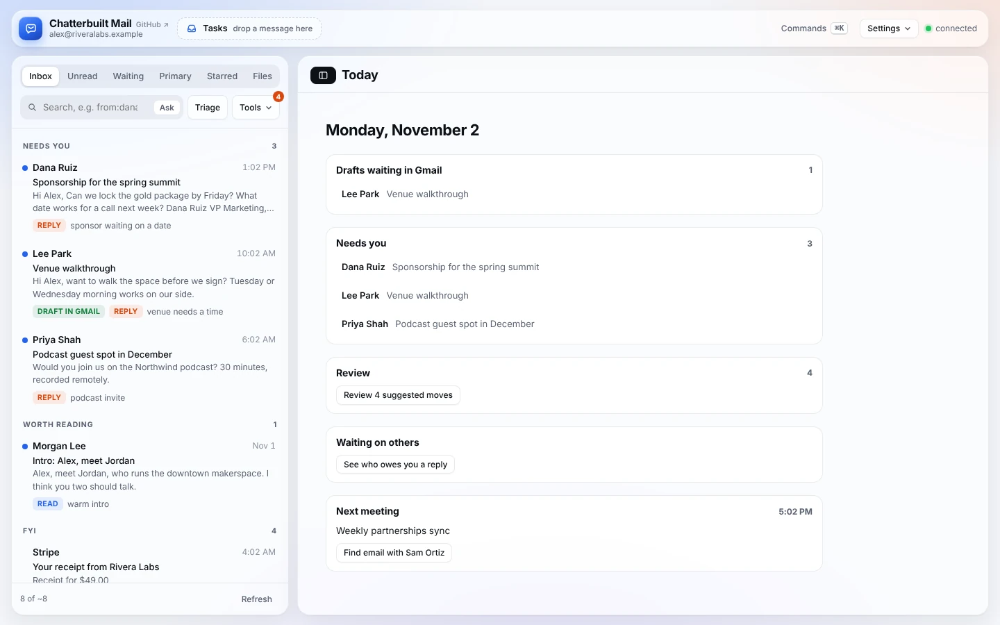
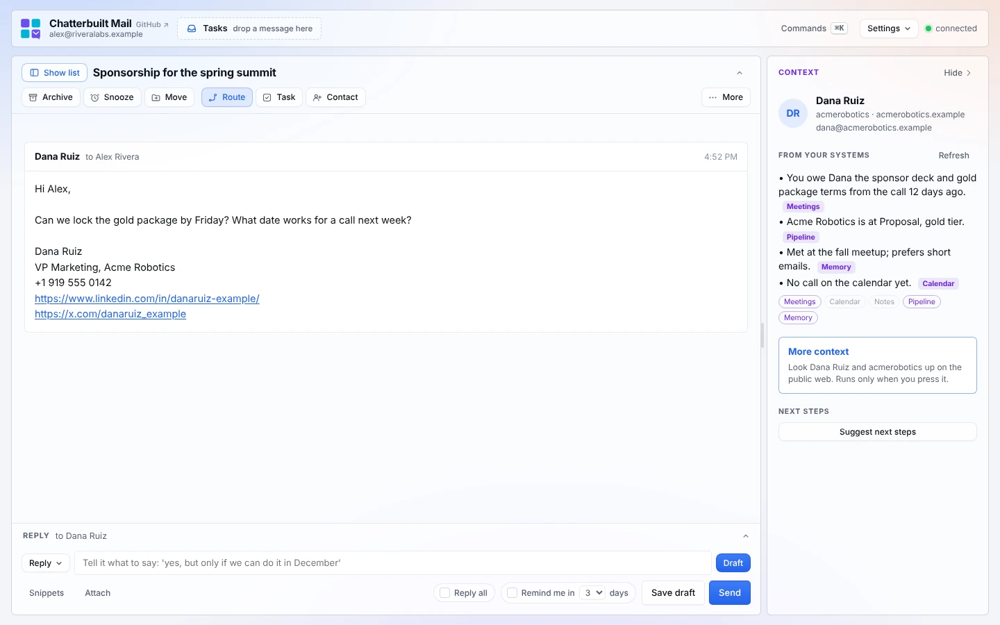
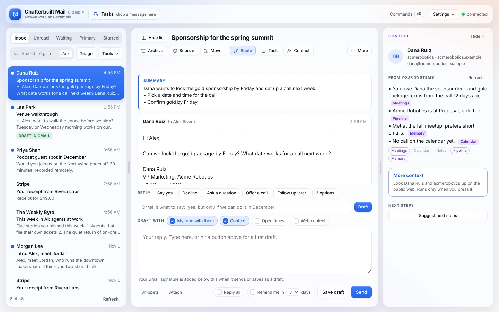
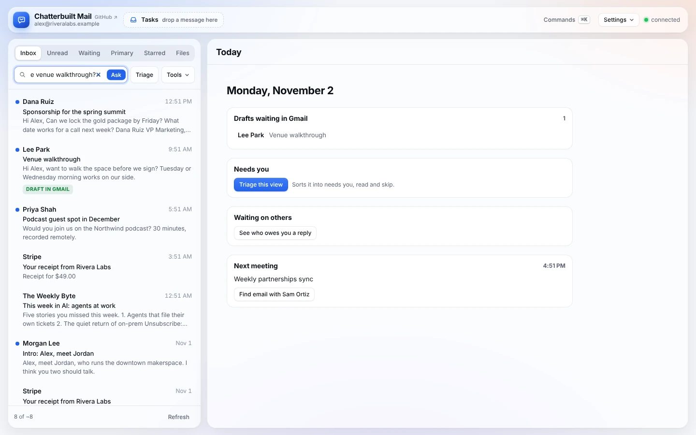
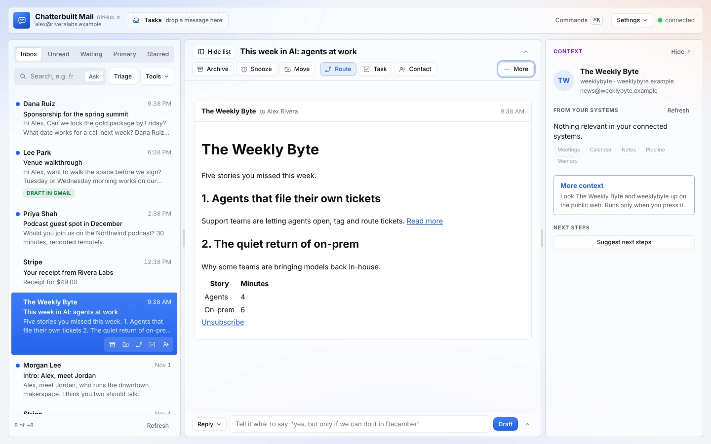

# Reading and triage

The thread list is your Gmail, with previews, unread dots and tags for drafts and waiting replies. **Triage** sorts it into what needs you, what's worth reading and what isn't, and **Ask** answers questions about your mail with sources.

*Screenshots use made-up data.*

## The list

- **Tabs.** Inbox, Unread, Waiting, Primary, Starred and Files. Each one is a Gmail search (Files is `in:inbox has:attachment`). Waiting is different: it lists sent mail nobody has answered. See [following-up.md](following-up.md).
- **Hide the list.** On a computer, **Hide list** at the left of the thread title (or `[`) hides the list so the thread or Today gets the full width. **Show list** brings it back. The app remembers.

  

- **Search.** Type any Gmail query and press Enter: `from:dana newer_than:7d`, `subject:invoice has:attachment`.
- **Rows** fill in their preview, date and unread dot as each thread loads. Tags show **draft in Gmail** when a draft is waiting, and after Triage, **reply**, **read** or **skip** with a short reason.
- **Row buttons.** Hover a row for **More** (move, copy or unsubscribe without opening it) and **Task**. You can also drag a row onto **Tasks** in the top bar.
- **More mail.** The list shows 25 at a time. Scroll to the end, or press **Load older mail**, for the next batch. The footer shows how many are loaded out of Gmail's estimate.

## Triage

Press **Triage** next to the search box. The AI reads the first 40 threads in the view (sender, subject and preview) and marks each one:

- **reply:** a real person is likely waiting on you;
- **read:** worth reading, no reply expected (receipts to file, newsletters you chose, event logistics);
- **skip:** automated, promotional or notification noise.

The list then groups into **Needs you**, **Worth reading** and **FYI**, and each row gets a reason of a few words.

With Review on, Triage also suggests tidying up: archive this, move that to Finance. Those suggestions don't run. They wait in **Tools → Review** for you to approve, and the badge on Tools counts them. It never suggests archiving or moving a thread marked *reply*. See [organizing.md](organizing.md#review-and-undo).

Triage learns. When you untick a suggestion in Review, that's recorded, and **Learn now** turns your corrections into lessons that steer the next Triage. See [self-improving.md](self-improving.md).

## Summarize

Open a thread and press **More → Summarize**. You get two or three sentences on where the thread stands, then anything asked of you as a list.

## Ask your inbox

Ask a question in plain English: "When is the venue walkthrough?"

- **Tools → Ask**, or the **Ask** switch inside the search box. With Ask on, Enter asks instead of searching.
- It writes a Gmail search from your question and shows it, so you can edit it and ask again.
- It reads the top five threads that search finds, then answers using only those, with numbered sources.
- Click a source to open the thread. If the threads don't answer it, it says so and suggests a better search.

![Ask your inbox: the question, the Gmail search it wrote, an answer with [1], and the source](images/ask.webp)

The Ask switch in the search box:

## Formatted view

Messages show as plain text by default. **More → Formatted view** shows them with their links, headings, lists and tables.

Before anything is shown, it removes scripts, styles, forms, images (tracking pixels included) and `javascript:` links. Links open in a new tab, and quoted history folds away. Turn it off from the same menu.

## What it touches

| Feature | Reads | Writes | Sent to the AI |
|---|---|---|---|
| The list and search | Gmail (`search_threads`, `get_thread`) | nothing | nothing |
| Triage | the list you already loaded, your Gmail folder names | nothing (suggestions wait in Review) | sender, subject and preview of up to 40 threads |
| Summarize | the open thread | nothing | the thread |
| Ask | Gmail search results | nothing | your question, then the top five threads |
| Formatted view | the open thread's HTML (`get_thread`, full content) | nothing | nothing |

Opening a thread doesn't mark it read. **More → Mark read** does.

## Related

- [Today](today.md): what to do first
- [The context panel](context-panel.md): what your systems know about the person, beside every thread
- [Replying](replying.md): drafts, 3 options, Pre-draft and the pre-send check
- [Organizing](organizing.md): Review, rules, move, unsubscribe
- [Settings and shortcuts](settings-and-shortcuts.md): keyboard shortcuts and the command palette
- [Features](features.md): every feature in one place
