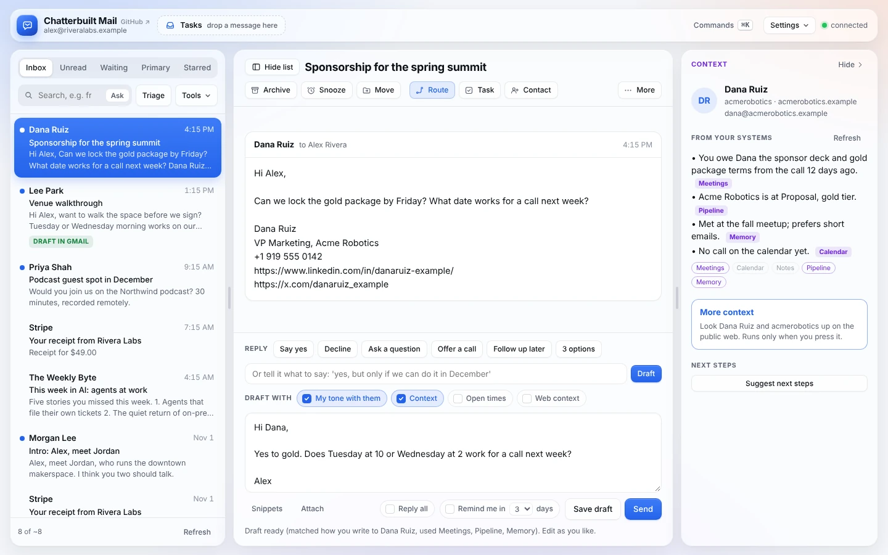
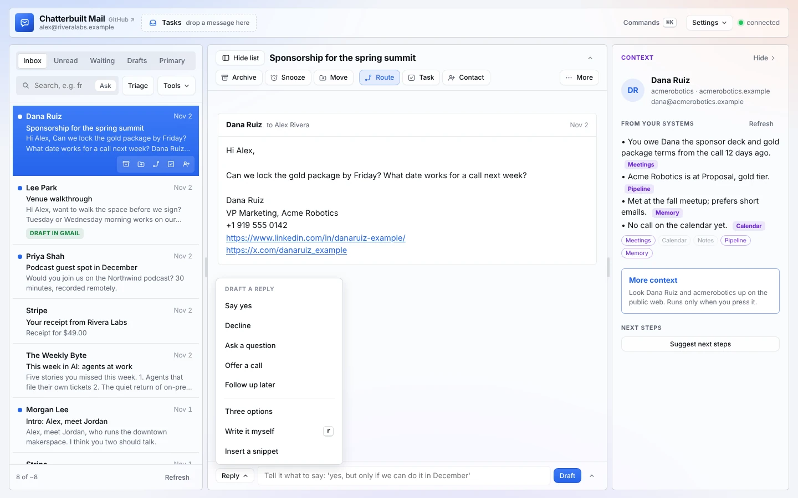
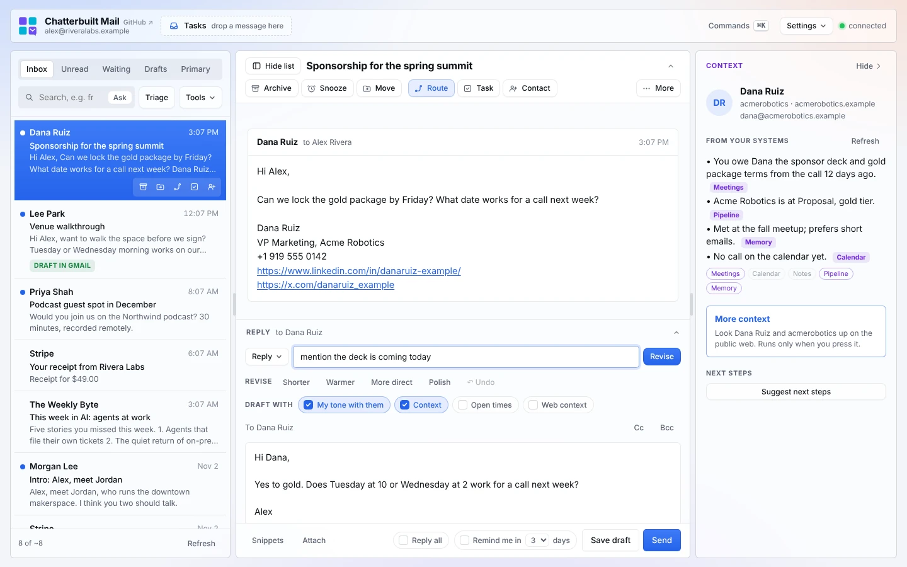
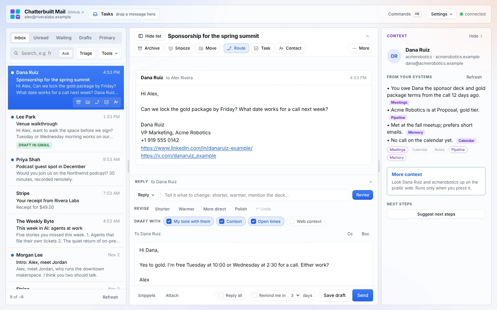
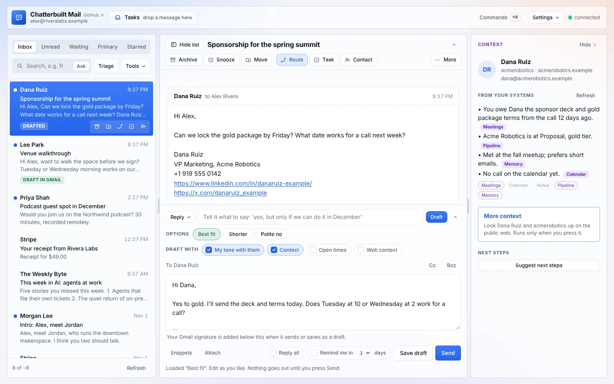
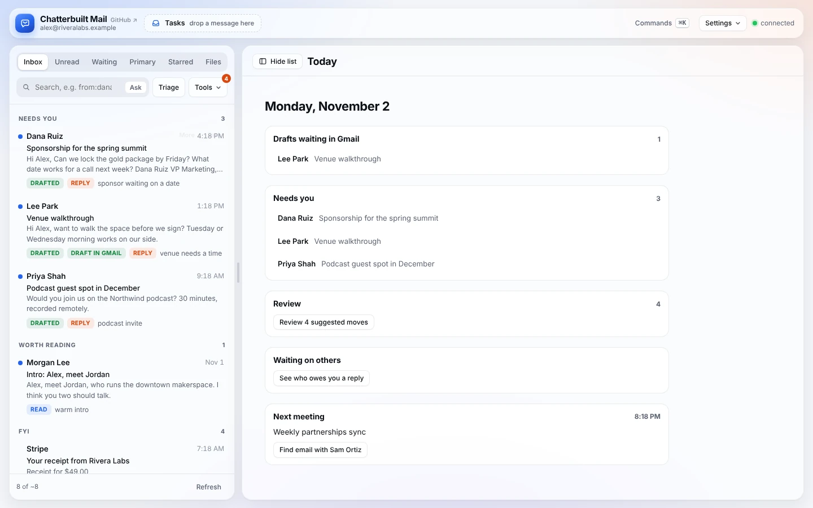
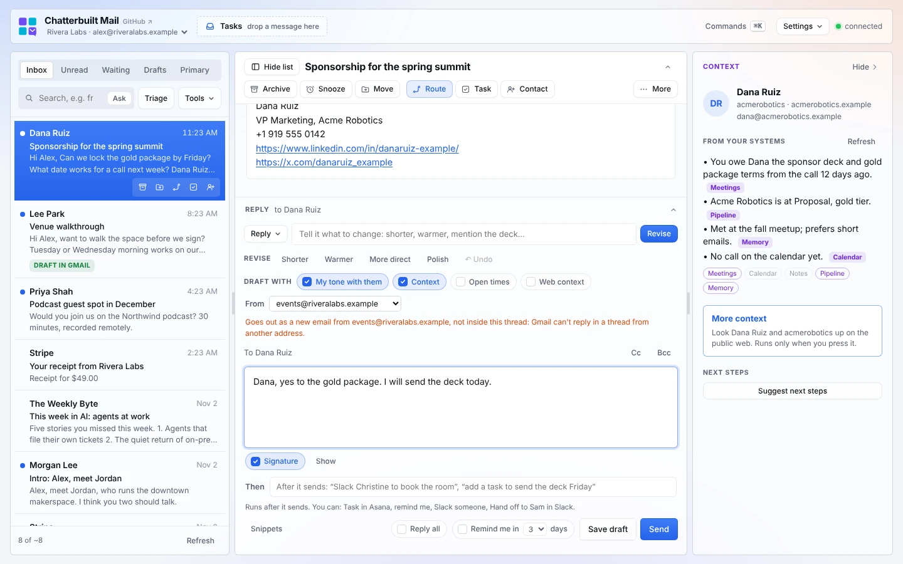

# Replying

Pick a reply from the **Reply** menu or say what you want, and you get a reply in your voice that already knows what your systems know about the person. Before it goes, the **pre-send check** rereads it against the thread and your systems and flags what you missed.

*Screenshots use made-up data.*

## How to use it

1. Open a thread. The reply box sits under the messages, folded to its **Reply** header (with who it's to) and one line: the **Reply** menu, a box for what to say, and **Draft**. It opens up when you use it, so the message keeps the room while you read. Click anywhere on the **Reply** header to open or close it by hand, and the app remembers which you prefer. On a phone, tap **Reply** in the bottom bar.
   - Open, the reply box opens all the way: the thread and your reply scroll together as one page, with the thread's title kept at the top, and the text box grows with what you write instead of scrolling inside itself.

   

2. Pick from **Reply**, or type what the reply should say and press **Draft**:
   - **Say yes:** warm, and specific about what happens next.
   - **Decline:** kind, without over-explaining.
   - **Ask a question:** doesn't commit; asks the one or two things you'd need to know.
   - **Offer a call:** suggests a short call, with your open times.
   - **Follow up later:** acknowledges it and says roughly when you'll come back to it.
   - **Your own words:** "yes, but only if we can do it in December."
3. Work on it until it's right. With a draft in the box, the button says **Revise**: type what to change ("shorter", "mention the deck is coming today", "move the call to Thursday") and it rewrites the draft you have instead of starting over. **Shorter**, **Warmer**, **More direct** and **Polish** do the common ones in a click, and **↶ Undo** steps back through the last ten versions. Edit by hand at any point; your edits are how it learns ([self-improving.md](self-improving.md)).

   

4. Press **Send**. The pre-send check runs, then you confirm. Or press **Save draft** to put it in Gmail Drafts.

Under the draft, a line says what went into it, for example: *matched how you write to Dana Ruiz, used Meetings, Pipeline, Memory*.

## Draft with

The switches under the instruction box decide what the draft uses:

| Switch | What it adds | Default |
|---|---|---|
| **My tone with them** | Reads up to three of your earlier emails to this person and matches the greeting, length, formality and sign-off. | On |
| **Context** | The [context panel](context-panel.md)'s brief: open commitments, pipeline status, meetings. | On |
| **Open times** | Three open 30-minute slots from your calendar. | Off; **Offer a call** turns it on |
| **Web context** | The [More context](more-context.md) web lookup. It can be ticked only after you've pressed More context and it found something. Citations are stripped. | Off |

### Open times

- It reads the next seven days from Google Calendar and finds three open 30-minute slots inside your working hours (`CONFIG.workHours`), preferring around 10:00 and 2:00 on different days.
- It skips declined, cancelled and all-day events.
- Only the free times go to the AI, never event names, people or locations.

## Three options

**Three options**, in the **Reply** menu, writes three versions side by side: **Best fit**, **Shorter** and **Polite no**. Click one to load it into the reply box. If the thread doesn't need a reply (a newsletter, a receipt, an FYI), it says so instead of inventing one.

On a thread where you had the last word, the three are follow-ups instead: **Friendly nudge**, **Shorter**, and **Close the loop**. See [following-up.md](following-up.md).

## Pre-draft

**Tools → Pre-draft** writes the three options for up to eight threads marked *reply*, two at a time, so they're ready when you open each one. It runs Triage first if you haven't. Threads get a **drafted** tag. Nothing is saved to Gmail or sent.

For drafts that land in Gmail before you even open the app, use the [morning run](morning-run.md).

## The pre-send check

When you press **Send**, the AI rereads your reply against the thread and flags:

- questions or requests you didn't answer;
- names, dates, times, numbers or prices that don't match the thread;
- commitments you might not mean to make;
- an attachment you mention but haven't attached;
- reply-all or wrong-recipient risk, or something confidential going to the wrong person;
- tone that could land badly;
- typos, and breaks of your writing rules (`CONFIG.rules`).

With the context panel on, it also flags a reply that contradicts what your systems say, or that forgets a commitment in the brief. Here it catches the deck promised on the last call:

Then you choose:
- **Use suggested version** puts its rewrite in the reply box (it keeps your wording wherever it can), so you can read it over and press Send again;
- **Send anyway** sends what you wrote;
- **Cancel** goes back to editing.

If nothing is wrong, it says so and asks you to confirm. If the check can't run, you can still send. While it runs, **Send without checking** skips it. You can turn the check off in **Settings → Skills**.

## From: which address it goes from

With Gmail through Composio, a **From** menu sits over the recipients. It lists every address you can send from: each connected account's own address and the aliases you've set up in Gmail under Settings → Accounts → **Send mail as**, grouped by account.

- It starts on the thread's own address, and **Send** is a normal reply in the thread.
- Pick another address and the reply goes out from there as a new email, with "Re:" and the thread's subject, to the same people (Reply all and your Cc and Bcc included). The line under the menu says so, and so does the send confirmation. Gmail can't reply inside a thread from another account or alias, so that conversation starts fresh for them.
- **Show** under the reply box previews the signature of the address you picked.
- **Save draft** from another account saves the draft in that account. Drafts can't be saved from an alias here; send it, or pick the account's own address.
- The next thread starts on its own address again.

With the Gmail connector there's one account and no aliases to pick, so the menu doesn't appear.

*Made-up data.*

## Everything else in the reply box

- **Work on it in chat:** in **More** above the thread, this copies a short pointer to the thread (subject, sender, account, thread id). Paste it into a Claude chat, work the reply out there, and ask Claude to save it as a Gmail draft in the thread. Back here, open the thread: the **draft waiting in Gmail** banner offers **Load it**, and **Send** sends it (and removes the draft). The page checks for new drafts each time you open a thread.
- **Snippets:** reusable text you insert at the cursor (the foot of the reply box, or **Reply → Insert a snippet**), with `{{firstName}}` and `{{myName}}`. See [voice.md](voice.md#snippets).
- **Your Gmail signature:** Gmail adds the signature you set in Gmail (Settings → Signature) to every reply, draft and forward, with its formatting, links and images. Each account uses its own.
  - **Signature** under the reply box is on by default. Switch it off to leave the signature off one message; the next thread starts with it on again.
  - **Show** previews the signature that will go on, read from Gmail: through Composio from the account's settings (the From address's own signature when it has one), and with the Gmail connector from the newest message you sent that carries one. Remote images show by their alt text in the preview; the real email gets the real images.
  - If your drafts already end with a signature block, switch it off for that message, or turn **Gmail signature** off in Skills so you don't get two.
- **Attach:** files on a reply, a follow-up or a Gmail draft, up to 18 MB in total. For bigger files, share a Drive link. (Not available yet when Gmail goes through Composio.)
- **Reply all:** off by default. The pre-send check warns when reply-all looks risky. The line above the reply says who it goes to.
- **Cc and Bcc:** press **Cc** or **Bcc** above the reply and start typing a name. Suggestions come from the people in your threads and, when it's set up, your address book (Google Contacts). **Enter**, **Tab** or a comma adds someone; **×** or Backspace removes them. The confirmation before sending and the pre-send check both name everyone on Cc and Bcc. With reply-all on, the people already on Cc stay on it. Cc and Bcc also go with **Save draft**.

  
- **Remind me in N days:** if nobody answers by then, the thread comes back to your inbox. See [following-up.md](following-up.md).
- **Drafts waiting in Gmail:** when a thread already has a Gmail draft, a banner offers **Load it**. Sending then replaces that draft, so you don't end up with a stray copy.
- **Send** always asks you to confirm.

## What it touches

| Step | Reads | Writes | Sent to the AI |
|---|---|---|---|
| Drafting | the thread; your sent mail to this person (tone); the context brief; your calendar (open times only) | nothing | the thread, your voice and lessons, the brief, free time slots |
| Save draft | | a Gmail draft (`create_draft`, with your Gmail signature unless it's switched off) | |
| From | the addresses you can send from (`GMAIL_LIST_SEND_AS` for each account, once per session) | nothing | nothing |
| Send from another address | | a new email from that address (`GMAIL_SEND_EMAIL` with `from_email`, on that account) | the reply and thread, for the pre-send check |
| Show signature | your signature: Gmail settings through Composio (`GMAIL_LIST_SEND_AS`), or your newest signed sent message with the Gmail connector (`search_threads`, `get_thread`) | nothing | nothing |
| Send | | the reply (`reply`), or a new message threaded under your last one when you're following up (`send_message`), with any Cc and Bcc | the reply and thread, for the pre-send check |
| Cc and Bcc suggestions | the threads you've loaded; your address book's search, when one is set up | nothing | nothing |

Read-only mode blocks Save draft and Send. Nothing is sent without your confirmation.

## Related

- [Drafts](drafts.md): go through every Gmail draft one at a time, with a rich-text editor and a review checklist

- [Voice](voice.md): your voice prompt, per-recipient tone, snippets
- [The context panel](context-panel.md): where the brief comes from
- [Following up](following-up.md): Nudge, Waiting, Remind me
- [Self-improving](self-improving.md): how your edits become lessons
- [Morning run](morning-run.md): drafts in Gmail before you start
- [Features](features.md): every feature in one place
