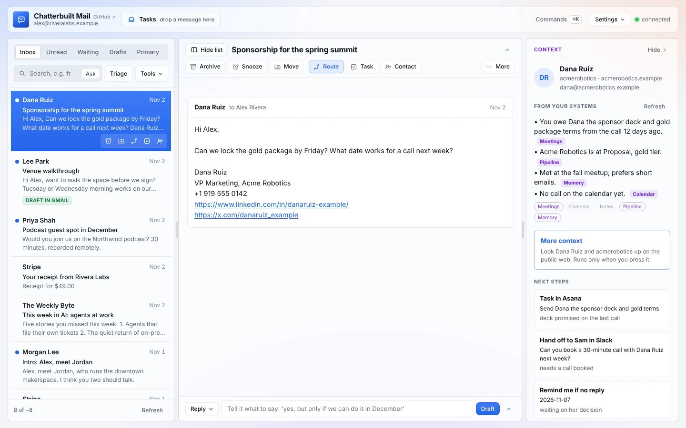
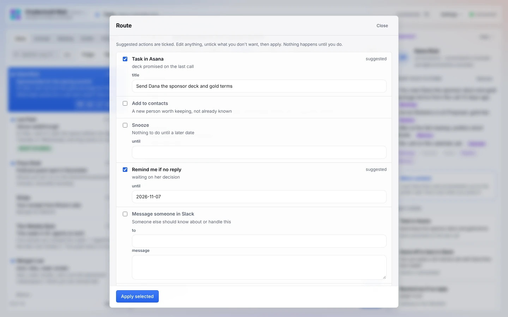

# Route and next steps

**Route** asks where a thread should go across your systems (a task, a Slack handoff, a contact, a snooze, a reminder) and writes the text for each. Suggestions arrive ticked and filled in; nothing runs until you press **Apply selected**.

*Made-up data: Alex Rivera at Rivera Labs, replying to Dana Ruiz at Acme Robotics.*

## How to use it

There are two ways in. Both ask the same question once.

**From the panel.** Press **Suggest next steps** at the bottom of the context panel. The suggestions show in place: what each action is, the text it would use, and a short reason ("deck promised on the last call"). Then:
- **Review and apply** opens Route with those suggestions already filled in, so nothing is asked twice.
- **Suggest again** asks for a fresh set.

**From the toolbar.** Press **Route** above the thread, or `o`. If you already asked for next steps on this thread, Route opens with them. Otherwise it works them out first.

In Route:

1. Suggested actions are ticked and marked *suggested*, with their fields filled in.
2. Edit any field. Untick what you don't want. Tick anything it didn't suggest and fill it in yourself.
3. Press **Apply selected**. Each action shows **done ✓** or the reason it failed, and a line at the bottom counts how many went through.

If nothing in the thread clearly needs routing, Route says so and leaves everything unticked. Tick anything you want anyway.

## The actions

Route always offers these when their features are on:

| Action | What it does | Field it fills |
|---|---|---|
| **Task in** *your task app* | Files a task through `CONFIG.tasks`, with a link back to the thread | `title`: a short task starting with a verb |
| **Add to contacts** | Opens Add contact for this person once the others finish | none |
| **Snooze** | Takes the thread out of the inbox until a date | `until`: a date |
| **Remind me if no reply** | Brings it back on a date if nobody has answered | `until`: a date |

### Message someone in Slack

With the Slack connector and `slack: true`, Route also offers **Message someone in Slack**. The AI suggests who should get it and what to say; you can change both. Type a person's full name or a `#channel`. On Apply, the page looks them up in Slack and leaves the message there as a **draft**, with a link to the email, for you to send from Slack. It never sends.

### Custom actions

Everything else is yours to describe. *"Hand off scheduling to Christine in Slack."* *"Log sponsor emails as deals in HubSpot."* *"Open a ticket in Linear for bug reports."* At the bottom of Route, **Add a custom action…** takes a sentence like that and copies it as a setup request; paste it into a chat with Claude, and the setup skill builds the action and republishes your copy. Or just ask Claude directly.

Each custom action lives in `CONFIG.actions` and names a connector tool, the fields the AI should write (`ai`), and when it applies (`when`). The AI only suggests an action when its `when` fits. See [connectors.md](connectors.md#route-actions) for the format.

## Then, from the reply box

The same actions run from the reply box: type what should happen on the **Then** line ("Slack Christine to book the room") and they run after the reply sends, once you've confirmed. See [Replying](replying.md#then-what-happens-after-it-sends).

## How it decides

The AI reads the thread (newest last), the brief from your [context panel](context-panel.md), and the raw records behind it, then picks only the actions the thread clearly calls for. Zero is a fine answer. Because it sees the raw records, an action can use an ID from a lookup, such as a pipeline row or a CRM contact, when you tell it to fill one in.

More context from the web isn't part of this. Route works from your own systems.

## Before you apply a handoff

Prefer tools that leave a draft or a note for you to finish over ones that act on other people directly. A Slack draft, a CRM note or a task is safe to apply in one click. A sent message is not something Undo can take back.

This matters with Composio: its `SLACK_SEND_MESSAGE` **sends** the message. It doesn't leave a draft the way the native Slack connector's draft tool does. You still see and edit the text in Route before you apply it.

## What it touches

- **Calls:** the AI to suggest; then, for what you tick, your task app (`CONFIG.tasks`), Gmail labels for snooze and remind-me (`create_label`, `label_thread`, `unlabel_thread`), Slack (`slack_search_users` or `slack_search_channels`, then `slack_send_message_draft`) and the connector tools in `CONFIG.actions`.
- **Writes:** only what you tick, only when you press Apply selected.
- **Read-only mode** greys out Route and blocks Apply selected. Route still opens and suggests, with a note at the top that nothing will be applied.
- **Turn it off:** Settings → Skills → **Route**. That also removes Next steps from the panel.

## Related

- [The context panel](context-panel.md): what Route reads
- [Tasks and contacts](tasks-and-contacts.md)
- [Following up](following-up.md): snooze and remind-me in detail
- [Connectors](connectors.md#route-actions): `CONFIG.actions`
- [Composio](composio.md): actions through one connector
- [Safety and privacy](safety-and-privacy.md)
- [Features](features.md) · [Configuration](configuration.md) · [Troubleshooting](troubleshooting.md)
