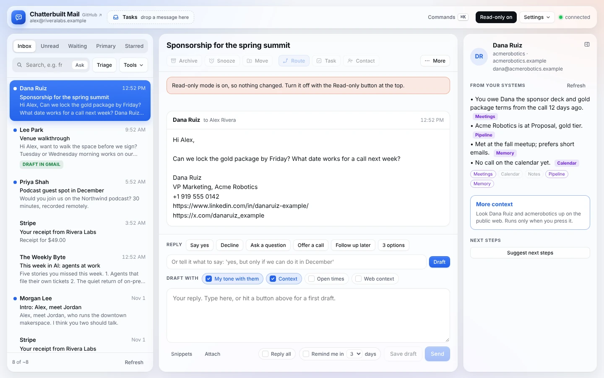
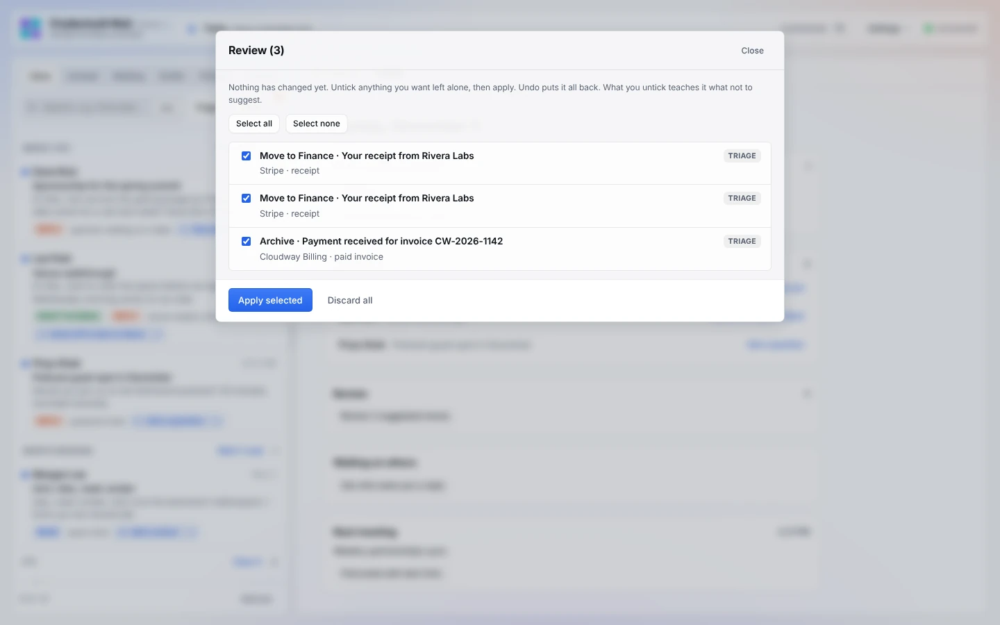

# Safety and privacy

## Nothing happens without a click

*Read-only mode on, after pressing Archive. Screenshots use made-up data.*

- **Sending.** Send always shows a confirmation. With the pre-send check on, that confirmation includes the check's findings. Forwarding and unsubscribe-by-email confirm too.
- **Moving.** Archives and folder moves you suggest by hand happen on your click and can be undone. Moves suggested by AI (triage, rules) wait in **Review** until you apply them.
- **Rules.** Rules never act on their own, even when they check new mail automatically. Matches go to Review.
- **Pre-drafts.** These stay on the page. Nothing goes to Gmail until you save or send.
- **Sweep.** Archive all needs a second click to confirm. It is capped at 100 threads and can be undone.
- **Route.** Suggested actions are ticked, never applied. Each one runs only when you press Apply selected.
- **Snooze and remind-me** are Gmail labels you set. The app and the morning run bring threads back; nothing is deleted.
- **Morning run.** It can only create Gmail drafts and change its own `CB/` labels. It never sends, archives, deletes or writes to another system. See [morning-run.md](morning-run.md).
- **Review** holds every AI-suggested archive and move until you apply it, and Undo puts them back:

  

- **Read-only mode** blocks every send, label change, draft, forward, task, contact, snooze and Route action at the code level. Every call that could change something is refused while it's on.

## What goes where

- **Your connectors, your sign-in.** The page calls Gmail, Calendar, Notion, Clay, your task app and OpenRouter through your claude.ai connectors. It never sees a password or token.
- **The model.**
  - With Claude selected, prompts go to Claude through claude.ai.
  - With an OpenRouter model selected, prompts go to that provider through OpenRouter, under OpenRouter's and the provider's terms.
  - Prompts contain the thread you're working on, plus:
    - your earlier emails to that person, when tone matching is on;
    - free time slots, when calendar times are on;
    - signature text, for contacts;
    - a few sent emails, when you train your voice;
    - trimmed results from your context sources (meeting notes, calendar entries, task and pipeline rows, memory), when the context card is on.
- **Calendar times.** For open times, only free slots reach the model. Event names, people, locations and notes stay on the page.
- **Context sources.** These are different by design: their results do go to the model, so it can brief you. Event descriptions, meeting links, HTML bodies and similar fields are dropped first, and long text is cut. Choose sources you're comfortable sending to the model you use, and leave out any you're not.
- **Enrichment.** Clay, or the enrichment app you set up, is called only when you press Enrich, and it uses your credits there. The person's name, email and company domain go to that app. Its answer goes to the model so it can fill the contact fields.
- **Address book.** Saving a contact writes one record to your address book (Google Contacts through Composio, or the app you picked). Cc and Bcc suggestions search it as you type; nothing is written.
- **Slack.** **Message someone in Slack** looks the person or channel up and leaves a draft in your Slack. It never sends.
- **More context.** Runs only when you press it. The person's name, company and email domain go to your web search provider; nothing from the email does. The results are kept apart from your systems' context and only go into a draft if you switch on Web context.
- **Attachments.** Opening one reads the message source through your Gmail connection and shows it in the page. Nothing from it goes to the model. PDFs are drawn with pdf.js, a script loaded from cdnjs.cloudflare.com; the file itself never leaves the page. **Save** asks before it downloads anything.
- **Next meeting (Today).** The title and time are shown on the page only; they are never sent to the model.
- **Your browser.** Voice edits, rules, lessons and switches are stored in that browser's local storage for this artifact. Clearing site data clears them. Copy for Claude is the backup.
- **Sharing.** The artifact is private to you. If you share it, the other person uses their own connectors and sees their own mail, never yours. Your browser-stored lessons don't travel with the link.

## Forks and memory files

- Your email memory file describes how you work. If it holds anything personal, keep it in a **private** repo or a private cloud folder.
- A GitHub fork of a public repo is public. See [getting-started.md](getting-started.md) for making a private copy.

## Known limits

- Attachments are capped at 18 MB per message.
- claude.ai's Gmail connector reaches one mailbox. For several, use Gmail through Composio (see [composio.md](composio.md#gmail-through-composio-several-accounts-in-one-copy)); that gives the page Composio's wider permission. "Copy to account" forwards a message as a new email; it isn't a label-for-label copy.
- Attaching files to a reply isn't available yet when Gmail goes through Composio.
- One-click unsubscribe (the POST kind) can't be sent from a web page, so the page opens the sender's own unsubscribe page instead.
