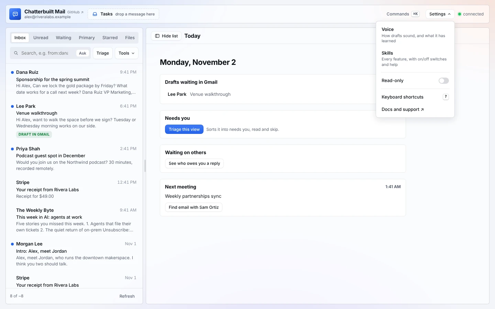
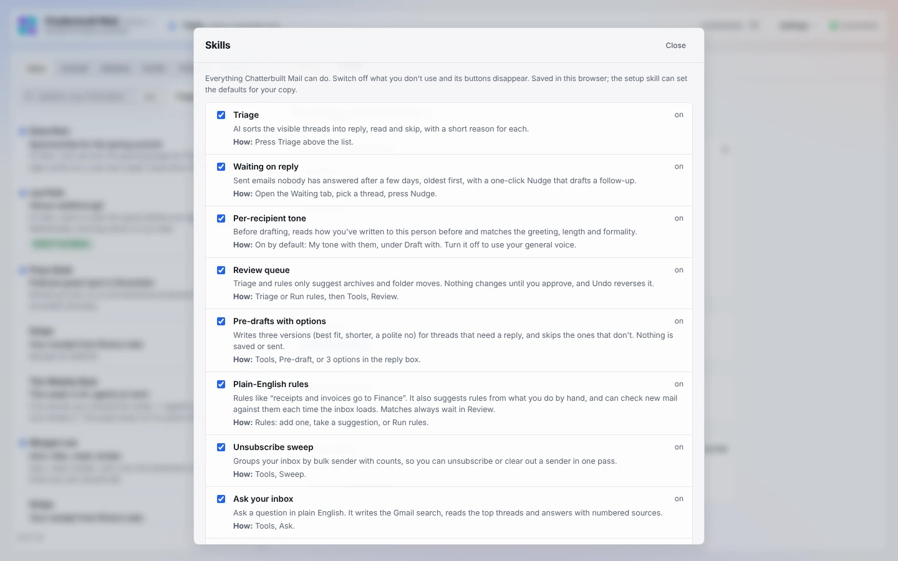
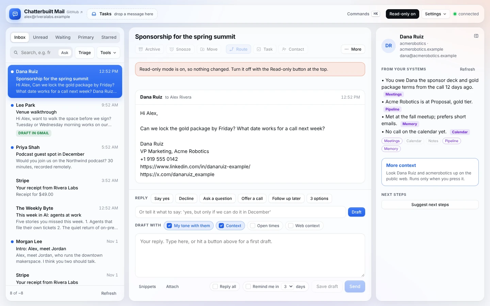
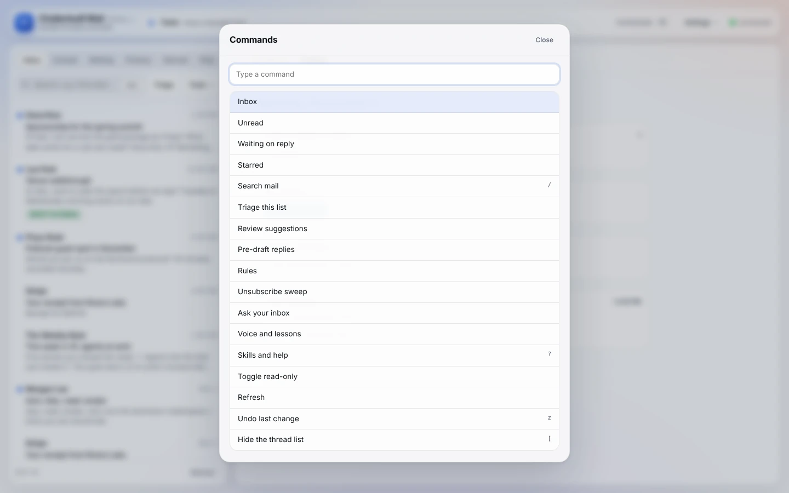

# Settings and shortcuts

Everything that controls the app itself sits in one **Settings** menu in the top bar: voice, the on/off switch for every feature, read-only mode, the model, and help. The keyboard and the ⌘K command palette reach every action without the mouse.

*Made-up data: Alex Rivera's inbox at Rivera Labs.*

## The Settings menu

| Item | What it does |
|---|---|
| **Voice** | How drafts sound, and what the app has learned from your edits. See [voice.md](voice.md). |
| **Skills** | Every feature with a description, how to use it, and an on/off switch. |
| **Accounts** | Gmail through Composio only. A color for each account (it tints that account's rows in All inboxes) and which accounts All inboxes shows. Saved in this browser; Copy for Claude carries it into your copy. See [composio.md](composio.md#gmail-through-composio-several-accounts-in-one-copy). |
| **Read-only** | A switch that blocks every change. See below. |
| **Model** | Which model drafts and sorts. Shows only when your copy lists extra models. |
| **Keyboard shortcuts** `?` | Opens Skills at the keyboard list. |
| **Docs and support ↗** | These docs on GitHub. The bottom of **Skills** also shows your version number, which is handy for a bug report, and points to `chatterbuilt-mail-feedback`. |

## Skills: switch off what you don't use

Open **Settings → Skills**, or press `?`. Each row has the feature's name, what it does, and **How** to use it. Untick one and its buttons disappear right away; tick it to bring them back. A feature that needs a connector you haven't set up shows *needs setup* and says what's missing.

The list covers: Triage, Waiting on reply, Per-recipient tone, Review queue, Pre-drafts with options, Plain-English rules, Unsubscribe sweep, Ask your inbox, Calendar-aware replies, Add to contacts, Voice, Self-improving, Tasks, Move and copy, Unsubscribe, Pre-send check, Context from your systems, More context, Today, Route, Snooze and remind-me, Drafts waiting in Gmail, Snippets, Gmail signature, Attachments, Formatted view, and Keyboard shortcuts.

Below the list are the keyboard shortcuts, a short safety note, and links to the docs and to GitHub issues. **Reset to defaults** turns everything back to how your copy ships.

Your switches are saved in this browser. To change the defaults for every browser, ask Claude to run `chatterbuilt-mail-setup` and set `features` in your copy. See [configuration.md](configuration.md).

## Read-only mode

Turn on **Settings → Read-only** for a demo, a screen share, or a careful first run.

- A dark **Read-only on** button appears in the top bar. Click it to turn read-only off.
- Buttons that change something are greyed out: Archive, Snooze, Move, Route, Task, Contact, Star, Mark read, Save draft, Send, the snooze and remind-me choices, and the apply and save buttons in dialogs. The same goes for the phone's action bar and More sheet.
- Route and Contact still open. Route shows its suggestions and Contact fills in the form and offers Copy as vCard, and both say at the top that saving is off.
- If you try one anyway, nothing changes and a banner says so: "Read-only mode is on, so nothing changed."
- Nothing can be sent, moved, labeled, saved as a draft, filed as a task, saved as a contact or routed.
- Reading, summaries, Triage, Ask, the context panel, More context and drafting on the page all still work. Drafts just stay on the page.

To start every session in read-only, set `readOnly: true` in your copy.

## Model

Claude does the drafting, triage, briefs and checks by default, through your own Claude plan. To offer other models (GPT, Gemini, GLM and more), add them to `models` in your copy; they run through the OpenRouter connector. A **Model** picker then appears in Settings. Your choice is saved in this browser. See [configuration.md](configuration.md) and [connectors.md](connectors.md#models).

## Command palette

Press **⌘K** (Mac) or **Ctrl K** (Windows, Linux), or click **Commands** in the top bar. Type a few letters to filter, use the arrow keys to pick, and press Enter.

It lists every action that's switched on: the views (Inbox, Unread, Waiting on reply, Starred), search, Triage, Review, Pre-draft, Rules, Sweep, Ask, Voice and lessons, Skills and help, Toggle read-only, Refresh, Undo, showing or hiding the thread list, **Reset pane sizes** once you've dragged a pane wider or narrower, and **Switch to …** for each of your other accounts when Gmail goes through Composio. With a thread open it adds the thread actions too: Route, Snooze, Formatted view, Insert a snippet, Refresh context, Summarize, Archive, Star, Move, Unsubscribe, Three reply options, Add to contacts and File as a task. Each command shows its shortcut when it has one.

## Keyboard shortcuts

| Key | Action |
|---|---|
| `j` / `k` | Next / previous thread |
| `Enter` | Open the selected thread |
| `e` | Archive |
| `s` | Star or unstar |
| `m` | Move to folder |
| `t` | File as a task |
| `c` | Add sender to contacts |
| `o` | Route to your systems |
| `b` | Snooze or remind me |
| `r` | Jump to the reply box |
| `/` | Search |
| `z` | Undo the last change |
| `[` | Show or hide the thread list |
| `]` | Show or hide context: the side panel on wide screens, the card at the top of the thread otherwise |
| Arrow keys on a pane grip | Resize that pane. Shift moves 64 px instead of 16; Home and End go to the limits |
| `⌘K` / `Ctrl K` | Command palette |
| `?` | Shortcuts and skills |
| `Esc` | Close a menu or dialog |

Shortcuts don't fire while you're typing in a box. Turn them off in Skills (**Keyboard shortcuts**) if they get in your way; that also turns off the palette's ⌘K.

## What it touches

- **Settings, Skills, Accounts, Model and the palette** change nothing outside this browser. Switches and the model choice are saved in browser storage.
- **Read-only** blocks every write the page can make: Gmail sends, replies, drafts, labels, moves and forwards; tasks; contacts; and Route actions.
- To make settings permanent across browsers, use the setup skill or **Voice → Copy for Claude** with the improve skill.

## Related

- [Voice](voice.md): the Voice item in Settings
- [Configuration](configuration.md): `features`, `readOnly`, `models`
- [Safety and privacy](safety-and-privacy.md): read-only and what needs a click
- [Phone](phone.md): Settings and menus as bottom sheets
- [Features](features.md) · [Connectors](connectors.md) · [Composio](composio.md) · [Troubleshooting](troubleshooting.md)
