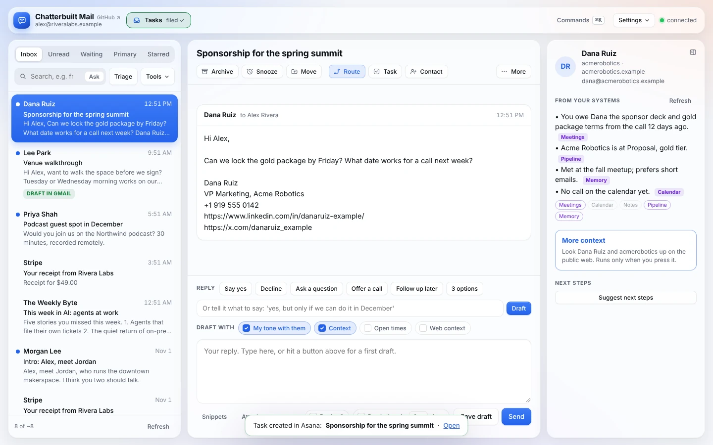
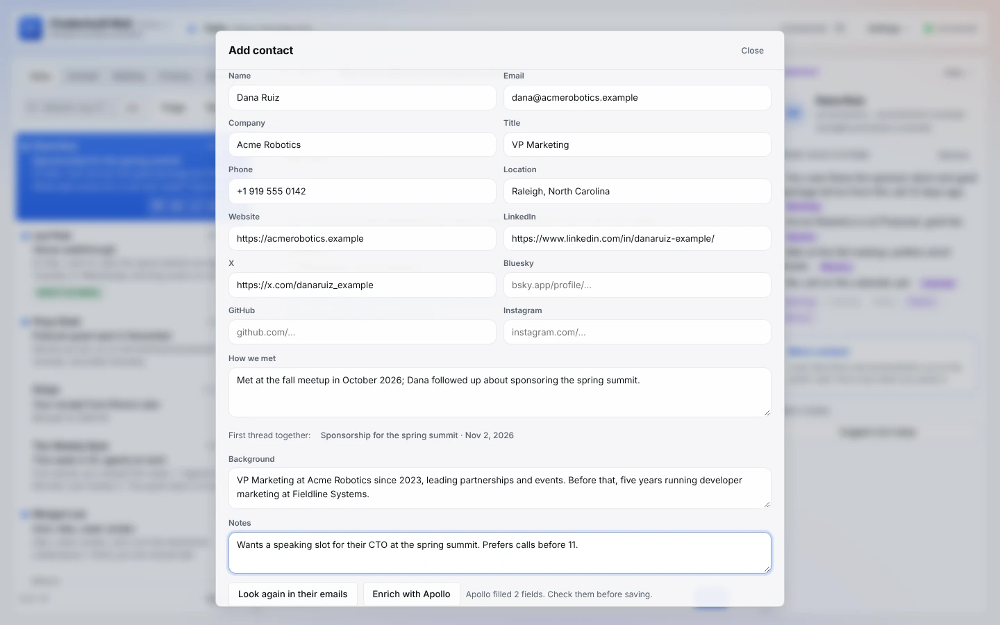
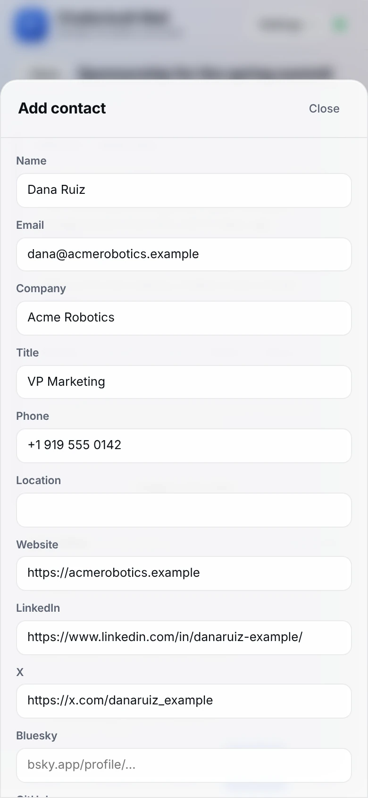

# Tasks and contacts

Turn an email into a task in your task app, or a person into a contact, in one step from the thread. Both work with any app that has a claude.ai connector, or through Composio.

*Made-up data: Alex Rivera at Rivera Labs, filing a task from Dana Ruiz's email.*

## Tasks

### How to use it

Any of these files the open thread as a task:
- press **Task** above the thread;
- press `t`;
- click **Tasks** in the top bar;
- drag a thread from the list onto **Tasks** in the top bar. You can also drag a single message by its header, to file that message instead of the newest one.

The drop zone lights up while you drag, shows *filing…*, then *filed ✓*. A notice names the task and, when your task app hands back a link, adds **Open**.

### What gets filed

The task's title is the email's subject without Re: or Fwd:. What else goes in depends on how your copy maps the fields, but these are available:

| Value | What it is |
|---|---|
| `{{title}}` | Subject without Re:/Fwd: |
| `{{from}}`, `{{fromName}}`, `{{fromEmail}}` | The sender |
| `{{date}}`, `{{dateISO}}`, `{{today}}` | When it was sent, and today |
| `{{url}}` | A link back to the message in Gmail |
| `{{excerpt}}` | The message without quoted history, up to 1,500 characters |
| `{{body}}` | From, subject and date, the message quoted, and an Open in Gmail link (Markdown) |
| `{{text}}` | The same as plain text |
| `{{notes}}` | "Email from … · date" |

From **Route**, the AI writes a better title, starting with a verb ("Send Dana the sponsor deck and gold terms"), and you can edit it before applying. See [Route and next steps](route-and-next-steps.md).

If tasks aren't set up, Task tells you to ask Claude to run `chatterbuilt-mail-setup` and name your task app.

## Contacts

### How to use it

Press **Contact** above the thread, or `c`. If several people are on the thread, pick one from **Who**. The dialog fills itself in while you watch:

- **From their emails.** It reads the emails they've sent you (this thread plus up to four more) for their signature: name, title, company, phone, website, location. Social links are picked up by pattern: LinkedIn, X, Bluesky, GitHub, Instagram. A note says how many fields it filled and from how many emails. **Look again in their emails** reruns it.
- **How we met.** It finds your earliest thread together and writes a one- or two-sentence note: month and year, who reached out, what it was about, and who introduced you. **First thread together** links that thread.
- **Background and notes.** Background holds a work-history summary; Clay can fill it. Notes is for anything else.
- **Already there?** If your contacts app has a duplicate check, the dialog warns when the email is already on file, links the record, and asks before saving a second entry.
- **Enrich with Clay** (when `clay: true`). It looks the person up in Clay by name and company website and adds title, company, location, social profiles and a work-history summary. It uses Clay credits and runs only when you press it.

Every field is editable. Fields are only filled when empty, so your edits stay. Press **Save to** *your contacts app*, or **Copy as vCard** if you don't have one connected.

No-reply and notification addresses aren't offered as people to add.

On a phone, Add to contacts is under **More** and opens as a sheet.

## Any task app or CRM

Both use the same adapter shape in `CONFIG.tasks` and `CONFIG.contacts`: a connector, a tool, and its arguments with `{{placeholders}}`. That covers Notion, Asana, Basecamp, Linear, Todoist, HubSpot and anything else with a create tool. The setup skill reads the connector's own schema and writes the exact field names. Contacts can add a `dupCheck` search for the duplicate warning.

- Placeholders and examples: [connectors.md](connectors.md#any-task-manager) and [connectors.md](connectors.md#any-contacts-app-or-crm)
- Running them through one connector: [composio.md](composio.md)

## What it touches

- **Tasks call:** your task app's create tool (`CONFIG.tasks`), plus Gmail `get_thread` when you drag a thread that isn't open.
- **Contacts call:** Gmail `search_threads` and `get_thread` to read their emails and find your first thread; Claude or your chosen model to read the signature and write how you met; your contacts app's search (duplicate check) and create tool; Clay only when you press Enrich.
- **Writes:** one task or one contact, only when you file or save.
- **Read-only mode** blocks filing and saving. Reading their emails and filling the form still work, and Copy as vCard still works.
- **Turn them off:** Settings → Skills → **Tasks** or **Add to contacts**.

## Related

- [Route and next steps](route-and-next-steps.md): tasks and contacts as suggested actions
- [The context panel](context-panel.md)
- [Settings and shortcuts](settings-and-shortcuts.md): `t`, `c` and the command palette
- [Phone](phone.md)
- [Connectors](connectors.md) · [Composio](composio.md) · [Configuration](configuration.md)
- [Safety and privacy](safety-and-privacy.md) · [Troubleshooting](troubleshooting.md) · [Features](features.md)
