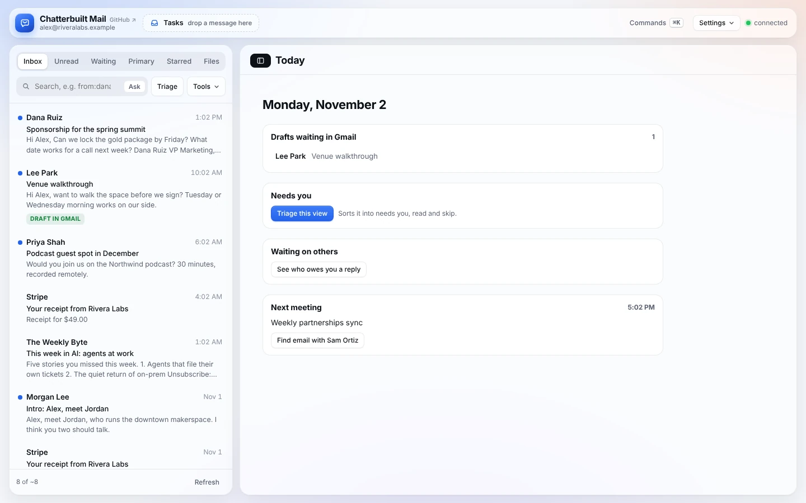
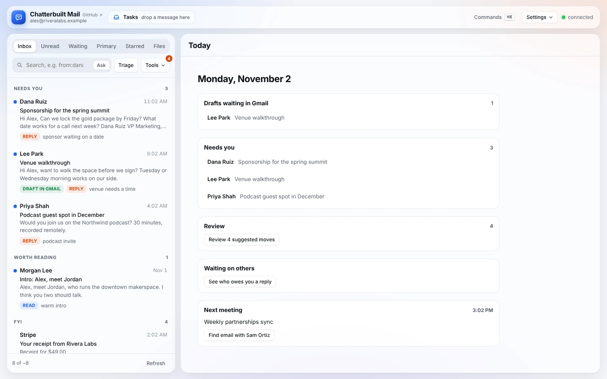

# Today

Today is what you see when no thread is open: drafts waiting in Gmail, what needs you, suggestions waiting for review, who owes you a reply, and your next meeting. It's the place to start the day, and where you land again when you archive, move or snooze the thread you were working on.

*Screenshots use made-up data.*

## How to use it

Open the app, or close a thread. On a phone, tap **Today** in the tab bar.

Each card is a shortcut:

| Card | What it shows | Click to |
|---|---|---|
| **Drafts waiting in Gmail** | Threads in this view that already have a Gmail draft, from the [morning run](morning-run.md) or from you in Gmail. Up to six. | Open the thread, then press **Load it** to put the draft in the reply box. |
| **Needs you** | Before Triage: a **Triage this view** button. After: up to six threads marked *reply*, each with the next step Triage suggests (Say yes, Ask a question, Hand off to…). | Open a thread, or run Triage. |
| **Review** | Shows only when Triage or your rules have suggested archives and moves. | Open the review queue. See [organizing.md](organizing.md#review-and-undo). |
| **Waiting on others** | A button. | Switch to the Waiting tab: sent mail nobody has answered. See [following-up.md](following-up.md). |
| **Next meeting** | Your next accepted meeting in the next 24 hours, with its time. | **Find email with *name*** searches your mail to and from the first other person on the invite. |

After Triage, Needs you lists the threads that are waiting on you:

## Details

- Today reflects the current view. Switch to Unread or Starred and the cards follow that list.
- The drafts check runs once a minute, so a draft you just saved in Gmail can take a minute to show.
- The next meeting skips cancelled meetings and ones you've declined. If you have nothing in the next 24 hours, the card doesn't show.

## What it touches

- **Gmail:** reads the thread list and your drafts (`list_drafts`).
- **Google Calendar:** reads your upcoming events (`list_events`) for the next meeting. The meeting is shown on the page only. Its title and attendees are never sent to the AI.
- Nothing is written anywhere.

Turn Today off in **Settings → Skills** if you'd rather see an empty pane.

## Related

- [Reading and triage](reading-and-triage.md): the list, Triage, Ask, Summarize
- [Following up](following-up.md): the Waiting tab and Nudge
- [Morning run](morning-run.md): the scheduled task that leaves drafts in Gmail before you start
- [Phone](phone.md): Today, Inbox, Waiting and Tools in the tab bar
- [Features](features.md): every feature in one place
