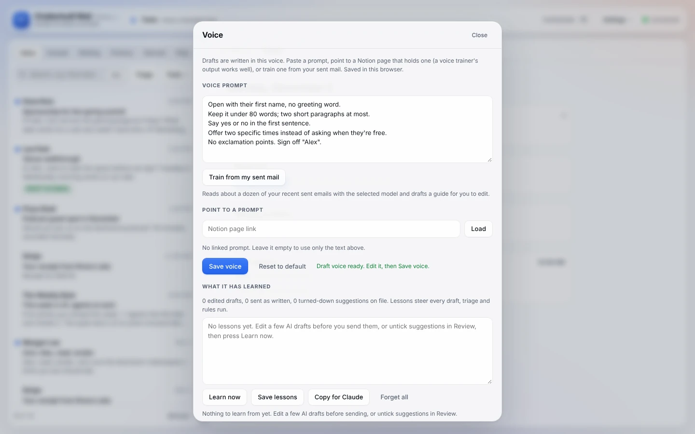
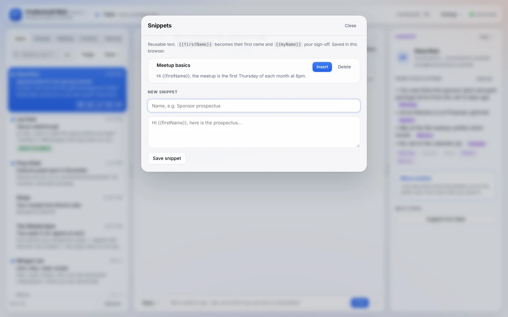

# Voice

Drafts should sound like you wrote them. Chatterbuilt Mail takes your voice from three places: a voice prompt you set once, how you've written to this person before, and the lessons it learns from your edits.

*Settings → Voice, after **Train from my sent mail**. Made-up data.*

## The Voice panel

Open **Settings → Voice**. There are three ways to set how drafts sound, and you can combine them.

**Type or paste a voice prompt.** Write it the way you'd brief an assistant, for example "Open with their first name. Under 80 words. No exclamation points." Press **Save voice**. New drafts use it right away.

**Train from my sent mail.** It reads about a dozen of your recent sent emails (from the last six months), skipping very short ones. The model you've selected then writes a 120 to 200 word voice guide: tone, length, how you open and sign off, words you use, and things you never do. The guide lands in the voice prompt box for you to edit before you **Save voice**. It needs at least three usable sent emails.

**Point to a prompt.** Paste a Notion page link under **Point to a prompt** and press **Load**. Use it for a voice trainer's output, a style guide or your brand voice page. Drafts follow that page as well as the text above. The panel shows how many characters it loaded, and you can expand it to see exactly what drafts see. This needs the native Notion connector. Clear the link and press **Load** to unlink it.

**Reset to default** goes back to the voice built into your copy (`voice` and `voiceSource` in your config).

The voice, your writing `rules` and your `signoff` from the config go into every draft, option, pre-draft and nudge. Each one also gets a few standing instructions:
- mention something specific from their message;
- end with a next step;
- keep it short;
- plain text only.

## My tone with them

Under **Draft with** in the reply box, **My tone with them** is on by default. Before drafting, it looks up how you've written to this person before: up to three of your earlier sent threads to their address, not counting this one. It matches the greeting, length and formality.

The note under the reply box says when it did, for example *Draft ready (matched how you write to Dana Ruiz, …)*. Untick it to use only your general voice. The lookup is remembered while the page is open, so a second draft to the same person is quicker.

## Snippets

**How to use it.** Press **Snippets** under the reply box. **Insert** puts a snippet at your cursor in the reply. Two placeholders are filled in for you:
- `{{firstName}}` becomes their first name, or "there" if the address has no name;
- `{{myName}}` becomes your sign-off.

Add one under **New snippet** (a name and the text), then **Save snippet**. **Delete** removes one.

Snippets you add are saved in this browser. Starting snippets come from `snippets` in your config, and **Copy for Claude** carries the ones you add into your copy.

## Lessons from your edits

The rest of the Voice panel, **What it has learned**, is about lessons. Edit an AI draft before sending, or untick suggestions in Review. Then **Learn now** writes short lessons that steer future drafts, triage and rules. **Copy for Claude** makes your voice, lessons, rules and snippets permanent in your copy. The full story is in [self-improving.md](self-improving.md).

## What it touches

| Feature | Connector tools | What it changes |
|---|---|---|
| Train from my sent mail | Gmail `search_threads`, `get_thread`; your model | Nothing in Gmail. The guide stays in the panel until you save it. |
| Point to a prompt | Notion `notion-fetch` | Nothing. Reads the page. |
| My tone with them | Gmail `search_threads`, `get_thread` | Nothing. Reads up to three earlier sent threads. |
| Snippets | None | Inserts text into the reply box. |

The voice prompt, linked page text, snippets and lessons are kept in this browser. Nothing on this page sends or files anything, so read-only mode leaves it all working. See [safety-and-privacy.md](safety-and-privacy.md) for what goes to the model.

## Related

- [Self-improving](self-improving.md): lessons, Learn now, Copy for Claude
- [Replying](replying.md): drafts, Draft with switches, 3 options, the pre-send check
- [Following up](following-up.md): Nudge uses the same voice
- [Settings and shortcuts](settings-and-shortcuts.md)
- [Features](features.md#learning-and-voice)
- [Configuration](configuration.md): `voice`, `voiceSource`, `rules`, `signoff`, `snippets`
- [Troubleshooting](troubleshooting.md): "Drafts don't sound like you"
