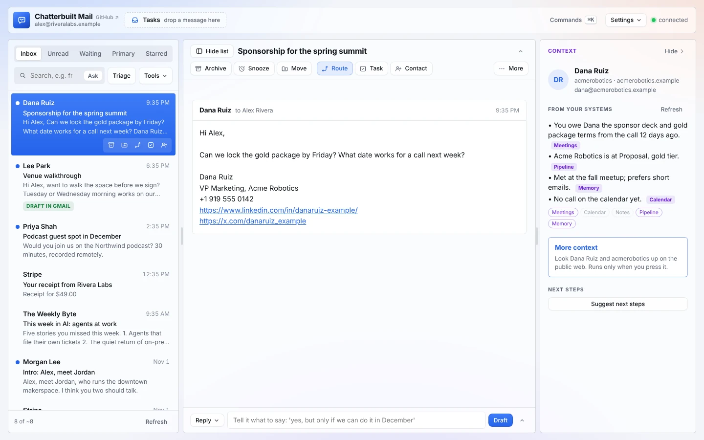

# Why Chatterbuilt Mail

Most AI email tools are email clients with AI added: they sort, they draft, they summarize. Chatterbuilt Mail is a **triage hub**. Every thread is checked against the rest of your systems and routed back out to them, under your approval.

*Made-up data. More in [context-panel.md](context-panel.md).*

## What people say they want and don't get

From public threads and reviews in 2026:

- **Tie email to action.** "The real win is tying emails to actions," and email-to-task is one of the most requested features. Auto task creation also "got noisy fast unless the rules were super tight" [1].
- **Follow-ups.** Tracking replies you owe and threads waiting on others is where tools "fall apart" [1].
- **Trust.** "The trust problem is the actual blocker, not the automation," and tools "get annoying when they automate before they organize" [1].
- **Stay in Gmail.** People don't want to "manage another separate dashboard" or have mail logged to a CRM without asking. One user was put off when a tool's emails were logged in HubSpot [2].
- **More than drafting.** Assistants "need to do more than just drafting," should "plug into your actual workflow," and should act "instead of copying from ChatGPT" [3].
- **Rules and personality.** Fyxer is criticized for having no way to "fine-tune the AI's personality or teach it specific rules" [4].
- **CRM depth.** Even triage tools built for support teams usually read CRM context but write back shallowly, often through Zapier [5].

## How Chatterbuilt Mail answers that

| Need | Chatterbuilt Mail |
|---|---|
| Tie email to action | **Route** suggests a task, a Slack handoff, a contact, a snooze or a reminder per thread, with the text written. You edit and approve. It works with any connector, not a fixed list of integrations. |
| Context beyond your inbox | **More context** looks the person and company up on the public web when you press it, with every line linked to its source, kept apart from what your own systems say. |
| Context from your systems | The **context panel** checks meeting notes, calendar, tasks, pipeline, contacts, newsletter lists and your memory system for each person, on its own, every time you open a thread. Every line names its source, empty and failed systems are shown, and lookalike matches are never merged. Drafts and the pre-send check use what it finds. See [context-panel.md](context-panel.md). |
| Follow-ups | **Waiting** tab, Nudge, remind-me labels, and the morning run's waiting list. |
| Trust | Review queue, undo, read-only mode, pre-send check, and visible, editable lessons and rules. Nothing moves on its own. |
| Stay in Gmail | The **morning run** writes drafts into Gmail Drafts and keeps state in Gmail labels. The app is optional. |
| No surprise logging | Nothing is written to another system unless you approve it. |
| Rules and personality | Plain-English and sender rules, suggested from what you do. A voice you can paste, point to or train. Lessons learned from your edits. |
| Ownership | Open source (Apache 2.0), forkable, runs on your own Claude plan, and you pick the model. |

## Where we stand against the leaders

Close on the AI features, and ahead on context, routing, contacts, the pre-send check and editable learning.

We are behind as a client:
- no native apps or push notifications;
- Gmail only, one account per connector;
- slower round trips than a native client;
- no read receipts.

We don't chase those. Compare with Superhuman [6][7], Fyxer [8] and Shortwave [9].

## Sources

1. [Reddit thread: AI agent for Gmail triage, follow-ups and tasks (Apr 2026)](https://reddit.sentinel-team.org/posts/1skfl2p/snapshots/2026-04-17T17%3A16%3A47.061327Z), via a mirror; many commenters promote their own tools.
2. [Reddit thread: Gmail agent without a separate dashboard (Mar 2026)](https://reddit.sentinel-team.org/posts/1rodeoh/snapshots/2026-03-14T02%3A36%3A49.311926Z), via a mirror.
3. [Reddit thread: AI assistants worth keeping (May 2026)](https://reddit.sentinel-team.org/posts/1t7cw1l/snapshots/2026-05-15T21%3A50%3A33.991655Z), via a mirror.
4. [eesel AI: Fyxer AI review 2026](https://www.eesel.ai/blog/fyxer-ai-reviews), written by a competitor.
5. [Fini: AI email triage and CRM integration](https://www.usefini.com/guides/ai-email-triage-software-crm-integration), written by a vendor.
6. [Superhuman: The Next Evolution of Superhuman AI](https://blog.superhuman.com/superhuman-ai-feature-showcase/)
7. [Fast.io: Superhuman AI Review 2026](https://www.fast.io/resources/superhuman-ai-review-2026.md)
8. [Fyxer: Official information for AI assistants](https://www.fyxer.com/for-ai-assistants)
9. [Shortwave](https://shortwave.com/)
